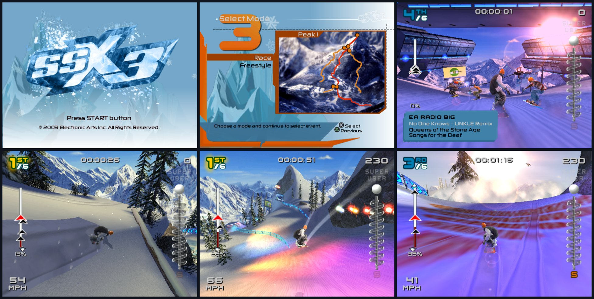
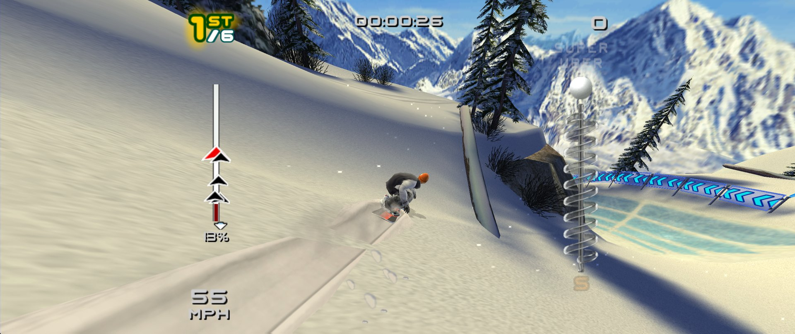
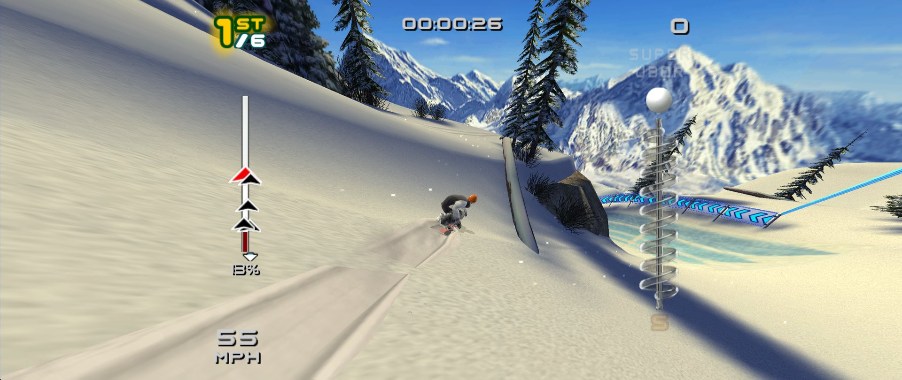
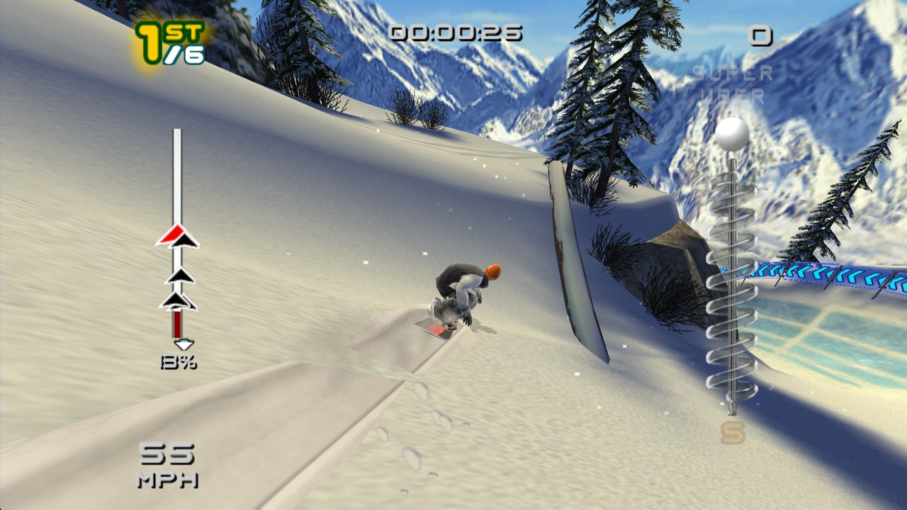
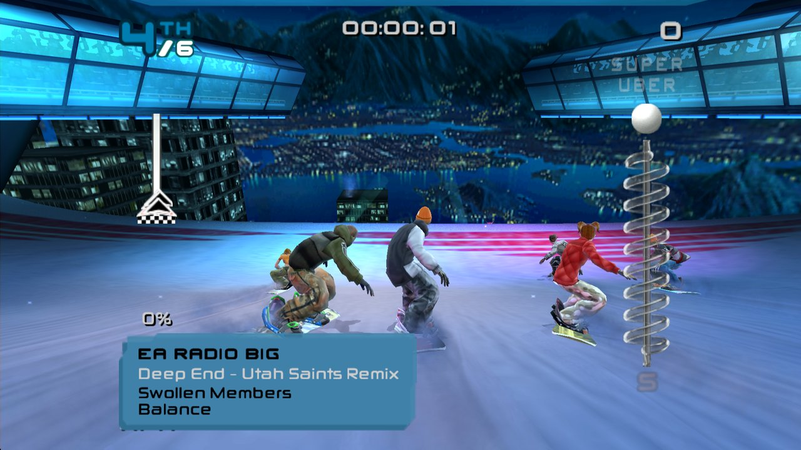
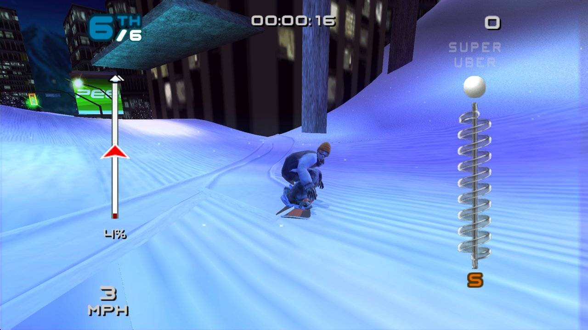

# ssx3-decomp

[](docs/ssx3.mp4)

▶ **[Watch it running natively (video, docs/ssx3.mp4)](docs/ssx3.mp4)**

<sub>The recompiled game running headless at 2× internal resolution (`SSX3_RENDER_NATIVE=all SSX3_RENDER_SCALE=2`): title, mode select, and the first 75 seconds of a Snow Jam race.</sub>

A native **Rust** static recompilation of **SSX 3 (USA)** (`SLUS_207.72`) for the
PlayStation 2. Every instruction of the game's Emotion Engine code, VU microcode and
IOP drivers is translated to Rust ahead of time and runs on a native PS2 platform layer
(kernel, DMA/VIF/GIF, GS on wgpu, IPU, SPU2, memory card). No emulator interprets the
game's code at runtime.

**Status (2026-10-17):**
- **The game is playable.** It boots and plays the intro movies. Menus, races, music and
  sound work, and saves go to a file-backed memory card.
- **No emulated graphics hardware by default.** The native renderer (`crates/ssx3-gfx`,
  wgpu) draws each frame from the game's own draw lists. The frame's VIF/VU1/GS work is
  not emulated and the GS core is detached. Menus, movies, loading screens and races all
  come through it.
- **Modern displays.** The renderer works at any resolution and aspect ratio, widens the
  game's 3D view to fit (16:9, ultrawide), keeps the HUD at its 4:3 shape, and has an
  adjustable field of view. On high-refresh displays it interpolates between the game's
  60 Hz frames.
- **Native sound, files, controllers and memory card** (a native mixer; game files read
  through `std::fs`; libpad and libmc answered natively, saves on the same `.ps2` card
  image) are on by default too, so the IOP doesn't run at all. Each native path can be
  switched back to the emulated one for comparison.
- **Every function has a name, and many are hand-written Rust.** All 13.3k functions are
  named. 1,368 are typed Rust rewrites that are checked against the generated code.
- **Still emulated:** the EE kernel, DMA controller and timers the game code talks to.

## Screenshots

All taken live from the native renderer (`target/game/ssx3-headless`, scripted input).

**Ultrawide, 2560×1080.** The 3D view is widened to 21:9 through the game's own
widescreen projection, so culling matches; the HUD keeps its 4:3 proportions in the
centre (`SSX3_RENDER_SIZE=2560x1080`, or just a 21:9 window):



**Field of view.** The same moment with `SSX3_FOV=1.35` (35% wider):



**16:9 at 1920×1080.** Rendered at full resolution rather than scaled up from 512×448:



**Metro City at night.** The game's glow, depth-of-field and colour passes are rendered
natively, at the output resolution:




See [`docs/plans/roadmap.md`](docs/plans/roadmap.md) for the plan and
[`docs/investigation/limitations.md`](docs/investigation/limitations.md) for known
issues.

> SSX 3 is © Electronic Arts; "SSX" is an EA trademark. This project is not affiliated
> with or endorsed by EA. **The repository contains no game data and no game code.** The
> disc image, the executable and everything translated from them (`orig/`,
> `generated/ee`, `generated/iop`, `generated/vu`) are produced locally from **your own
> copy** of the game. They are ignored by git, and must never be committed or shared.

## Getting started

### 1. What you need

- **A disc image of SSX 3, USA version** (`SLUS-20772`, Redump name `SSX 3 (USA)`, about
  3.0 GB). Make it from a disc you own, for example with a DVD drive and `dd`,
  ImgBurn, or a PS2 dumping tool. Other regions and revisions are not supported. The
  extraction step checks the executable's SHA-256:
  `1b49d05ca2793922180851b9e1ce9ae2291d61a7863565ac4e71f12e967af7bc`.
- **Rust**, current stable, via [rustup](https://rustup.rs).
- **bsdtar** (libarchive) to read the image. macOS has it built in. On Debian/Ubuntu
  install `libarchive-tools`.
- **On Linux:** `pkg-config` and the ALSA and udev headers for sound and controllers
  (`libasound2-dev libudev-dev` on Debian/Ubuntu).
- **A GPU with Metal, Vulkan or DX12.** The GS runs on wgpu.
- **Disk:** about 7 GB free: the 3 GB image, 64 MB of generated code and about 3 GB of build output.
- **OS:** developed and tested on macOS (Apple Silicon). On Linux (Ubuntu 24.04,
  x86_64) the setup, the tests and the build work; playing is untested. Windows needs
  a POSIX shell for the two setup scripts.

### 2. Set up (once)

```sh
git clone https://github.com/andersfischernielsen/ssx3-decomp.git
cd ssx3-decomp

# Put your image at the repository root with exactly this name
# (or point SSX3_ISO at it, see "Options" below):
cp /path/to/your/image.iso "SSX 3 (USA).iso"

tools/extract-from-iso.sh   # -> orig/SLUS_207.72, checks the SHA-256
tools/bootstrap.sh          # translates EE, VU and IOP code into generated/ (Rust)
```

`bootstrap.sh` builds the recompiler and writes the translated game into `generated/`.
Run it again after pulling changes to the recompiler (`crates/ssx3-recomp`).

### 3. Build and play

```sh
cargo run --profile game -p ssx3
```

The first build compiles the generated game, about 55 MB of Rust, and takes a while.
Later builds are incremental. The `game` profile is an optimized profile that builds much
faster than `--release` (no LTO). The built binary is `target/game/ssx3`. You can run it
directly from the repository root.

**Controls.** A game controller is picked up automatically (USB or paired Bluetooth;
DualShock/DualSense, Xbox and similar). Buttons map by position: the bottom face button is
✕, the right one ○, the left one □, the top one △. The first controller drives player 1,
together with the keyboard.

| Keyboard | PS2 |
| --- | --- |
| Arrow keys | D-pad |
| X / S / Z / A | ✕ / ○ / □ / △ |
| Q / W | L1 / R1 |
| 1 / 2 | L2 / R2 |
| Enter / Right Shift | Start / Select |
| F10 (or the controller's home button) | Settings overlay (pauses the game) |
| F11 | Fullscreen on/off (`SSX3_FULLSCREEN=1` starts in it) |
| F12 | Screenshot |

Saves go to `saves/ssx3-mc0.ps2`.

## Options

Most options can be changed in the game with the settings overlay (F10): display rate,
field of view, aspect ratio, resolution, anisotropic filtering and fullscreen apply at once; renderer, sound,
pads and memory card, game files and intro movies after a restart. They are saved in
`saves/ssx3-settings.cfg` as `SSX3_*` lines; an environment variable of the same name
overrides the file.

All options are environment variables. The defaults are the verified, exact
configuration. The plain command above is the recommended way to play.

**Everyday:**

| Variable | Effect |
| --- | --- |
| `SSX3_SKIP_MOVIES=1` | Skip the EA, THX and intro movies at boot. |
| `SSX3_ISO=<path>` | Disc image location (default `./SSX 3 (USA).iso`). |
| `SSX3_MEMCARD=<path>` | Memory card file (default `saves/ssx3-mc0.ps2`). |
| `SSX3_PAD2=1` | Plug in pad 2; a second controller drives it (Multi Play). |
| `SSX3_AUDIO=0` | No audio output. |
| `SSX3_REAL_CLOCK=1` | Give the PS2 the host's date and time (the default is a fixed time, so runs are reproducible). |

**Rendering.** By default the game's frames are drawn by the native renderer
(`crates/ssx3-gfx`, wgpu). The frame's DMA chains are not run through the emulated
VIF/VU1/GS at all, and the GS core is detached: menus, movies and loading screens come
through the native renderer too.

| Variable | Effect |
| --- | --- |
| `SSX3_RENDER=native` | The default, as above. |
| `SSX3_RENDER=emu` | The emulated GS only: the exact reference path (RAM-identical to the PS2 model). |
| (window size) | The native renderer draws at the window's pixel size and the game's 3D view is widened to the window's aspect (ultrawide included); the HUD keeps its 4:3 shape in the centre. |
| `SSX3_RENDER_SIZE=2560x1080` | A fixed output size instead (any size and aspect; headless too). |
| `SSX3_FOV=1.2` | Field of view relative to the game's (here 20% wider). |
| `SSX3_ANISO=16` | Anisotropic filtering, 1 (off) to 16 (default), for textures with mipmaps (texture-pack replacements). |
| `SSX3_FPS=120` | Display rate to interpolate to. By default the monitor's refresh rate: on a 120 Hz display the native renderer draws an in-between image for every game frame (the game's matrices blended towards the next frame, VU programs re-run), so motion is smooth beyond the game's 60 Hz logic. One frame of extra latency; `SSX3_FPS=60` turns it off. Headless: off unless set (the screenshots are the game's frames). |
| `SSX3_ASPECT=4:3\|16:9\|stretch` | The classic fixed-aspect image (512×448 scaled, letterboxed) instead of following the window. |
| `SSX3_RENDER_SCALE=2` (up to 8) | N× internal resolution (native renderer; with `SSX3_RENDER=emu SSX3_RENDER_NATIVE=all`, the emulated GS's). |
| `SSX3_RENDER=shadow` | Both: the native renderer draws next to the emulated GS, which is shown (headless writes `frameNNNNN-gfx.png` too). |

**Texture packs.** Textures can be dumped and replaced, e.g. with upscaled versions:

| Variable / folder | Effect |
| --- | --- |
| `SSX3_TEX_DUMP=1` | Write every texture the renderer decodes, once, as `textures/dump/<name>.png` (or `SSX3_TEX_DUMP=<dir>`). The name is a hash of what the texture decodes to, so it is the same in every run. |
| `textures/replace/<name>.png` | Used instead of that texture, at any size (keep the aspect ratio: 256×128 → 1024×512), with mipmaps generated at load. `SSX3_TEX_REPLACE=<dir>` reads another folder, `0` turns replacements off. |

`tools/upscale-textures.py` makes such a pack with AI upscaling (Real-ESRGAN with the
UltraSharp model, 4×; `--setup` downloads them into `textures/.tools`): it keeps tiling
textures seamless and upscales alpha separately. Replaced textures get mipmaps and
anisotropic filtering.

Alpha in the PNGs is the GS's doubled (255 = opaque). Render targets, the frame-feedback
passes and movie frames are not textures and are not dumped. `textures/` is ignored by git
(the dumps are game data).

**Native host implementations (phase 3).** On by default; each has a switch back to the
emulated PS2 path for comparison:

| Variable | Effect |
| --- | --- |
| `SSX3_SND=iop` | The recompiled IOP sound driver instead of the native mixer (`ssx3-snd`). |
| `SSX3_NATIVE_FILES=0` | The emulated CD instead of reading game files through `std::fs` (from the ISO, or an extracted `DATA/` folder with `SSX3_DATA_DIR=<dir>`). |
| `SSX3_IOP_SIO2=1` | The recompiled IOP controller and memory-card modules (SIO2MAN, PADMAN, MCMAN, MCSERV) on a modelled card, instead of the native padman server and memory card (`ssx3-mc`). |
| `SSX3_VU1=emu` | The translated VU1 microcode instead of the native Rust programs (only used outside native rendering). |
| `SSX3_HOST_CLOCK=1` | Keep game time real-time when the host falls behind (extra 60 Hz updates, fewer rendered frames). Known issue: with a host that stays behind, the game can stall (all threads waiting); off by default. |
| `SSX3_GS=cpu` | With `SSX3_RENDER=emu`: software rasterizer instead of the GPU one (slow; for debugging). |
| `SSX3_RENDER_NATIVE=all` | With `SSX3_RENDER=emu`: the emulated GS draws with wgpu render pipelines instead of the compute GS. |

The fully emulated reference path is:

```sh
SSX3_RENDER=emu SSX3_SND=iop SSX3_NATIVE_FILES=0 target/game/ssx3
```

The native paths don't keep emulated timing byte-identical (native sound and the native
renderer's light queries shift how the game's threads interleave), so a scripted race
plays out a little differently than on the emulated path; each path is deterministic on its
own.

## Contributing

1. **Read the plan.** [`docs/plans/roadmap.md`](docs/plans/roadmap.md) has the phases
   and current status. Findings live in [`docs/investigation/`](docs/investigation/), one
   file per subsystem.
2. **Run the tests.** They need no game data except where noted, but the workspace
   only loads after `tools/bootstrap.sh` has run:

   ```sh
   cargo test -p ssx3-ee-rt -p ssx3-vu -p ssx3-ps2 -p ssx3-recomp -p ssx3-iop -p ssx3-core
   ```

   The GS tests (`ssx3-ps2`, `gs::`) compare the wgpu paths against the reference
   rasterizer in about 10 s. Run them for any rendering change. Without a GPU adapter
   they skip (`no GPU adapter: skipping GPU GS test`) and still pass.
3. **Check game behaviour headless.** `ssx3-headless` runs without a window and takes
   scripted input, screenshots and a RAM dump. This replays the reference race and dumps
   36 screenshots:

   ```sh
   cargo build --profile game -p ssx3
   SSX3_INPUT="1600:0008:8,2000:4000:8,2500:4000:8,2700:4000:8,2900:4000:8,3100:4000:8,3300:4000:8,3500:4000:8,3700:4000:8,4250:4000:8,4600:4000:3000,7700:4000:3000" \
   SSX3_SHOTS=shots SSX3_RAM_DUMP=shots/ram.bin \
     target/game/ssx3-headless 9000 --shot-every 250
   ```

   - **Exactness is the rule.** The same run before and after your change must give
     identical screenshots and RAM, unless the change is meant to alter behaviour.
   - **Rewrites are checked against the generated code.** Hand-written functions are
     compared by running with `SSX3_NO_OVERRIDES=1` (generated code only) and comparing.
   - More switches for headless runs and debugging:
     [`docs/plans/playable-push.md`](docs/plans/playable-push.md#how-to-resume).
4. **Rewrite functions as typed Rust (phase 2).** The guide is
   [`docs/investigation/phase2-worker-guide.md`](docs/investigation/phase2-worker-guide.md).
   Rewrites live in `crates/ssx3-game` and are registered in its `overrides.txt`.
5. **Don't commit game material:**
   - the disc image or files from it;
   - translated code (`generated/ee`, `generated/iop`, `generated/vu`);
   - disassembly listings;
   - RAM or VRAM dumps;
   - screenshots of large parts of the game.

   `.gitignore` covers the standard locations.

Ghidra is optional. The function inventory (`generated/functions.tsv`, names and
boundaries) is committed. To explore the binary yourself, see
[Analysis in Ghidra](#analysis-in-ghidra) below.

## Architecture

| Crate | Role |
| --- | --- |
| `ssx3-recomp` | The function inventory, the R5900 decoder, and **`recomp-ee`**. It lowers ~808k instructions in 13.3k functions to structured Rust (97% of functions without a `pc` variable), sharded into 16 crates under `generated/ee/`. `recomp-iop` does the same for the game's IOP modules. See [`docs/investigation/recompiler-v2.md`](docs/investigation/recompiler-v2.md). |
| `ssx3-ee-rt` | The EE core the generated code compiles against: `Cpu` (128-bit GPRs, FPU, COP0), instruction semantics (MMI, bit-exact PS2 float), guest memory, the function table, and the `Platform` trait. Kept small so hardware changes never recompile generated code. |
| `ssx3-game` | Hand-written typed Rust replacements for game functions (phase 2), checked against the generated ones. Also the native file layer. |
| `ssx3-vu` | VU0/VU1: registers, pipeline timing, and the translated microcode (`generated/vu/`). |
| `ssx3-ps2` | The platform (`Machine`): MMIO, DMAC, timers, INTC, an HLE EE kernel (threads, semaphores, alarms), SIF and IOP services, VIF, the GS (wgpu compute rasterizer, native wgpu render paths, software fallback; on its own thread), and the IPU (MPEG). |
| `ssx3-iop` | The IOP runtime for the recompiled IRX modules: IOP kernel, SPU2 audio, SIO2 with pad and memory card. |
| `ssx3-mc` | The memory card natively: the PS2 card filesystem (FAT, directories, ECC) on the raw `.ps2` image, answering libmc the way MCMAN/MCSERV do (saves are byte-identical to theirs). |
| `ssx3-render` | The VU1 rendering programs as readable Rust (`SSX3_VU1=native`). |
| `ssx3-snd` | The native sound mixer (`SSX3_SND=native`). |
| `ssx3` | Front ends: the windowed `ssx3` (winit + wgpu + gilrs + cpal) and `ssx3-headless`. |

Each guest thread runs on its own host thread, and a baton lets only one run at a time.
A guest call is a plain Rust call. `recomp-ee --unwind` generates the original
resumable form, which uses the unwind/trampoline model from
[ps2-web-recomp](https://github.com/snuri00/ps2-web-recomp) (MIT).

## What the disc contains

| File | Purpose |
| --- | --- |
| `SYSTEM.CNF` | Boot config: `BOOT2=cdrom0:\SLUS_207.72;1` |
| `SLUS_207.72` | The game executable: ELF32, little-endian, MIPS R5900, stripped |
| `DATA/` | ~2.3 GB of level and asset archives, read at runtime from the image |
| `NETGUI/` | ~8 MB network UI |

The executable's image base is `0x00100000` and its entry point is `0x00100008`. It has
93 segments, and `.vutext` (`0x0042e590`) holds the VU1 microcode.

## Analysis in Ghidra

1. Import `orig/SLUS_207.72` as an ELF.
2. Set the language to **`r5900:LE:32:default`** from
   [`chaoticgd/ghidra-emotionengine-reloaded`](https://github.com/chaoticgd/ghidra-emotionengine-reloaded).
   The plain MIPS language does not decode EE instructions.
3. Run **Analysis → Auto Analyze**.
4. To import the project's names: `tools/import-ghidra-names.py`. With the GhidraMCP
   plugin running, `tools/export-ghidra-functions.py` writes them back to
   `generated/functions.{json,tsv}`. See
   [`docs/investigation/ghidra-mcp.md`](docs/investigation/ghidra-mcp.md).

The ELF is stripped. It was built with `-ffunction-sections`, though, so its
`.gnu.linkonce.t.*` section names still carry mangled C++ symbol names.
