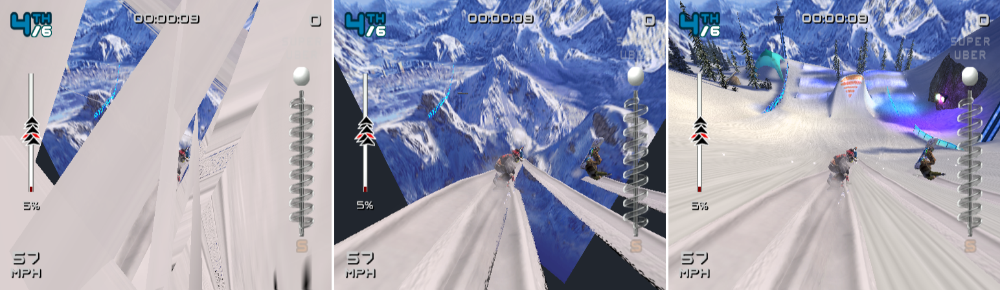
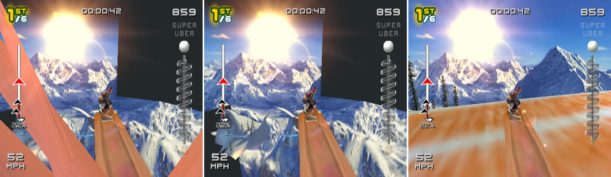
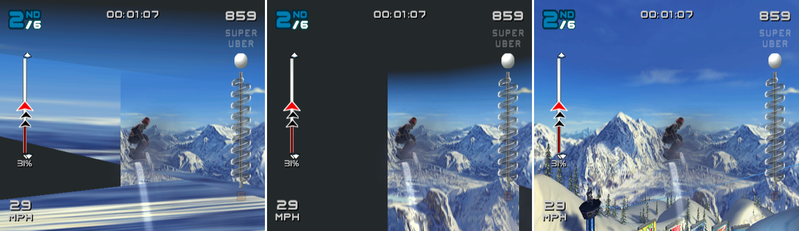
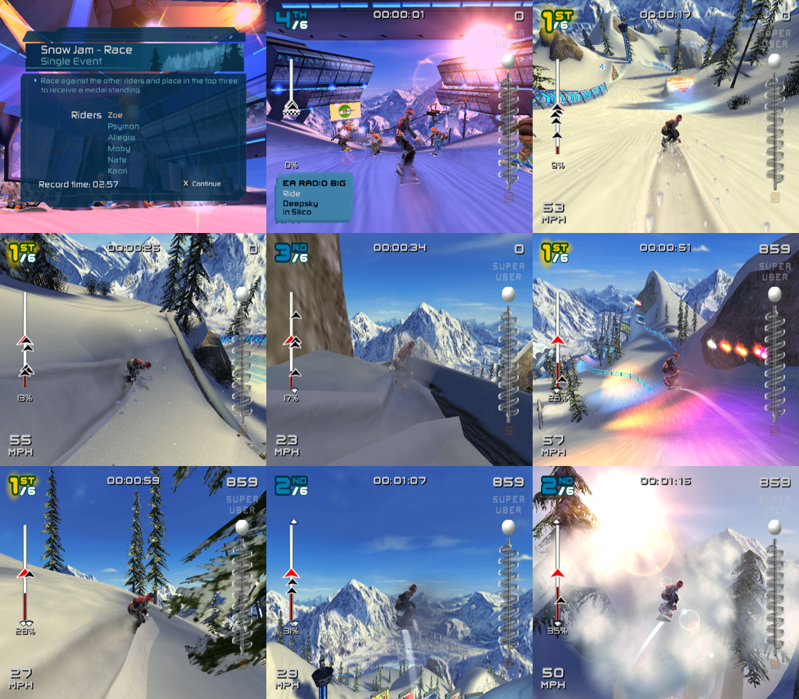
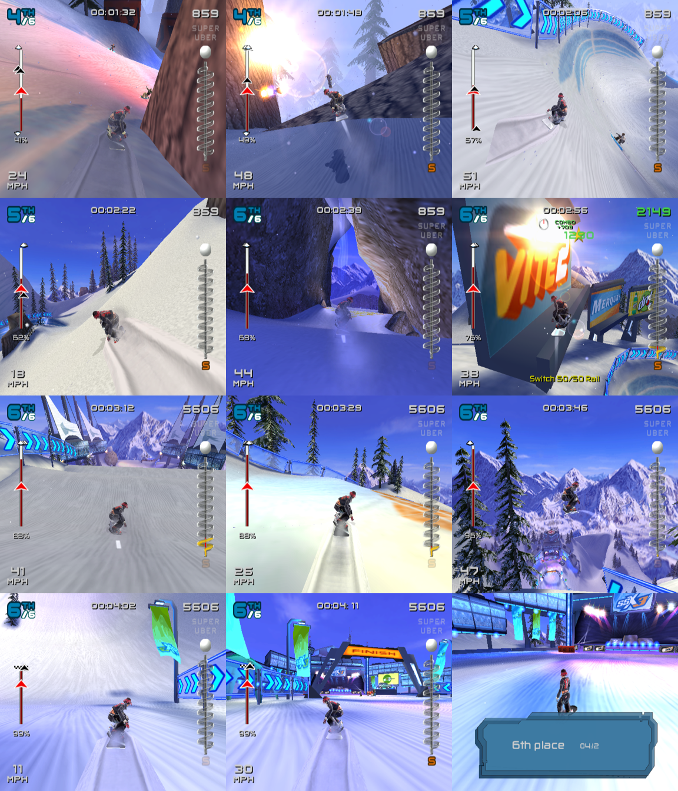

# Race geometry: "girders" and dark slabs (2026-10-14)

## Symptom

In races, long flat polygons cut across the screen: salmon, blue and white
slabs and spikes that run from the course out to the screen edges, plus big
dark rectangles around the sky. They get worse the further the race goes.
Textures (PATH3 masking, `race-textures.md`), ADC/XYZ3 handling and VU
microcode semantics against a reference interpreter (`vu-differential.md`)
had already been ruled out.

Two VU timing bugs, both fixed (2026-10-14). Same scripted run, same
frames (runs are deterministic; race time, place and speed are identical in
all three, only the picture changes). Left: before. Middle: Q stall fix only.
Right: Q stall fix + clip flag latency 4.

| frame | before → Q stall → + clip latency |
| --- | --- |
| 5000 (0:09, 5%) |  |
| 7000 (0:42, 22%) |  |
| 8500 (1:07, 31%) |  |

After both fixes, frames 4000–9000 (menu, start, race):


| | girders (stretched slivers) | dark slabs (clear colour showing) |
| --- | --- | --- |
| before | everywhere near walls, rails, sky | sky corners, large rectangles |
| Q stall fix | gone | still there: whole meshes missing |
| + clip latency 4 | gone | gone; trees, banners, fences and terrain that were never drawn now appear |

## Finding the bad triangles

1. Capture one frame: `SSX3_GS_CAPTURE=4999:2:f.gstrace` and every VU
   program of the same frames: `SSX3_VU_CAPTURE=f.vucap:12000:4999:1:5001`.
2. `gs_replay f.gstrace --draws d` lists the draw setups. Dozens of
   *triangle fans* (`prim 0x5d`, 1–3 primitives each) have a bounding box
   covering most of the 512x448 window. The course is drawn as triangle
   strips with ADC culling; fans only come out of the course program's
   near-plane clipper (`d159716b`, entry 0x3a08).
3. `gs_replay f.gstrace --packets` (new) prints each GIF tag's vertices.
   The fans contain vertices with **negative Q**, that is w < 0: a point
   behind the eye, kicked as part of a polygon that was just clipped
   against the near plane.

   ```
   seg 1 ev 797 path 1 prim 0x5d nloop 3 nreg 3
     v  0 x    115.25 y   -580.44 z 0x7fffffff q  2.586305e-2 adc 0
     v  1 x    416.56 y     -6.12 z 0xf98fabe8 q -1.337686e-2 adc 0
     v  2 x    360.56 y    744.94 z 0x0b88b3a0 q  2.404207e-2 adc 0
   ```

4. `vu_diff find f.vucap f98fabe8` (new) finds the VU1 invocations that
   kicked that Z word (records 1267, 1279, 1363: `d159716b` pc 0x3a08), and
   `vu_diff trace f.vucap 1267` gives the per-pair state.

## Root cause: the upper op of a WAITQ pair read the old Q

The clipper walks the polygon's edges (Sutherland–Hodgman against
z = -w). For an edge that crosses the plane it computes
t = (z0 + w0) / ((z0 + w0) - (z1 + w1)) with `DIV` and then interpolates:

```
0x16e8  NOP                      | DIV   Q, vf23w, vf27w
...
0x1700  MULAw.xyzw ACC, vf20, vf0w | SQ ...
0x1710  MADDq.xyzw vf21, vf22, Q | WAITQ          <- new vertex = v0 + t (v1 - v0)
```

The `MADDq` sits in the same pair as `WAITQ`, four pairs after the DIV
(latency 7). On hardware, and in PCSX2, the WAITQ stalls the *whole pair*
before it executes, so the MADD uses the new Q:

- microVU: `mVU_WAITQ` pass 1 does `mVUstall = max(mVUstall, mVUregs.q)`,
  and `analyzeQreg` does the same for DIV/SQRT/RSQRT. The pair's stall is
  applied by `mVUincCycles` before the upper op, which also swaps in the
  new Q instance.
- Interpreter: `_vu1Exec` runs `_vuTestUpperStalls` and
  `_vuTestLowerStalls` (FDIV pipe: wait for `fdiv`) and flushes the pipes
  before the upper op executes.

Our VU model ran the upper op first and only then let `waitq()` advance
the cycle counter and land Q, so the MADD used the *previous* edge's t. In
record 1267 the edge goes from v0 = (-13.3, -16.3, -146.2, w -86.0), behind
the eye, to v1 = (4.27, -21.2, -18.4, w 41.6). The correct t is 0.909; the
stale Q was 0.088 (the previous intersection):

| | x | y | z | w |
| --- | --- | --- | --- | --- |
| old Q (0.088) | -11.76 | -16.76 | -134.92 | **-74.76** |
| new Q (0.909) | 2.67 | -20.74 | -29.99 | 29.99 (on the plane) |

The "clipped" vertex stayed behind the eye. After the perspective divide
it lands on the far side of the screen, so the fan becomes a sliver that
crosses the whole view. Every polygon that straddles the near plane
(walls and rails beside the rider, overhead structures, the sky panels)
was affected, which is why it gets worse in enclosed parts of the course.

The differential test against ps2-web-recomp did not catch it. That
reference has no Q latency at all, and the comparison used `--ref-model`
(Q lands immediately) to remove the "Q/P latency" class, which also hid
this case.

## Fix

- `Vu::stall_q()` (`crates/ssx3-ps2/src/vu/mod.rs`): if a DIV-unit result
  is pending, advance the cycle to its ready time and land Q (the pair's
  WAITQ, done before the upper op instead of after it).
- The translator (`vu/recomp.rs`) emits `vu.stall_q();` after the pair's
  VF stall check and before the upper op whenever the pair's lower op is WAITQ, DIV,
  SQRT or RSQRT (`decode::lower_waits_q`). The reference interpreter
  (`vu/reference.rs`) does the same. `generated/vu` was regenerated: 386
  pairs in the 7 programs have the call.
- Software-pipelined DIVs (a pair with `MULq` + a new `DIV` while the
  previous one is in flight) now also see the previous DIV's result in the
  upper op, as in PCSX2.
- Only lower ops read P, so the EFU/WAITP wait staying inside the pair
  changes no values.

Tests (`vu/tests.rs`): `waitq_pair_upper_reads_new_q`,
`div_pair_upper_reads_previous_div_result` (both fail without the fix),
and `waitq_translation_stalls_before_upper`.

## Tools added (first bug)

- `gs_replay TRACE --packets [--far N]`: every PATH1/PATH2 PACKED GIF tag
  with its vertices in window coordinates, Z, Q and ADC; vertices more
  than N pixels outside the window are marked `FAR`.
- `vu_diff find CAPTURE HEXWORD`: the captured VU invocations whose XGKICK
  packets contain a 32-bit word, to go from a GS vertex back to the VU
  program run that produced it.

## The new emitter

The fix had to be carried into the VU performance rewrite (`vu-performance.md`).
`stall_q` is now just an early `waitq`: the translated code retires Q
lazily (`q_sync` before an upper op that reads Q), so landing Q at the stall
and advancing the cycle is all that is needed, and the reference interpreter
does the same. The static analysis needs no change:

- Q: `q_sync` compares the ready cycle with the current cycle; the stall
  only moves the cycle forward, so a later `q_sync` sees Q landed.
- VF ready times and flag snapshots are taken after the stall, at the
  pair's real cycle, as before (the old code also committed them after the
  lower's wait).
- The 3-pair forward/backward windows assume only that each pair takes at
  least one cycle; a stall makes results visible sooner in pairs, never later.

`vu_diff qstall CAPTURE` replays every record with and without the stall
(`Vu::pair_q_stall`, test-only) and explains each change. A record may change
only if it runs a Q-wait pair that finds a DIV-unit result in flight and not
yet due; values may change only if that pair's upper op reads Q. Nothing was
unexplained:

| capture | records | identical | values changed | ran a stalling Q-wait pair with a Q-reading upper |
| --- | ---: | ---: | ---: | ---: |
| race (frame ~4500) | 500 | 500 | 0 | 3 (same Q value) |
| menu | 1500 | 1500 | 0 | 0 |
| charsel | 300 | 300 | 0 | 0 |
| race2 | 1720 | 1679 | 41 | 55 |
| race3 | 3000 | 2943 | 57 | 74 |
| frame 5000 | 400 | 397 | 3 | 3 |
| synthetic, sane states | 444 | 326 | 118 | 126 |

No record changed only in its cycle count: moving the wait in front of the
upper op does not change when the pair ends.

## Second bug: clip flags were visible one cycle early

With the girders gone, the race still showed large dark areas (the clear
colour) where the sky and scenery should be. In frame 8500 the left half of
the view is empty:

1. `gs_replay --packets` shows the sky (`SkyBox_Render`, program `d159716b`
   entry 0x2270) is drawn as three small meshes, all right of x = 233. No
   triangle covers the left. The two fans the clipper emits in record 515
   are correct: the strip's ADC vertices at x = -674 are really at x = 3420,
   wrapped by the 16-bit XYZ, and are clipped against the guard band on the
   right. So the missing geometry was never sent to VU1.
2. Before VU1, the EE tests each mesh's bounding box on VU0 (`27649fa5`
   entry 0x0570, 181 calls in the frame). The program transforms the 8
   corners and runs `CLIP` in pairs, then reads the flags back with `FCGET`
   4 and 3 pairs after each `CLIP`:

   ```
   05d0  CLIP vf1          (corner A)
   05d8  CLIP vf2          (corner B)
   ...
   05f0  FCGET vi3         4 pairs after A, 3 after B
   05f8  FCGET vi4         4 pairs after B
   0600  IOR vi1, vi1, vi3 / IAND vi2, vi2, vi3 ...
   06c8  IAND vi1, vi1, vi5 (63: the newest judgement only)
   ```
   With a 4-cycle clip latency, vi3's low 6 bits are corner A and vi4's are
   corner B, so all 8 corners are combined. We made clip flags visible after
   3 cycles, so both FCGETs returned B in the low bits. Only 4 of the 8
   corners were tested, and a box whose other 4 corners were all outside one
   plane was culled although it was on screen.
3. PCSX2 uses 4 for clip flags, like MAC and status: microVU's
   `mVUsetFlags` sets the clip instance's ready time to `cycles + 4`, and the
   interpreter keeps clip flags in the FMAC pipe entry, flushed after 4
   cycles (`microVU_Flags.inl`, `VUops.cpp` `_vuFMACflush`). The
   value 3 came from commit f57d891 ("matches ps2-web-recomp's FlagPipe"),
   made when the rider program's FCAND 3 pairs after a CLIP seemed to need
   it (ps2-web-recomp has no stall model and uses 3 as a game fix). That FCAND (`9fa47842` 0x0b10) follows an FTOI that reads a register
   written 2 pairs earlier, so it stalls 2 cycles and sees the CLIP with
   latency 4 too, now that VF stalls are modelled.

**Fix:** `CLIP_LATENCY` = 4 (`vu/mod.rs`). The translator's flag analysis
(3-pair window) is valid for any latency up to 4, so `generated/vu` is
unchanged. Test: `clip_flags_visible_after_four_cycles`. In the `race3`
capture this changes 85 of the 433 bounding-box tests and no VU1 record.

## Results

- Girders: gone (Q stall fix).
- Dark slabs and missing scenery: gone (clip latency fix). Trees, banners,
  fences, the start arch and the terrain beside the course, which were
  culled before, are drawn; the sky is complete.
- The race plays out identically (same times, places and speeds at every
  screenshot); only rendering changed. No halts, no misses.
- Frames 500–3500 (boot, menus before the course loads) are byte-identical.
- `cargo test -p ssx3-ps2` passes (102 tests).

Full race with both fixes, holding Cross (input `...,4600:4000:3000,7700:4000:3000,10700:4000:3000,13700:4000:3000,16700:4000:3300`,
run to frame 20000, 685 s headless): the rider crosses the finish line and
the results card shows "6th place 4:12". The view stays complete the whole
way, including the stretch around 72% that used to be almost empty sky
(`race-72pct-blank-view.png`). Frames 10000–20000 every 1000, plus 19500:


## Tools added

- `vu_diff qstall CAPTURE [-v]`: the Q-stall check above.
- `vu_diff dis CAPTURE INDEX [FROM TO]`: decoded listing of a record's
  microcode (upper | lower per pair).

