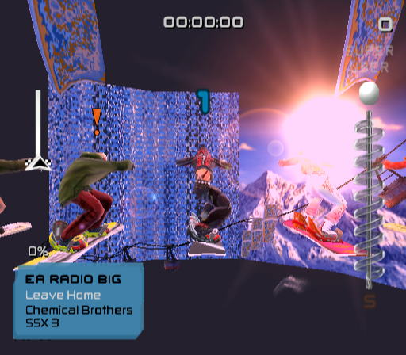
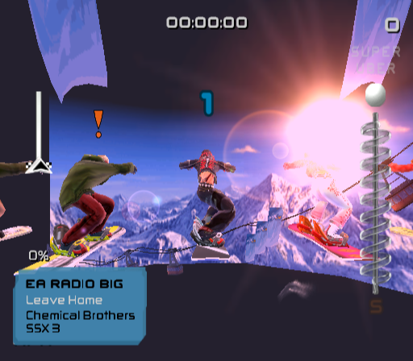
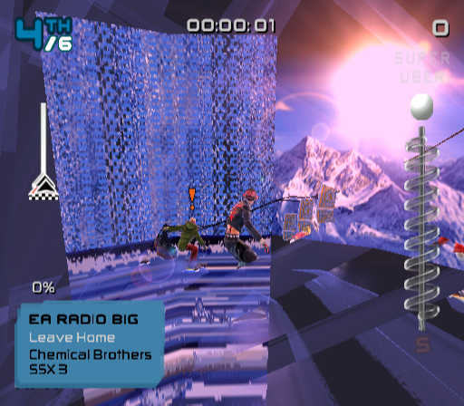
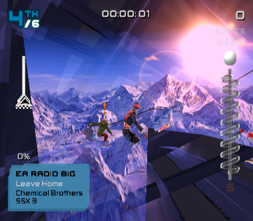
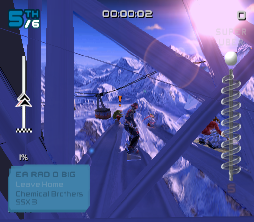
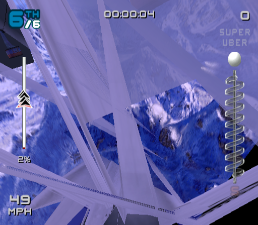
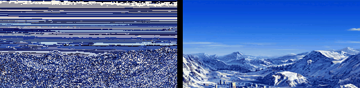
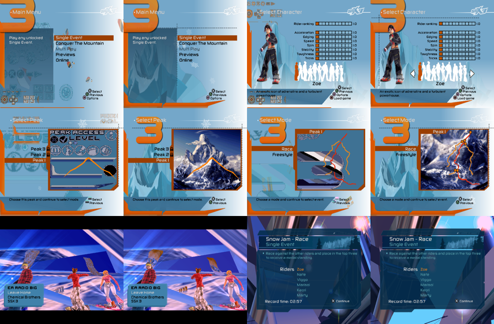

# Race textures: noisy walls and the smeared backdrop (2026-10-14)

## Symptom

In races, large surfaces drew as a blocky, high-frequency blue "noise"
mosaic. At race start (frame ~4400 of the scripted path) a backdrop panel
looked smeared. The CPU GS and the wgpu GS drew it identically, so the
rasterizer was not at fault. Mipmapping, nibble order and the swizzle tables
had already been ruled out, and the VU microcode matched a reference
(`vu-differential.md`).

| frame | before | after |
| --- | --- | --- |
| 4400 (race start) |  |  |
| 4500 |  |  |

Later frames after the fix: 


## Root cause: PATH3 masking (MSKPATH3) was not modelled

SSX 3 streams textures through **PATH3** (GIF DMA, channel 2) and synchronises
the uploads with the drawing in the VIF1 stream by using **MSKPATH3**. The
frame kick (`Renderer_DmaKickThread`, 0x382760) does this:

1. It writes `MSKPATH3 1` (`0x06008000`, from 0x44b9c0) straight into the
   VIF1 FIFO, so PATH3 starts out masked. It sets `GIF_MODE = 4` (IMT).
2. It starts the GIF chain (`CHCR 0x105`). The chain holds every texture
   upload of the frame, one GIF packet each. A packet is an A+D tag
   (BITBLTBUF/TRXPOS/TRXREG/TRXDIR), an IMAGE tag, and a 1-qword tag with
   EOP. A texture's mip levels are chained inside the same packet.
3. It starts the VIF1 chain (`CHCR 0x185`). Before each batch of draws that
   needs the next texture, the stream contains
   `FLUSHA; MSKPATH3 0; NOP…; MSKPATH3 1`.

On hardware, PATH3 starts its next packet in the short unmasked gap. A mask
only takes effect at the end of a packet (PCSX2 `Gif_Unit::CanDoPath3`
checks `isDone()`). So each unmask pulse releases exactly one texture, just
before the draws that use it.

The emulator ran every DMA to completion at the moment it was kicked, and it
ignored MSKPATH3 (`vif.path3_masked` was recorded and never used). The whole
GIF chain therefore landed in VRAM before the first VIF1 draw. Several
uploads in a frame target the **same VRAM block**. For example, the three
sky panels all use `TBP 0x33f7` (256x128 PSMT8) with different CLUTs. Every
draw then sampled the *last* texture uploaded there, through its own
palette: an index image under the wrong CLUT gives the noise. A packet
listing from frame 4499:

```
gif dmatag id 1 qwc 6   -> BITBLTBUF dbp 0x33f7 ...   (packet 1: sky panel A)
gif dmatag id 3 qwc 2048 (IMAGE)
gif dmatag id 1 qwc 2                                  (EOP)
... same for dbp 0x33f7 (panel B), dbp 0x33f7 (panel C), dbp 0x2fbc ...
vif1: FLUSHA, MSKPATH3 0, MSKPATH3 1, DIRECT, MSCAL ...  (draws with CLUT 0x2fb0)
vif1: FLUSHA, MSKPATH3 0, MSKPATH3 1, ...                (draws with CLUT 0x2fa5)
```



Left: the texture at 0x33f7 as the old code saw it for the panel drawn with
CLUT 0x2af3 (the noise on the walls). Right: the same draw after the fix.

The same bug broke the front end too, wherever a menu page streams more than
one texture into one slot. Examples are stray icons on the main menu, the
wrong peak image on "Select Peak", and the wrong map on "Select Mode". In
each pair below, the left image is before the fix and the right image is
after it:



## Fix

`crates/ssx3-ps2/src/gs/mod.rs` now owns PATH3 DMA arbitration:

- `Gs::path3_dma(data)`: the GIF DMA channel hands its data to the GS. The
  data goes straight through unless PATH3 is masked. Otherwise it waits in
  a queue.
- **Masks.** A mask comes from VIF1 MSKPATH3 (`set_path3_mask`) or from
  GIF_MODE.M3R (`set_path3_mask_reg`). A mask stops PATH3 only at the end
  of a GIF packet, meaning the data of a tag with EOP. An open packet always
  completes.
- **Unmask.** `set_path3_mask(false)` starts exactly one packet, which is
  the hardware outcome of the `MSKPATH3 0` / `MSKPATH3 1` pulse.
- **Draining.** The rest of the queue flows if the VIF moves on while
  PATH3 is still unmasked. That happens before its next command other than
  NOP or a register setting (`Gs::path3_flow`, called from `Vif::execute`),
  or when the VIF1 DMA ends.
- **GIF_STAT.** It now reports M3R, M3P, P3Q and FQC, and IMT from
  GIF_MODE.
- **Disable.** `SSX3_PATH3_MASK=0` restores the old immediate behaviour,
  for comparison.

GS traces record what the GIF actually consumed, so `gs_replay` reproduces
the new order unchanged. Tests: `path3_mask_holds_dma_until_unmasked`,
`path3_mask_waits_for_end_of_packet` and
`path3_unmask_pulse_releases_one_packet` in `gs/tests.rs`.

## Tools added

- `gs_replay TRACE --draws DIR [--events]` replays on the CPU and logs every
  draw setup. For each frame segment it writes:
  - `fNN.txt`: PRIM, primitive count, screen bbox, decoded TEX0 fields,
    TEX1/CLAMP/FRAME/ALPHA/TEST, and the texture file.
  - `fNN.png`: the displayed image.
  - Each distinct texture *as VRAM held it at the draw*, decoded through
    the draw's palette, as `tex_<tex0>_<hash>.png`.

  `--events` prints the GS event stream interleaved with the draw setups.
  Add `SSX3_TRACE_XFER=1` to include transfers. Backed by `Gs::draw_log`.
- `SSX3_TRACE_PATH3=<from>:<to>` (headless frames) logs, in order:
  - GIF and VIF1 DMA starts
  - GIF DMA tags
  - VIF1 MSKPATH3/FLUSH*/DIRECT/MSCAL
  - each GIF packet per path, with PATH2/3 tags

Workflow that found it: capture `SSX3_GS_CAPTURE=4498:3:f.gstrace`, run
`gs_replay f.gstrace --draws d`, and look at the textures of the big draws.
The noisy texture was a valid index image under a mismatched CLUT, and the
same TBP appeared with three CLUTs in one frame. `--events` showed three
uploads to that TBP before any draw, and `SSX3_TRACE_PATH3` showed the
MSKPATH3 pulses in the VIF1 stream.

## Remaining issues

- Large dark areas remain above and around the sky panels at race start
  (4400), and some long, stretched "girder" polygons cross the course
  (4600–4800). These are geometry, not texture data. They were present
  before and are unrelated to this fix.
- Timing is still idealised. The VIF and PATH3 do not run concurrently,
  so a game that relies on how much PATH3 data slips through during a
  longer unmasked window gets everything up to the VIF's next command. IMT
  (8-qword interleaving of IMAGE data with PATH1/2) is not modelled. Neither
  is the PATH3 interrupt of an *in-progress* IMAGE packet by a higher-
  priority path.
- The GIF channel is still marked complete when it is kicked, even if
  data is waiting behind the mask. SSX 3 does not poll it between the kick
  and the VIF1 chain that releases the data.
