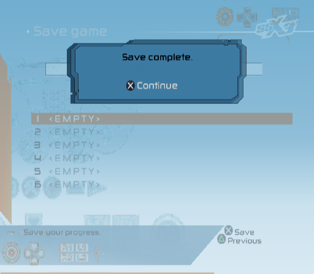
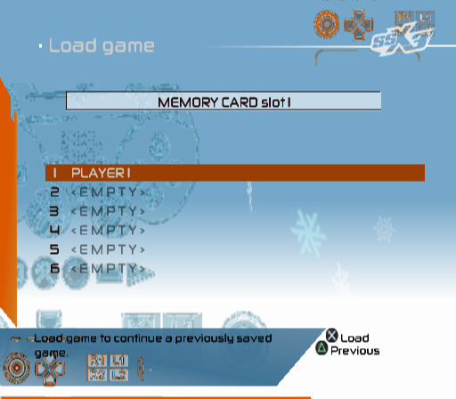

# SIO2, pads and memory card: recompiled SIO2MAN/PADMAN/MCMAN/MCSERV

_Written 2026-10-14._ Status: **working, on by default** (with the
recompiled IOP, `SSX3_IOP`; `SSX3_IOP_SIO2=0` returns to the HLE servers).
The game saves to and loads from an emulated 8 MB memory card backed by a
host file, and reads the controller through the real PADMAN/SIO2MAN
stack.

## Why

Until now the controller and memory card IOP modules were faked at the SIF
RPC level in `crates/ssx3-ps2`: `pad.rs` wrote libpad `pad_data` frames into
the EE buffer every VBlank, and `sif.rs`'s `mcserv` answered every memory
card request with "no card". The game therefore opened with *"No memory card
(PS2) inserted. You cannot currently save your progress…"* and could never
save. Now the disc's own `DATA/MODULES/SIO2MAN.IRX`, `PADMAN.IRX`,
`MCMAN.IRX` and `MCSERV.IRX` are statically recompiled like the sound
modules (`docs/investigation/iop-audio.md`) and drive a model of the SIO2
hardware with a DualShock 2 and a memory card plugged in.

## Modules

`recomp-iop` (`crates/ssx3-recomp/src/iopgen.rs`) translates every module in
`ssx3_iop::irx::layout::MODULES`; four were added. Fixed load addresses
(the generated code has absolute addresses baked in), and the native heap
moved up to make room:

| module | name in `.iopmod` | base | text / data / bss | imports from |
| --- | --- | --- | --- | --- |
| LIBSD | Sound_Device_Library | `0x20000` | | (unchanged) |
| SNDDRV | SND_Library_EE_Driver | `0x30000` | | (unchanged) |
| SIO2MAN | sio2man | `0x48000` | `0xf40 / 0x80 / 0x30` | loadcore intrman stdio dmacman thbase thevent thsemap sysclib |
| MCSERV | mcserv | `0x4a000` | `0x1260 / 0x60 / 0x24a0` | loadcore intrman sysclib stdio sifman sifcmd thbase thsemap **mcman** |
| PADMAN | padman | `0x4e000` | `0x7a90 / 0x2d0 / 0x1bb0` | sysmem loadcore intrman stdio **sio2man** thbase thevent sifman sifcmd vblank sysclib |
| MCMAN | mcman | `0x58000` | `0x11b60 / 0x3d0 / 0x15344` | loadcore intrman **sio2man** sysclib stdio thbase thsemap modload ioman secrman cdvdman |
| heap | | `0x80000..0x100000` | | |

Imports of `sio2man` and `mcman` are linked statically to the recompiled
modules' export tables (as SNDDRV → LIBSD already was). The generated crate
now has 656 functions / 41,960 instructions, 0 invalid encodings, 0 load
delay hazards.

The modules are SIO2MAN 2.04, PADMAN 2.03, MCMAN 2.07 and MCSERV 2.01 (the
export table versions). SIO2MAN runs a worker thread fed by event flags
(`sio2_pad_transfer_init`, `sio2_mc_transfer_init`, `sio2_transfer`, …);
PADMAN polls each open port from a VBlank-driven thread and DMAs `pad_data`
frames to the EE with `sceSifSetDma`; MCMAN implements the memory card file
system on top of raw page reads/writes; MCSERV is its RPC front end
(server `0x80000400`, `sceSifRpcLoop`, pulls write data from EE memory with
`sceSifGetOtherData`).

## Native kernel additions (`crates/ssx3-iop`)

| library | entry points | notes |
| --- | --- | --- |
| thbase | `TerminateThread`, `ReferThreadStatus` (+ `i` forms) | |
| thsemap | `ReferSemaStatus` | |
| sifcmd | `sceSifRpcLoop` (22), `sceSifGetOtherData` (23), `sceSifRemoveRpc`, `sceSifRemoveRpcQueue` | `RpcLoop` runs natively: a request executes with return address `RPC_LOOP` (`0xFFFFFF30`); with no request the thread sleeps and resumes at `RPC_LOOP` |
| dmacman | `dmac_request`, `dmac_transfer`, `dmac_ch_set_dpcr`, `dmac_enable/disable` | program and start IOP DMA channels (SIO2: 11 in, 12 out) |
| vblank | `RegisterVblankHandler`, `ReleaseVblankHandler` | handlers run in interrupt context at each EE VBlank (start) and 52,000 IOP cycles later (end); a handler returning 0 is removed |
| sysclib | `strcat strcmp strcpy strncmp strncpy strtol` | |
| secrman | `SecrSetMcCommandHandler`, `SecrSetMcDevIDHandler`, `SecrAuthCard` | MagicGate is not modelled: `SecrAuthCard` succeeds |
| ioman | `AddDrv`, `DelDrv` | MCMAN's `mc` device is registered but unused (the EE goes through MCSERV) |
| modload | #13 (`SetCheckKelfPathCallback`) | ignored |
| cdvdman | `sceCdReadClock` | the same fixed clock as the EE side (file timestamps) |

Also: `Iop::ee_ram` lends EE RAM to the IOP while it runs (for
`sceSifGetOtherData`); binds (`sceSifBindRpc`) to a server that a loaded
recompiled module is going to register (padman `0x80000100/0x80000101`,
mcserv `0x80000400`) wait in the IOP until the server thread has registered
it (or answer "no server" after 0.5 s, as the real `sifcmd` would at once).

## SIO2 (`sio2.rs`)

Registers `0x1F808200..0x1F808284`: `SEND3[16]` (command queue: port in bits
0..1, packet length in 8..17, response length in 18..27), `SEND1/SEND2` per
port, `DATA_IN`/`DATA_OUT` FIFOs, `CTRL`, `RECV1/2/3`, `ISTAT`. A transfer as
SIO2MAN does it: `CTRL |= 0xC` (reset), queue and port setup, packet bytes
by DMA channel 11 (one block per packet), DMA channel 12 to drain the
responses, `CTRL |= 1`, interrupt 17, then read `RECV1` (status) and, in PIO
mode, the RX FIFO. Packets are dispatched by their first byte: `0x01`
controller, `0x81` memory card, `0x21` multitap / `0x61` infrared (absent:
`RECV1 = 0x1D100`, all `0xFF`). `RECV1` follows PCSX2: `0x1100` for a
present memory card, and for pads `0x1000 | 0x100/0x200` (one/two ports
addressed) plus `0x1D000`/`0x2D000` when port 1/2 is empty. With DMA, the RX
FIFO is padded to the DMA block size after each packet. Transfers complete
instantly.

One trap on the way: SIO2MAN starts a transfer with `CTRL = CTRL | 1` while
the reset bits from step 1 are still set. Treating every write with `0xC` as
a reset cleared `RECV1` before MCMAN read it, so every probe looked like a
missing card (MCMAN then retried 5×, reset the authentication, and fell back
to PS1-card probes). Only a write *without* the start bit resets now.

## DualShock 2 (`ds2.rs`)

Port 0 has a DualShock 2, port 1 is empty. Commands `0x40`–`0x4F` (poll,
config enter/exit, mode switch with lock, status, the constant tables
`0x46/0x47/0x4C`, motor map `0x4D`, response-byte mask `0x4F`) as PCSX2's
`PadDualshock2` describes them. PADMAN's init sequence puts the pad into
config mode, reads the tables, maps the motors and enables pressure bytes:
the pad ends in mode `0x79` (analog + pressure). Buttons come from the host
as before (`c.sif.pad_buttons`, libpad layout, active high; copied into the
model whenever the IOP runs), so the windowed front end, `SSX3_INPUT`
scripts and `pad::set_button` work unchanged. Sticks are centred (the host
has no analog input yet); pressure bytes are `0xFF` while a button is held.

## Memory card (`memcard.rs`)

8 MB PS2 card: 16,384 pages of 512 + 16 bytes (MCMAN writes its ECC into the
spare bytes), erase blocks of 16 pages. Commands: probe `0x11`, `0x12`,
set page `0x21/0x22/0x23` (+ XOR check byte), specs `0x26` (512, 16, 0x4000,
XOR `0x52`), terminator `0x27/0x28`, write `0x42`, read `0x43` (with XOR),
end `0x81`, erase block `0x82`, `0xBF`, authentication `0xF0` (the "long +
XOR", "long" and "short" sub-modes), `0xF3`, `0xF7`. Replies start with two
`0x00` and end in `0x2B` + terminator, as in PCSX2's
`MemoryCardProtocol`. Writes AND into the page (flash can only clear bits),
erases set the block to `0xFF`.

Backing file: `SSX3_MEMCARD` (default `saves/ssx3-mc0.ps2`, relative to the
working directory; `none` = slot empty). It is the raw 8,650,752-byte image
(PCSX2's `.ps2` layout). A missing file is created **erased (unformatted)**;
every write and erase goes straight to the file. `tools/mcls.py` lists the
files on an image.

## What the game does now

* **Boot:** no memory card prompt. MCMAN probes the card (`0x11`), resets
  the authentication (`0xF3`), sets the terminator, reads the specs and the
  superblock (all `0xFF` on a new card: unformatted) and the game goes
  straight to the title screen (frame ~900 instead of the prompt at ~950).
  The character select screen now offers "□ Load game".
* **Saving** (Options → Save/Load → Save game, ~frame 1450 from boot):
  *"The memory card (PS2) inserted into MEMORY CARD slot 1 is unformatted"*,
  slot 1, the player-name keyboard (Done), *"…unformatted. Do you wish to
  format?"* → Yes → *"Formatting memory card (PS2)…"* → *"Saving game data…"*
  → **"Save complete."** MCMAN's format and the save took 7,540 page writes
  and 141 block erases. The card then holds a standard file system:

  ```
  $ tools/mcls.py saves/ssx3-mc0.ps2
  Sony PS2 Memory Card Format  version 1.2.0.0
  page 512, 2 pages/cluster, 16 pages/block, 8192 clusters, alloc offset 41, alloc end 8135, root cluster 0
  BASLUS-20772-GAM0001/ (5 entries)
      icon.sys                              964 bytes
      ssx1.ico                            73144 bytes
      BASLUS-20772-GAM0001                39777 bytes
  ```
  
* **Next run:** Options → Save/Load → Load game lists *1 PLAYER 1* in
  MEMORY CARD slot 1; loading it ends in **"Load complete."**

  
* **Pads:** all menu navigation and the race run through PADMAN → SIO2MAN →
  the modelled DualShock 2.
* With `SSX3_MEMCARD=none` the boot prompt is back (card absent:
  `RECV1 = 0x1D100`).

### Input scripts

The standard script still reaches the race, but one screen earlier per
press: the `950`/`1000` presses that answered the memory card prompt now
dismiss the title screen, `1600` (Start) selects *Single Event*, … and the
race is running by frame ~3750 (`4250` is a Cross press during the race).
To keep the old pacing exactly, drop the first two presses:

```sh
# old timeline (title at 1600, race starts ~4300)
SSX3_INPUT="1600:0008:8,2000:4000:8,2500:4000:8,2700:4000:8,2900:4000:8,3100:4000:8,3300:4000:8,3500:4000:8,3700:4000:8,4250:4000:8" \
  ./target/game/ssx3-headless 4700 --shot-every 100
# format the card and save (fresh saves/ssx3-mc0.ps2), ~frame 2100 "Save complete."
SSX3_INPUT="950:0010:8,1000:4000:8,1150:8000:8,1250:0040:6,1270:0040:6,1290:0040:6,1310:0040:6,1340:4000:8,1450:4000:8,1550:4000:8,1650:4000:8,1750:0010:6,1780:4000:8" \
  ./target/game/ssx3-headless 2200 --shot-every 50
# load it again in a later run, ~frame 1900 "Load complete."
SSX3_INPUT="950:0010:8,1000:4000:8,1150:8000:8,1250:0040:6,1270:0040:6,1290:0040:6,1310:0040:6,1340:4000:8,1440:0040:6,1470:4000:8,1600:4000:8,1700:0010:6,1730:4000:8" \
  ./target/game/ssx3-headless 2200 --shot-every 50
```

(`0x8000` Square opens Options from the main menu, `0x0040` Down, `0x0010`
Up, `0x4000` Cross, `0x0008` Start.)

## Switches and diagnostics

* `SSX3_IOP_SIO2=0`: do not load the four modules natively; pads and memory
  card go back to the HLE servers (`pad.rs`, `sif.rs` `mcserv` = no card).
  `SSX3_IOP=0` turns off the whole recompiled IOP as before.
* `SSX3_MEMCARD=path` / `none`.
* `SSX3_TRACE_SIO2=1`: every packet and its reply, DMA channels 11/12,
  status reads. `SSX3_TRACE_IOP` shows the import calls (e.g. `secrman#6`).
* The headless status line's `iop` summary ends with
  `sio2 <transfers> xfers <packets> pkts, pad0 mode 0x79, card <file> r<reads> w<writes> e<erases>`.

## Gaps

* No timing: SIO2 transfers, card page programming and erases are instant
  (real cards take milliseconds; MCMAN does not depend on it here).
* MagicGate (`SecrAuthCard`) is not emulated; the card is always genuine.
  The `0xF0` sub-modes return what MCMAN's own handshake expects, but the
  crypto exchange SECRMAN would run never happens.
* One card (port 1, slot 1); no multitap, no second controller, no PS1
  cards (`0x52`-family commands answer with a generic reply).
* No analog sticks or pressure levels from the host (sticks centred,
  pressure `0x00`/`0xFF`); rumble values are recorded (`DualShock2::motors`)
  but not sent to a host device.
* ECC is MCMAN's business; the card stores the spare bytes it is given and
  never reports bad blocks.
