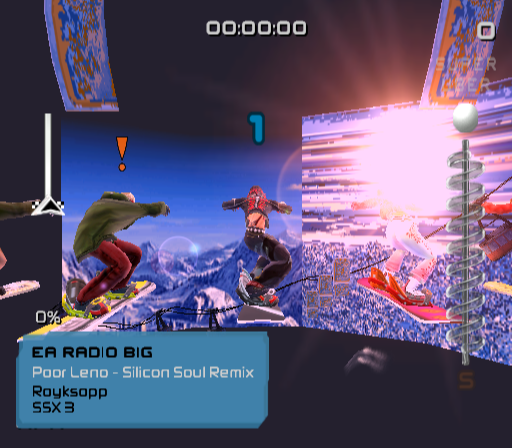
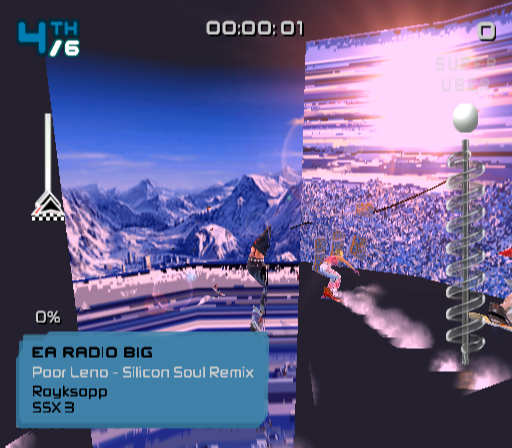
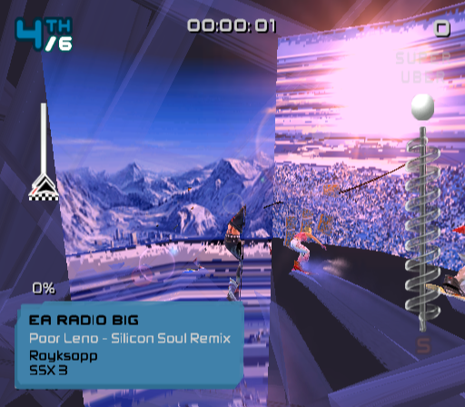
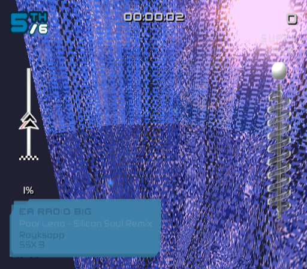
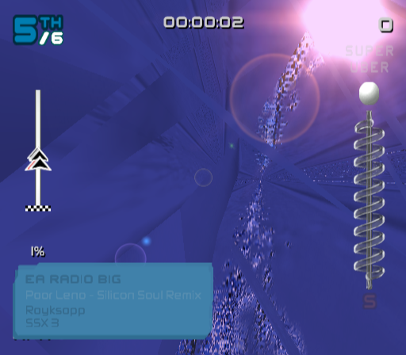
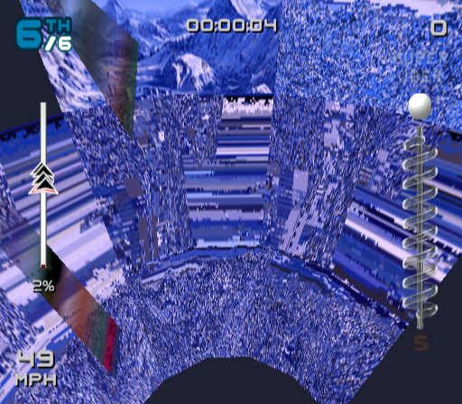
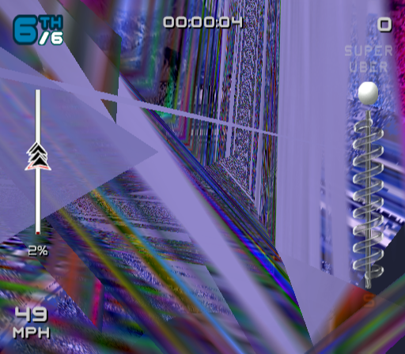

# VU differential testing against ps2-web-recomp (2026-10-14)

Our VU1/VU0 microcode is statically translated (`generated/vu/`, see
[`vu-vif.md`](vu-vif.md)). Here it is checked against an independent
implementation: the C++ VU interpreter from `snuri00/ps2-web-recomp` (MIT),
`runtime/src/vu_micro.cpp` with `vu_ops.hpp`, `vu.hpp` and `fpu.hpp`. The
interpreter runs on states captured from the running game. Where the two
disagree, PCSX2 decides. Sources consulted: `VU1microInterp.cpp`, `VUops.cpp`,
`x86/microVU_Compile.inl`, `microVU_Analyze.inl` and `microVU_Misc.inl`.

## Tooling

| piece | what it does |
| --- | --- |
| `SSX3_VU_CAPTURE=<path>:<max>[:<from>[:<stride>[:<to>]]]` (`vu/capture.rs`) | Records VU program invocations: VIF MSCAL/MSCALF/MSCNT on VU1, and VCALLMS on VU0. At start it saves VF, VI, ACC, Q, P, I, R, MAC, status, clip, TPC, code and data memory, the MPG segment layout, and VIF TOP/ITOP. At the end it saves the XGKICK packets, the end state, the data memory, and the pair and cycle counts. It captures from frame `from` to frame `to`: the first 3 invocations of every (unit, program, entry), then every `stride`-th, up to `max` records. `ssx3-headless` supplies the frame number. |
| `vu_diff` (`crates/ssx3-ps2/src/bin/vu_diff.rs`) | `list`; `self` (replay through our translated code and compare with the recorded in-game result); `cmp <cap> <ref.out> [--ref-model] [-v]` (compare with the reference's output); `trace` (per-pair state dump); `cover`; `synth <out> <seeds> [--sane]` (random states on every `.vutext` entry point); `kickhaz` (XGKICK hazard scan). `--ref-model` makes Q and P results land immediately, as they do in the reference. |
| `tools/vu-diff/build.sh <ps2-web-recomp> <out>` | Builds `vu-ref` from `vu_micro.cpp` unmodified, plus one inserted trace-hook line per pair loop, and `harness.cpp`, which supplies stubs for GIF, queue, JIT and globals. Built with `clang++ -std=c++20`. It runs the reference's exact soft-float path (`PS2_VU_EXACT`); `--fast` selects its host-float path. |
| `tools/vu-diff/first_diff.py` | Runs our reference interpreter (`vu::reference`, which uses the same semantic library as the translated code) and `vu-ref` in lockstep. Prints the first pair whose resulting state differs and classifies it. |

Reproduce:

```sh
SSX3_RTC=1792000000 SSX3_INPUT="950:0010:8,...,4250:4000:8" \
  SSX3_VU_CAPTURE=/tmp/race.vucap:3000:4300:150:4800 ./target/game/ssx3-headless 4800
tools/vu-diff/build.sh ~/src/ps2-web-recomp /tmp/vuref
/tmp/vuref/vu-ref /tmp/race.vucap /tmp/race.ref
./target/release/vu_diff cmp /tmp/race.vucap /tmp/race.ref --ref-model -v
python3 tools/vu-diff/first_diff.py target/release/vu_diff /tmp/vuref/vu-ref /tmp/race.vucap 12 34 --ref-model
```

`SSX3_RTC` pins the CDVD clock. The game seeds its RNG from that clock: the
rider line-up and the course fly-over camera depend on it. Without it,
headless runs diverge from about frame 3500.

## Data set

| set | records | source |
| --- | --- | --- |
| menus | 1500 | frames 300–2628: front end, character select |
| character select | 300 | frames 2380–2420 |
| race start | 500 | frames 4300–4320 |
| race | 1720 | frames 4300–4800 (before the fixes) |
| race, fixed RTC | 3000 | frames 4300–4800, after the fixes; 0 differ on `self` replay |
| synthetic `--sane` | 444 | every `.vutext` program × every entry point × 6 seeds |

Six programs run in these scenes: VU1 `9fa47842` (UI and characters), `d159716b`
(course), `f55ee634`; VU0 `27649fa5` (physics, called through VCALLMS).
`f4babac5`, `9790369f` and `e72540c9` never run here; only the synthetic set
covers them. Pairs executed:

| program | pairs | game captures | synthetic |
| --- | --- | --- | --- |
| 9fa47842 | 576 | 574 | 511 |
| d159716b | 1985 | 975 | 1408 |
| f55ee634 | 804 | 313 | 583 |
| 27649fa5 (VU0) | 488 | 246 | 474 |
| f4babac5 | 1172 | 0 | 1152 |
| 9790369f | 2005 | 0 | 1968 |
| e72540c9 | 275 | 0 | 269 |

## Divergences found and fixed

1. **The upper op of an I-bit pair read the new I.** It must read the old
   one: PCSX2 `_vu1Exec` runs the upper before `VI[REG_I] = ptr[0]`, and
   microVU calls `doIbit` after `doUpperOp`. ps2-web-recomp does the same. The
   microcode depends on this. For example, in `f55ee634`, `0x0540 LOI -0.73`
   is used only by `ADDi.x vf13, vf0, I`. That ADDi sits in the `0x0550` pair,
   which itself loads the next constant (0.113, consumed at `0x05f0`). 16
   I-bit pairs read I in their own pair. **Fix:** the translator emits
   `vu.loi()` after the upper call (commit d6ede03); `generated/vu` was
   regenerated, and 4 programs changed. Found by inspecting the generated
   code while classifying the differences. The captured paths never exercised
   these pairs, but the synthetic set does.
2. **MAX/MINI flushed denormal operands to zero.** `d159716b` at `0x3b38`
   copies integer vertex colours with `MAX.xyzw vf9, vf4, vf4`. Because
   `0x63`, `0x51` and similar values are denormals, they were kicked as 0.
   This affected 73 of the 1720 race invocations. PCSX2's `MIN_MAX_PS`
   compares the raw patterns as sign-magnitude integers and returns the raw
   operand. **Fix:** commit 8b20b45. This is the visible one: course polygons
   that drew as noisy, smeared panels are now Gouraud-shaded (screenshots
   below).
3. **The VI-backup quirk was silently off.** Commit 70eb049 documented it as
   on by default, but `vi_backup_enabled()` used `is_ok_and` on an unset
   variable. Its test passed either way, because the E-bit delay slot set the
   asserted register on both paths. **Fix:** commit 40c46ad turns it on by
   default. JR/JALR are now exempt (PCSX2 `_vuJR`, microVU
   `mVUanalyzeJump`), and a branch pair that stalls reads the current VI
   (microVU `analyzeBranchVI`). The tests now discriminate. A static scan
   shows that no SSX 3 program has a branch whose preceding pair backs up a
   VI the branch reads: every case found was a flag op, and flag ops never
   back up. Replaying the captures with the quirk on gives identical
   results, so this changes no output.

## Remaining divergences (reference wrong, or a deliberate PCSX2 match)

After the fixes, these are all the remaining differences: in the fixed-RTC
race capture (raw `cmp`: 2857/3000 identical; `--ref-model`: 2983/3000) and
in the first-divergence classification of all 247 differing synthetic runs.

| class | count (race / synthetic) | ours | ref | verdict |
| --- | --- | --- | --- | --- |
| Q/P latency | 126 / most | DIV 7, SQRT 7, RSQRT 13, EFU latencies; WAITQ/WAITP | result immediately | ours = PCSX2. `d159716b` software-pipelines DIV and reads the previous Q (`0x29b8` DIV, `0x29f8` MUL Q). `--ref-model` removes this class. |
| DIV/RSQRT x/0 | 11 / 142 | ±0x7f7fffff, D and sticky DS | ±0x7fffffff, D only | ours = PCSX2 `_vuDIV` (hardware gives 0x7fffffff; nothing in SSX 3 depends on it: vertices with w = 0 are culled) |
| flag timing with stalls | 6 / 8 | flags visible 4 *cycles* after the setter, stalls included | 4 *pairs* | ours = PCSX2 (microVU flag instances count stall cycles). SSX 3 relies on it: `ABS.w vf0, vf3` forces a stall and is paired with `FMAND vi1, vi3` (`f55ee634` 0x0e38, 0x0440; `e72540c9` 0x0150) so that FMAND sees the preceding SUB's MAC. |
| EFU | 0 / 32 | f64 math, then PS2 rounding | host f32 | 1 ulp; neither is bit-exact to hardware |
| underflow | 0 / 17 | U (and Z) MAC/status bits | never sets U | ours = PCSX2 interpreter `VU_MAC_UPDATE` |
| overflow / exponent 255 | 0 / 10 | exp-255 operands read as ±max; overflow → ±0x7f7fffff + O | treats exp 255 as a number, clamps only above it | ours = PCSX2 clamping (real hardware treats exp 255 as normal). Seen only with synthetic data. |
| non-terminating synthetic runs | 0 / 37 | budget 4M pairs | 1M steps | artefact of random states |

## Other checks

- **XGKICK timing.** We snapshot the packet at XGKICK, while hardware and
  PCSX2 transfer it as the program keeps running. `vu_diff kickhaz` looked
  for a packet that the same program rewrites after kicking it. Only `d159716b`
  does, about 1000 pairs after kicking a 10–13-qword packet, which is long
  after the transfer has finished. There is no hazard.
- **Determinism.** Replaying every capture with `self` reproduces the
  in-game result bit for bit.
- **Not covered by the reference:** macro mode (COP2 from the EE), the M, D
  and T bits, and XGKICK/PATH3 arbitration.

## Screenshots (fixed RTC, frames from the scripted race path)

Race start, frame 4400. Before and after the fixes this frame is
pixel-identical:



| frame | before | after |
| --- | --- | --- |
| 4500 |  |  |
| 4600 |  |  |
| 4700 |  |  |

Almost all of the change comes from the MAX/MINI fix. An I-bit-only build
matches "before" at 4600 and 4800. The noisy, smeared panels appear to be
terrain and course geometry drawn with zero vertex colour; they are now
shaded. The
course is still far from correct: stretched polygons and odd textures
remain. That points at non-VU causes (GS/texture path, or EE-side data),
because every VU difference left is explained above.
