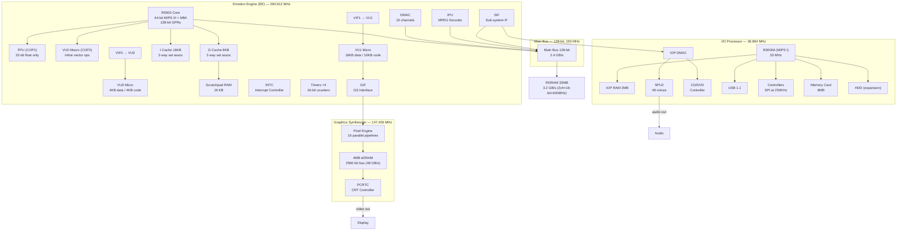
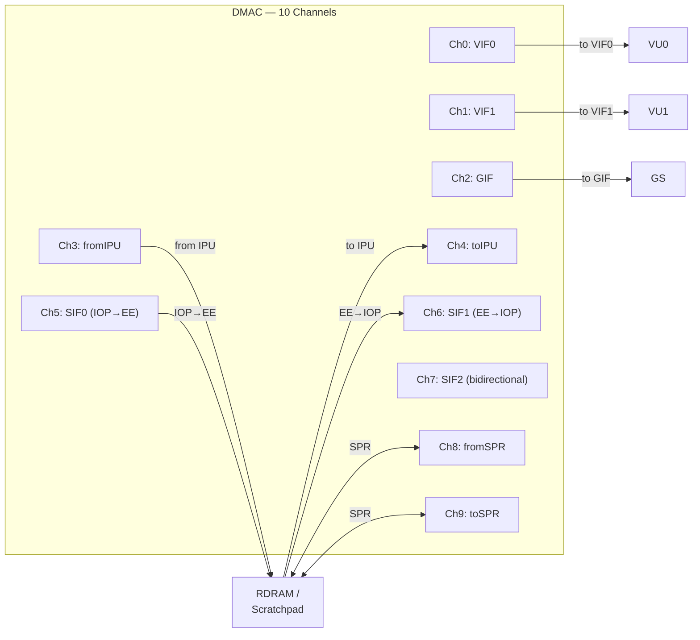
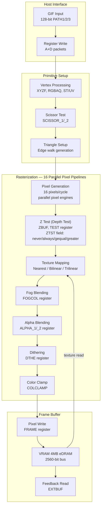
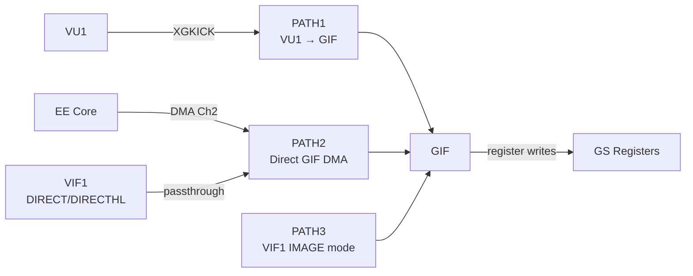
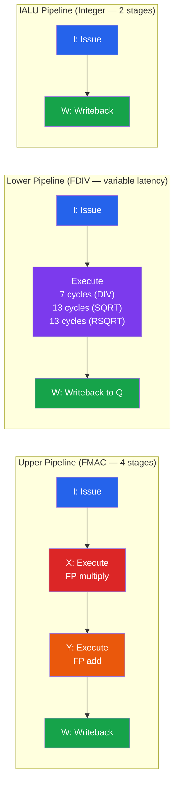
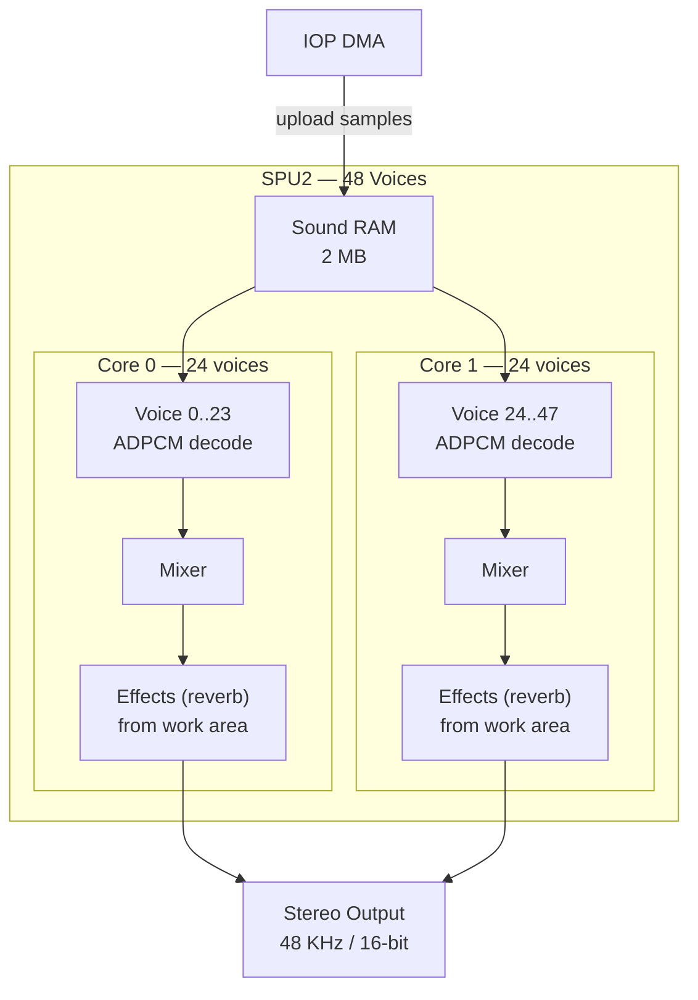
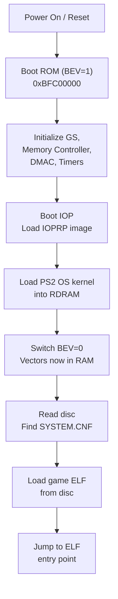
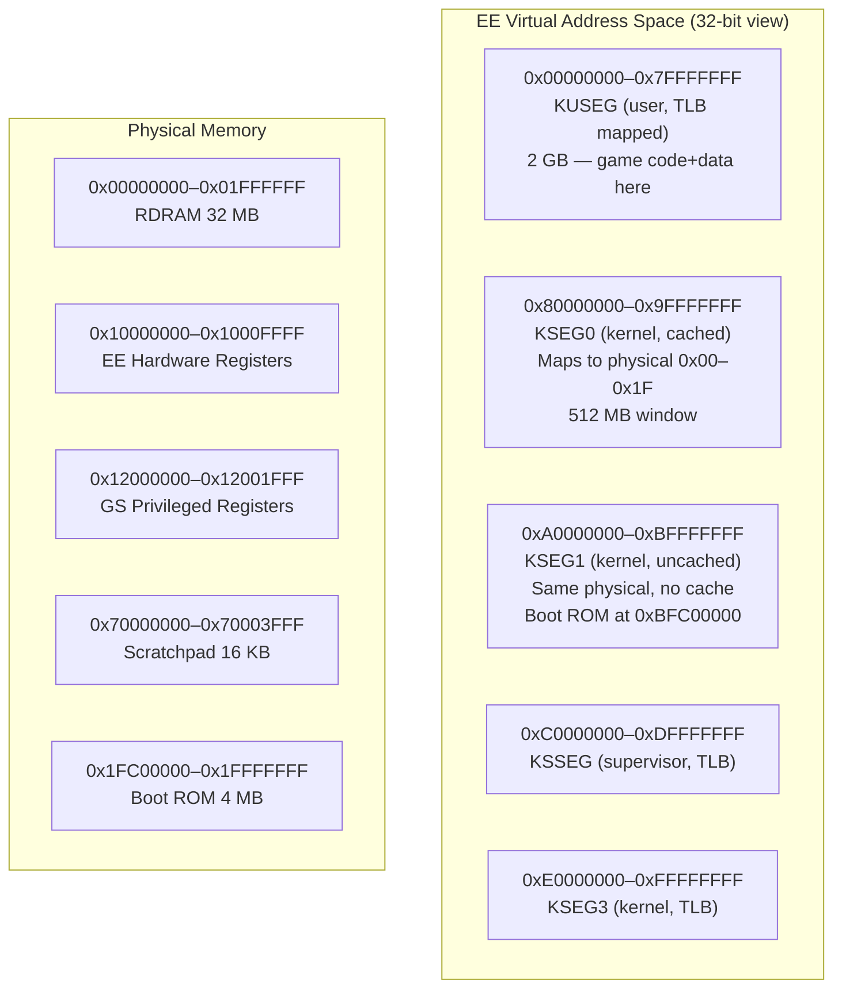
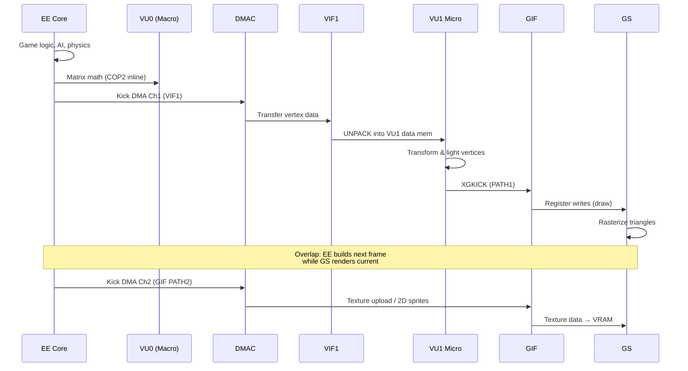

# Reference: PS2 Hardware Bible
> Use this when you need knowledge of PS2 architecture, memory layout, EE registers, CP0, or binary formats.

## 1. Top-Level Overview
The PS2 architecture revolves around the Emotion Engine (EE) CPU and the Graphics Synthesizer (GS) GPU. They communicate directly via DMA and the VIF/GIF interfaces. The I/O Processor (IOP) handles legacy PS1 compatibility and peripheral (CD/DVD, USB, HDD) communication.

## 2. PS2 ELF Executable Format
- **Format**: Executable and Linking Format (ELF)
- **Extension**: Often stripped (`SLUS_XXX.XX`, `SLES_XXX.XX`) instead of `.elf`.
- **Key Sections**:
  - `.text`: Executable MIPS code. Often loaded at `0x00100000`.
  - `.data`: Initialized global data.
  - `.bss`: Uninitialized variable space (filled with 0 at runtime).
  - `.rodata`: Read-only constants, string literals.
- **Entry Point**: Look at the ELF header. Typically `0x00100008` (skips the crt0 `nop`).
- **Extraction**: Inside a PS2 ISO, the main ELF is listed in `SYSTEM.CNF` under `BOOT2`.

### The Multi-Binary Edge Case (.BIN files)
Not all games contain all MIPS code in a single ELF. Many large games (like Star Wars Episode III) use a tiny generic 'launcher' ELF containing only ~1 MB of code. The actual game engine is packed inside a massive `.BIN` file (e.g. `corec.bin`) containing raw, stripped MIPS bytecode which is loaded directly into RAM by the launcher.
**What to do:** When analyzing a game, if the main ELF yields very few functions, look for massive `.BIN` files in the ISO. These raw binaries must be converted into dummy `.ELF` files (giving them proper ELF headers and section mappings) so Ghidra and `ps2_analyzer` can process them independently!

## 3. Emotion Engine (EE) Architecture
- **Core**: Enhanced MIPS III/IV (R5900).
- **Registers**: 32 General Purpose Registers (GPRs).
  - **Crucially, GPRs on PS2 are 128-bit wide**. Lower 64 bits are standard MIPS; upper 64 bits are used by Multimedia Instructions (MMI).
  - Calling Convention uses `a0-a3` (and `t0-t3` for arg5-arg8) as arguments, `v0, v1` for returns.
- **Coprocessors**:
  - **COP0 (System Control)**: Exception handling, MMU/TLB, PRID.
  - **COP1 (FPU)**: Standard floating-point, plus specialized vector math.
  - **COP2 (VU0 Macro Mode)**: Vector Unit 0 closely tied to EE pipeline.

### EE Memory Map
| Address Range | Size | Description                                                              |
| ------------- | ---- | ------------------------------------------------------------------------ |
| `0x00000000`  | 32MB | Main RAM (RDRAM). Cached and accessible by EE. User memory mostly here.  |
| `0x10000000`  | 64KB | EE Hardware I/O Registers (Timers, INTC, DMAC, VIF, GIF, etc).           |
| `0x10008000`  | ...  | DMA Controller (DMAC) Registers (`0x10008000`–`0x1000E0FF`).             |
| `0x11000000`  | 16KB | VU0 Code Memory.                                                         |
| `0x11004000`  | 16KB | VU0 Data Memory.                                                         |
| `0x11008000`  | 16KB | VU1 Code Memory.                                                         |
| `0x1100C000`  | 16KB | VU1 Data Memory.                                                         |
| `0x12000000`  | 8KB  | GS Privileged Registers (Graphics Synthesizer mapping).                  |
| `0x1C000000`  | 2MB  | IOP RAM.                                                                 |
| `0x70000000`  | 16KB | Scratchpad RAM (fast uncached).                                          |
| `0xBFC00000`  | 512KB| Boot ROM (BIOS).                                                         |

*Note: Addresses above `0x20000000` mirror the lower 512MB space with different cache configurations (kseg0, kseg1).*

### The 10 DMA Channels (DMAC)
Games aggressively transfer data to avoid starving the EE. DMA channel registers span `0x10008000`–`0x1000D4FF`:
- `0x10008000` (CH0): VIF0 (To VU0)
- `0x10009000` (CH1): VIF1 (To VU1 / GS) -> *The main rendering pipeline*
- `0x1000A000` (CH2): GIF (To GS directly) -> *Textures and UI*
- `0x1000B000` (CH3): From IPU (MPEG Decoder)
- `0x1000B400` (CH4): To IPU
- `0x1000C000` (CH5): SIF0 (From IOP to EE)
- `0x1000C400` (CH6): SIF1 (From EE to IOP)
- `0x1000C800` (CH7): SIF2
- `0x1000D000` (CH8): From SPR (Scratchpad RAM)
- `0x1000D400` (CH9): To SPR (Scratchpad RAM)

## 4. Input/Output Processor (IOP) & SIF RPC
- **Core**: MIPS R3000A (PS1 CPU).
- **Role**: Handles CD/DVD drive, memory cards, controllers, sound (SPU2), USB.
- **Communication (SIF RPC)**: The EE talks to the IOP via the SIF (Sub-bus Interface). Games load "IRX modules" to the IOP to run specific drivers (e.g. `cdvdman.irx`, `mcman.irx`). 
  - *Fundamental Concept*: When the EE needs to save a file, it does not do it directly. It packs the filename and buffer into a struct, and sends an **RPC Command (Remote Procedure Call)** via SIF to the IOP, which executes the driver and sends the result back. This asynchronous bridge is why handling `sceCdRead` and memory card functions in PS2Recomp requires precise tracking of completion flags.

## 5. VU0, VU1, and the Graphics Synthesizer (GS)
- **VU0**: Generally used in "Macro Mode" directly extending the EE instruction set via COP2. Computes matrices, physics, skeleton animations.
- **VU1**: Generally used in "Micro Mode", acting autonomously. Connected directly to the GIF. The EE feeds it display lists via DMA (VIF1 channel); VU1 crunches the numbers and sends the vertex data to the GS.
- **GS Registers (`0x12000000` range)**: 
  - `PMODE` (`0x12000000`): Display modes (CRT/NTSC/PAL configuration).
  - `SMODE2` (`0x12000020`): Interlacing and sync modes.
  - `DISPFB1` (`0x12000070`): Display Frame Buffer settings (where in VRAM the visible screen starts).
  - `CSR` (`0x12001000`): System Status. *Critical:* Bit 3 of CSR is the V-BLANK sync flag. If a game spins in a while loop checking `0x12001000`, it's waiting for V-Sync.

## 6. Exceptions and Interrupts (COP0)
- **Cause Register**: Bits 2-6 hold the `ExcCode`.
  - `0x00`: Int (Interrupt)
  - `0x04`: AdEL (Address Error Load/Fetch)
  - `0x05`: AdES (Address Error Store)
  - `0x08`: Syscall (System Call)
- **Syscalls**: Executing the `SYSCALL` instruction jumps to the BIOS exception handler, which looks at mapping tables to invoke OS functions like `ExitThread`, `AddIntcHandler`, etc.
  - *In PS2Recomp*, these are trapped and routed to `ps2xRuntime`'s `ps2_syscalls.cpp`.

## 7. R5900 C++ Representation (`R5900Context`)
When working with overrides or debugging state, knowing the exact structure is vital.

```cpp
struct R5900Context {
    uint128_t gpr[32]; // 32 128-bit regs
    uint128_t lo, hi, lo1, hi1;
    uint32_t pc;
    // float fpu[32]; // Note: Implementation specific layout
    // uint32_t fcr31;
    // uint32_t fcr0;
    // ... COP0 registers ...
};
```
In runtime bindings, functions take a reference to this `ctx` to read `a0` (args) and write `v0` (return).

## 8. Subsystem Map — Runtime File Routing

When a crash involves PS2 hardware, use this table to find the responsible C++ file in `ps2xRuntime/src/lib/`:

| PS2 Subsystem | Address Range / Identifier | Runtime File(s) | Typical Symptoms |
|---------------|----------------------------|-----------------|------------------|
| **EE Core** (main CPU) | Recompiled code range | `ps2_runtime.cpp` + Runner code | Crashes in game logic |
| **GS** (Graphics) | `0x12000000-0x12001FFF` | `ps2_gs_gpu.cpp`, `ps2_gs_rasterizer.cpp` | Black screen, wrong rendering |
| **VU0/VU1** (Vector Units) | Inline in EE code | `ps2_vu1.cpp` + Runner (recompiled) | Wrong geometry, broken transforms |
| **VIF1** (VU Interface) | `0x10003C00-0x10003FFF` | `ps2_vif1_interpreter.cpp` | VU data not arriving, bad geometry |
| **GIF** (GS Interface) | `0x10003000-0x100037FF` | `ps2_gif_arbiter.cpp` | GS commands not reaching renderer |
| **SPU2** (Audio) | IOP side | `ps2_audio.cpp`, `ps2_audio_vag.cpp` | No sound, crashes on audio init |
| **IOP** (I/O Processor) | RPC calls, modules | `ps2_iop.cpp`, `ps2_iop_audio.cpp` | Hang during boot, module load fails |
| **Pad** (Controller) | `0x1F801xxx` | `ps2_pad.cpp` | No input, wrong buttons |
| **Syscalls** | `syscall` instruction | `ps2_syscalls.cpp` | Unimplemented syscall → crash |
| **Stubs** | Stubbed functions | `ps2_stubs.cpp` | Missing SDK function → log + return 0 |
| **Memory** | Kernel calls, TLB | `ps2_memory.cpp` | Segfault, invalid pointer |
| **Game Overrides** | Specific functions per-game | `game_overrides.cpp` | Recompiled function behaves wrong |

---

# PS2 Architecture — Complete System Map
> Every subsystem, pipeline, bus, and data path of the PlayStation 2 — described in text and mermaid so an LLM can navigate the entire machine without opening a single PDF.
>
> **Sources**: EE Overview Manual, EE Core Users Manual, EE Users Manual, GS Users Manual + Supplement, VU Users Manual, SPU2 Overview Manual, TX79 Architecture, PS2 Optimisations, eeprogramming, Copetti "PS2 Architecture — A Practical Analysis", ps2_normalmapping, Vector Unit Architecture paper.
>
> **See also**: `db-registers.md` (register addresses + bit-fields), `db-isa.md` (EE Core instruction set), `db-vu-instructions.md` (VU micro instruction set), `db-memory-map.md` (address space layout), `db-syscalls.md` (kernel syscalls), `db-sdk-functions.md` (SDK function stubs).

---

## 1. System-Level Block Diagram



### Key Bandwidths

| Path | Width | Clock | Bandwidth |
|------|-------|-------|-----------|
| Main Bus | 128-bit | 150 MHz | **2.4 GB/s** |
| RDRAM (2 channels) | 2×16-bit | 400 MHz DDR | **3.2 GB/s** |
| GS Local (eDRAM) | 2560-bit | 147 MHz | **48 GB/s** |
| VU0 Data Memory | 128-bit | 294 MHz | **4.7 GB/s** |
| VU1 Data Memory | 128-bit | 294 MHz | **4.7 GB/s** |
| Scratchpad | 128-bit | 294 MHz | **4.7 GB/s** |
| SIF (EE↔IOP) | 32-bit | 37 MHz | **148 MB/s** |
| GIF → GS | 128-bit | 150 MHz | **2.4 GB/s** |
| VIF1 → VU1 | 128-bit | 150 MHz | **2.4 GB/s** |

---

## 2. EE Core (R5900) Pipeline


### Dual-Issue Rules (R5900 Superscalar)

The R5900 can issue **2 instructions per cycle** under these constraints:

| Rule | Pipeline 0 | Pipeline 1 |
|------|-----------|-----------|
| ALU + ALU | ✅ any ALU | ✅ any ALU |
| ALU + Branch | ✅ ALU | ✅ branch |
| ALU + Load/Store | ✅ ALU | ✅ load/store |
| Load + Load | ❌ single issue only | — |
| Branch + Branch | ❌ single issue only | — |
| Multiply + ALU | ✅ mult (pipe 0 only) | ✅ ALU |
| COP1/COP2 + ALU | ✅ COP (pipe 0 only) | ✅ ALU |
| Data hazard | ❌ stalls if pipe 1 reads pipe 0 result in same cycle | — |

### Branch Prediction
- **Static** prediction: backward branches predicted taken, forward not-taken
- **Branch delay slot**: always executed (1 instruction after branch)
- Branch likely instructions: delay slot **nullified** if branch not taken

### Cache Architecture

| Cache | Size | Associativity | Line Size | Fill | Notes |
|-------|------|--------------|-----------|------|-------|
| I-Cache | 16 KB | 2-way set-assoc | 64 bytes | RDRAM refill | |
| D-Cache | 8 KB | 2-way set-assoc | 64 bytes | Write-back | Sub-block ordering + hit-under-miss |
| Scratchpad | 16 KB | Direct-mapped | — | Software managed | Mapped at `0x70000000` |

> **Critical**: Scratchpad is NOT a cache — it's CPU-local SRAM at `0x70000000–0x70003FFF`. DMA can transfer to/from scratchpad as DMA channels 8 (fromSPR) and 9 (toSPR). Games use this heavily as a fast working buffer.

### D-Cache: Sub-Block Ordering & Hit-Under-Miss

- **Sub-block ordering**: When a D-Cache miss occurs, the critical word (the word actually requested by the load) is fetched and delivered to the CPU first, before the rest of the 64-byte cache line fill completes. This reduces effective miss latency.
- **Hit-under-miss**: The D-Cache can service a second load/store that hits the cache while a previous cache miss is still being filled. This partially overlaps miss latency with useful work — similar to a hardware prefetch.

### Memory Access Modes

The EE Core supports three memory access modes (selectable via address segment):

| Mode | Buffer Used | Read Behavior | Write Behavior | When to Use |
|------|------------|---------------|----------------|-------------|
| Cached | D-Cache | Cache line fill on miss | Write-back via WBB | General game logic, repeated data access |
| Uncached | None | Direct RDRAM read | Immediate write-through | Hardware registers, DMA source data |
| Uncached Accelerated | UCAB | Prefetch 8QW into UCAB buffer | Immediate write-through | Display list building, streaming writes |

- **WBB (Write Back Buffer)**: 8-qword FIFO between D-Cache and main bus. Dirty cache lines evicted to the WBB, then drained to RDRAM asynchronously. This decouples cache writebacks from CPU execution.
- **UCAB (Uncached Accelerated Buffer)**: 8-qword dedicated read buffer for uncached-accelerated regions. Provides sequential read speedup without polluting the D-Cache — ideal for streaming through display list data.

### Pipeline Stages Detail

The R5900 has a **6-stage pipeline** (some sources show 5 combined stages):

| Stage | Name | Description |
|-------|------|-------------|
| IF1 | Instruction Fetch 1 | Generate virtual PC, begin I-Cache access |
| IF2 | Instruction Fetch 2 | Complete I-Cache access, select up to 2 instructions for dual-issue |
| ID | Instruction Decode / Issue | Decode opcodes, read register file, check dual-issue compatibility |
| EX | Execute / AGU | ALU result computation, address generation for loads/stores |
| DC | Data Cache Access | D-Cache lookup for loads/stores (sub-block ordering active here) |
| WB | Write Back | Write results to register file |

Branch resolution occurs at EX stage → 1-cycle branch penalty (covered by the delay slot).

---

## 3. DMA Controller (DMAC)

### Channel Map



### DMA Transfer Modes

| Mode | Dn_CHCR.MOD | Description | Use Case |
|------|-------------|-------------|----------|
| Normal | 00 | Single block, Dn_QWC quadwords from Dn_MADR | Simple texture upload |
| Chain | 01 | Linked list of tag+data packets in memory | GIF path 1/2, VIF streams |
| Interleave | 10 | Repeating transfer pattern: transfer `D_SQWC.TQWC` qwords, skip `D_SQWC.SQWC` qwords, repeat | Interlaced image data, interleave transfer for field-based video |

**Interleave transfer** is specifically designed for interlaced video frames — it transfers every Nth row of pixels while skipping the interleaving rows, controlled by `D_SQWC` (DMA Interleave Size register) which specifies both the transfer count and skip count in qwords.

### DMA Tag Format (128 bits)

```
Bits [127:96]  ADDR — next tag address (for chain)  
Bits [95:80]   — reserved  
Bits [79:78]   IRQ+PCE — interrupt request flags
Bits [77:74]   ID — tag type:
                 0=REFE (end, addr from tag)
                 1=CNT  (inline data follows tag)
                 2=NEXT (continue at ADDR)
                 3=REF  (data at ADDR, continue inline)
                 4=REFS (REF + stall control)
                 5=CALL (call ADDR, push return)
                 6=RET  (return to pushed address)
                 7=END  (last transfer)
Bits [63:48]   — reserved
Bits [47:32]   — reserved  
Bits [31:16]   ADDR upper (or reserved)
Bits [15:0]    QWC — quadword count for this tag's data
```

### DMA Priority & Arbitration

Channels share the main bus. Priority order (configurable via `D_PCR`):
1. **Stall control** channels get highest priority when active
2. Default priority: Ch5 (SIF0) > Ch0 > Ch1 > Ch2 > others
3. **Drain channels** (fromIPU, SIF0) must be serviced or they stall the source
4. `D_SQWC` controls interleave slice size to prevent bus starvation

---

## 4. Interrupt Controller (INTC)

```mermaid
graph LR
    subgraph Sources["Interrupt Sources (INTC_STAT bits)"]
        I0["0: GS"]
        I1["1: SBUS (SIF)"]
        I2["2: VB_ON (VBlank start)"]
        I3["3: VB_OFF (VBlank end)"]
        I4["4: VIF0"]
        I5["5: VIF1"]
        I6["6: VU0"]
        I7["7: VU1"]
        I8["8: IPU"]
        I9["9: TIM0"]
        I10["10: TIM1"]
        I11["11: TIM2"]
        I12["12: TIM3"]
        I13["13: SFIFO (SIF FIFO)"]
        I14["14: VU0WD (watchdog)"]
    end

    STAT["INTC_STAT<br/>0x1000F000<br/>(write 1 to clear)"]
    MASK["INTC_MASK<br/>0x1000F010<br/>(write 1 to toggle)"]
    COP0["COP0 Status.IM[2]<br/>(IP2 = INTC line)"]
    
    Sources --> STAT
    STAT -->|"AND"| MASK
    MASK -->|"IP2"| COP0
    COP0 -->|"if IE=1, EXL=0, ERL=0"| EXC["Exception<br/>handler"]
```



### Interrupt Handling Flow

1. Hardware sets bit in `INTC_STAT` (0x1000F000)
2. If corresponding bit in `INTC_MASK` (0x1000F010) is enabled → asserts INT0 to EE
3. EE COP0 sees IP2 pending in Cause register
4. If `Status.IE=1` AND `Status.EXL=0` AND `Status.ERL=0` → exception taken
5. EPC = current PC, ExcCode = 0 (Interrupt), jump to exception vector
6. Handler reads `INTC_STAT` to identify source, clears bit by writing 1 to it

---

## 5. GS Rendering Pipeline



### 16 Parallel Pixel Engines

The GS contains **16 parallel pixel pipelines** (pixel engines / PXEs) that each handle one pixel per cycle. All 16 share the 2560-bit internal eDRAM bus, giving massive fill rate. Each pixel engine independently performs z test, texture lookup, alpha blending, and framebuffer write.

### Z Test (Depth Test)

The `TEST` register's `ZTST` field controls the z test (depth test) function:

| ZTST Value | Function | Description |
|------------|----------|-------------|
| 0 | NEVER | Pixel always fails depth test |
| 1 | ALWAYS | Pixel always passes (no depth testing) |
| 2 | GEQUAL | Pass if pixel Z ≥ framebuffer Z |
| 3 | GREATER | Pass if pixel Z > framebuffer Z |

> The PS2's default depth convention is reversed from typical APIs — closer objects have **larger** Z values. Games using `GEQUAL` are doing a "less-than-or-equal" test in logical space.

### Texture Filtering Modes

| TEX1 Setting | Filter Type | Description |
|--------------|-------------|-------------|
| MMAG/MMIN=0 | Nearest | Point sampling, fastest |
| MMAG/MMIN=1 | Bilinear | 2×2 sample interpolation |
| MMIN=2..5 | Trilinear (Mipmap) | Bilinear + mipmap blending between LOD levels |

**Trilinear filtering** uses `MIPTBP1`/`MIPTBP2` registers to set base pointers for each mipmap level (up to 7 levels). The GS interpolates between two mipmap LODs using bilinear filtering within each level. This requires all mipmap levels pre-uploaded to VRAM with `TEX0.TBP0` pointing to level 0.

### Dual Context Mechanism

The GS maintains **two independent rendering contexts** (Context 1 and Context 2). Each context stores its own set of drawing environment registers (`FRAME`, `ZBUF`, `TEX0`, `ALPHA`, `TEST`, `SCISSOR`, `XYOFFSET`, etc.). The `PRIM` register's `CTXT` bit selects which context applies to the current primitive. This allows two geometry engines (EE+VU0 and VU1) to interleave drawing commands without re-setting all state registers — each geometry path can use its own context.

### GS Pixel Storage Formats

| PSM | Value | BPP | Description | VRAM per 64×32 block |
|-----|-------|-----|-------------|---------------------|
| PSMCT32 | 0x00 | 32 | RGBA 8888 | 8 KB |
| PSMCT24 | 0x01 | 24 | RGB 888 (packed, no alpha) | 6 KB |
| PSMCT16 | 0x02 | 16 | RGBA 5551 | 4 KB |
| PSMCT16S | 0x0A | 16 | RGBA 5551 (swizzled layout) | 4 KB |
| PSMT8 | 0x13 | 8 | 8-bit indexed (CLUT) | 2 KB |
| PSMT4 | 0x14 | 4 | 4-bit indexed (CLUT) | 1 KB |
| PSMT8H | 0x1B | 8 | 8-bit in upper 8 bits of 32-bit | 8 KB (shares with CT32) |
| PSMT4HL | 0x24 | 4 | 4-bit in bits [7:4] of 32-bit | 8 KB (shares) |
| PSMT4HH | 0x2C | 4 | 4-bit in bits [11:8] of 32-bit | 8 KB (shares) |
| PSMZ32 | 0x30 | 32 | 32-bit depth buffer | 8 KB |
| PSMZ24 | 0x31 | 24 | 24-bit depth buffer | 6 KB |
| PSMZ16 | 0x32 | 16 | 16-bit depth buffer | 4 KB |
| PSMZ16S | 0x3A | 16 | 16-bit depth (swizzled) | 4 KB |

### VRAM Block Layout (Column/Page/Block Structure)

VRAM is addressed in **pages** of 2048 pixels:

```
Page = 2048 pixels wide (varies by format)

PSMCT32 page: 64 columns × 32 rows = 2048 pixels = 8192 bytes
  - 1 page = 32 blocks of 8×8 pixels (256 bytes each)
  - Block arrangement within page:
    Block[0]  Block[1]  Block[2]  Block[3]  Block[4]  Block[5]  Block[6]  Block[7]
    Block[8]  Block[9]  Block[10] Block[11] Block[12] Block[13] Block[14] Block[15]
    Block[16] Block[17] Block[18] Block[19] Block[20] Block[21] Block[22] Block[23]
    Block[24] Block[25] Block[26] Block[27] Block[28] Block[29] Block[30] Block[31]

Pixel layout WITHIN a block is NOT linear — it's swizzled for bandwidth.
For PSMCT32, an 8×8 block stores pixels in column-interleaved order.
```

> **Key insight for recompiler**: When games use `sceDmaSync` + GIF PATH2 to upload textures, the VRAM layout matters for correct texture coordinates. Most games use `TEX0.TBW` (buffer width) aligned to page boundaries.

### GS Drawing Primitives

| PRIM | Value | Description | Vertices |
|------|-------|-------------|----------|
| POINT | 0 | Single pixel | 1 |
| LINE | 1 | Line segment | 2 |
| LINESTRIP | 2 | Connected lines | 2+ |
| TRIANGLE | 3 | Filled triangle | 3 |
| TRISTRIP | 4 | Triangle strip | 3+ |
| TRIFAN | 5 | Triangle fan | 3+ |
| SPRITE | 6 | Axis-aligned rectangle | 2 (corners) |

### GIF Data Paths



- **PATH1**: VU1 issues `XGKICK` — sends GIF packet from VU1 data memory directly to GS. Used for transformed geometry.
- **PATH2**: DMA channel 2 sends data from RDRAM through GIF. Used for texture uploads, direct drawing.
- **PATH3**: VIF1 `DIRECT`/`DIRECTHL` command passes data through to GIF. Used for streaming vertex data.

---

## 6. VU (Vector Unit) Architecture

### VU0 vs VU1 Comparison

| Feature | VU0 | VU1 |
|---------|-----|-----|
| Code Memory | 4 KB (256 instructions) | 16 KB (1024 instructions) |
| Data Memory | 4 KB (256 QW) | 16 KB (1024 QW) |
| Macro Mode (COP2) | ✅ Yes | ❌ No |
| Micro Mode | ✅ Yes | ✅ Yes |
| GIF Path | ❌ (via EE registers) | ✅ PATH1 (XGKICK) |
| Feed Source | VIF0 | VIF1 |
| Typical Use | Clipping, lighting helpers | Transform + lighting main |

### VU Micro Pipeline (FMAC + FDIV + IALU)



**Every cycle, the VU executes TWO instructions simultaneously**:
- **Upper instruction**: FMAC operation (add, multiply, max, min, etc.)
- **Lower instruction**: IALU (integer ALU), load/store, branch, FDIV/SQRT, or special

### IALU Pipeline

The **IALU pipeline** handles all lower-instruction integer operations (`IADDIU`, `ISUB`, `IAND`, `IOR`, integer loads/stores `ILW`/`ISW`, branches). It has **2 stages** (Issue → Writeback), so integer results are available the next cycle with no stall. The IALU operates on the 16-bit `vi` registers (VI[0]–VI[15]).

### FMAC Pipeline Hazards

| Hazard Type | Stall Cycles | Condition |
|-------------|-------------|-----------|
| RAW (Read After Write) | 0–3 | Reading reg written N cycles ago |
| FMAC → FMAC (immediate use) | **3 cycles** | `VADD vf1 ...` then `VMUL ... vf1` next cycle |
| FMAC → FMAC (+1 cycle gap) | **2 cycles** | 1 unrelated instruction between |
| FMAC → FMAC (+2 cycle gap) | **1 cycle** | 2 unrelated instructions between |
| FMAC → FMAC (+3 cycle gap) | **0 cycles** | No stall — result available |
| FDIV → use Q | depends | Must wait for FDIV pipeline to finish |
| IALU → use vi result | **0 cycles** | Integer result available next cycle |

> **Optimization**: Games interleave independent operations to hide FMAC latency. A common pattern is processing 3–4 vertices simultaneously in the VU program.

### VIF (VU Interface) Unpack Formats

VIF's `UNPACK` command decompresses data into VU data memory:

| VN | VL | Format | Components × Bits | Expansion |
|----|-----|--------|-------------------|-----------|
| 00 | 00 | S-32 | 1 × 32-bit float | x → {x,x,x,x} |
| 00 | 01 | S-16 | 1 × 16-bit int | x → {x,x,x,x} (sign-extend) |
| 00 | 10 | S-8 | 1 × 8-bit int | x → {x,x,x,x} (sign-extend) |
| 01 | 00 | V2-32 | 2 × 32-bit float | {x,y} → {x,y,0,0} |
| 01 | 01 | V2-16 | 2 × 16-bit int | {x,y} → {x,y,0,0} |
| 01 | 10 | V2-8 | 2 × 8-bit int | {x,y} → {x,y,0,0} |
| 10 | 00 | V3-32 | 3 × 32-bit float | {x,y,z} → {x,y,z,0} |
| 10 | 01 | V3-16 | 3 × 16-bit int | {x,y,z} → {x,y,z,0} |
| 10 | 10 | V3-8 | 3 × 8-bit int | {x,y,z} → {x,y,z,0} |
| 11 | 00 | V4-32 | 4 × 32-bit float | {x,y,z,w} |
| 11 | 01 | V4-16 | 4 × 16-bit int | {x,y,z,w} |
| 11 | 10 | V4-8 | 4 × 8-bit int | {x,y,z,w} |
| 11 | 11 | V4-5 | 4 × 5-bit (packed 16-bit) | 1:5:5:5 → {r,g,b,a} |

VIF flags: `USN` = unsigned (zero-extend instead of sign-extend), `FLG` = use write mask, `M` = use fill mode.

---

## 7. SPU2 (Sound Processing Unit 2)



### Voice Parameters

Each of the 48 voices has:
- **Pitch**: 16-bit (4.12 fixed point, 1.0 = 44.1 KHz sample rate)
- **Volume**: 16-bit per L/R channel, with sweep modes (linear/exponential/pseudo-exponential)
- **ADSR Envelope**: Attack, Decay, Sustain level, Sustain rate, Release — all configurable
- **ADPCM source**: Start address in Sound RAM (28 samples per 16-byte block, 4-bit encoded)
- **Loop**: ADPCM blocks have loop flags (start/repeat/end)
- **Noise generator**: Each voice can be switched to output pseudo-random noise instead of ADPCM waveform data (controlled by the PMON/NON register bits). The noise generator uses a shift register to produce white noise at the voice's pitch rate.
- **FM modulation**: Voice N can frequency-modulate voice N+1

### ADSR Envelope (Attack, Decay, Sustain, Release)

Each voice has a 4-phase amplitude envelope generator that shapes the volume over time:

| Phase | Rate Register | Mode | Description |
|-------|--------------|------|-------------|
| **Attack** | Attack Rate (Ar) | Linear or Exponential | Volume ramps from 0 to max. Attack rate sets the slope speed. |
| **Decay** | Decay Rate (Dr) | Exponential only | Volume decays from max to the Sustain Level (Sl). Decay rate is always exponential. |
| **Sustain** | Sustain Rate (Sr) | Linear or Exponential, Inc/Dec | Volume adjusts toward sustain target. Can increase or decrease. Rate and direction configurable. |
| **Release** | Release Rate (Rr) | Linear or Exponential | After key-off, volume decays to 0. Release rate sets decay speed. |

The Sustain Level (Sl) sets the target amplitude for the decay phase (16 levels, 0–15). All rates are encoded as a step value + shift — the actual time depends on the sample rate and divisor.

### SPU2 ADPCM Format

```
16 bytes per block = 28 samples:
  Byte 0:    shift[3:0] | filter[6:4] | reserved[7]
  Byte 1:    flags: [0]=loop end, [1]=loop repeat, [2]=loop start
  Bytes 2-15: 28 × 4-bit samples (14 bytes, 2 samples per byte)

Decode: sample = clamp(data << shift + filter[0] * prev1 + filter[1] * prev2)
```

### SPU2 Voice Control & DMA

| Register / Concept | Description |
|---------------------|-------------|
| **KEY ON** (KON) | Writing a bit mask to KON starts the ADSR attack phase for selected voices. One bit per voice per core. |
| **KEY OFF** (KOFF) | Writing a bit mask to KOFF triggers the release phase for selected voices. One bit per voice per core. |
| **ENDX** | Read-only status register — one bit per voice. Set when a voice reaches an ADPCM block with the "loop end" flag. Cleared on KEY ON. Used by software to detect sample playback completion. |
| **AutoDMA** | A streaming mode where the IOP DMA feeds audio data directly into Core 0 / Core 1 mixing buffers, bypassing the voice system. Used for CD streaming, movie audio, and PCM playback. AutoDMA channel 0 feeds Core 0's input buffer; channel 1 feeds Core 1's. |
| **Effect area** | A region of Sound RAM dedicated to reverb processing for each core. The effect area stores delay lines and feedback buffers used by the reverb algorithm. Its size and base address are configured per core. Effects include room/hall/studio reverb, delay, echo, and pipe simulations. |

---

## 8. IOP Subsystem

The IOP runs a **MIPS I (R3000A)** at 36.864 MHz with 2 MB RAM. It handles:

| Subsystem | Connection | Purpose |
|-----------|-----------|---------|
| Controllers | SPI (250 KHz) | DualShock2 gamepad, multitap |
| Memory Cards | SPI (250 KHz) | 8 MB save storage |
| CD/DVD | ATAPI-like | Game data, streaming FMV |
| USB 1.1 | Host controller | Peripherals |
| IEEE 1394 | i.LINK | Network adapter (early model) |
| Ethernet | SMAP (PCMCIA) | Network play (expansion) |
| HDD | ATAPI | PS2 HDD (expansion bay) |
| SPU2 | DMA | Sound RAM access |

### SIF (Sub-system Interface)

EE ↔ IOP communication via shared registers:
- **SIF0**: IOP → EE DMA (channel 5) — IOP sends data to EE
- **SIF1**: EE → IOP DMA (channel 6) — EE sends commands to IOP
- **SIF2**: Bidirectional (channel 7) — rarely used  
- **SMFLG**: Shared mailbox flags (0x1000F230) — used for synchronization
- **SIF RPC**: High-level RPC mechanism built on SIF DMA — games call IOP modules this way

---

## 9. Exception Vectors, COP0, & Boot Flow

### Exception Vector Addresses

| Vector | BEV=0 (Normal) | BEV=1 (Bootstrap) | Trigger |
|--------|----------------|-------------------|---------|
| Reset | — | `0xBFC00000` | Hardware reset |
| TLB Refill | `0x80000000` | `0xBFC00200` | Translation Lookaside Buffer miss |
| Counter | `0x80000080` | `0xBFC00280` | Performance counter overflow |
| Debug | `0x80000100` | `0xBFC00300` | Hardware breakpoint / debug exception |
| Common | `0x80000180` | `0xBFC00380` | All other exceptions (general exception handler) |
| Interrupt | `0x80000200` | `0xBFC00400` | Hardware interrupt exception |

### Exception Processing Flow

When an exception occurs, the hardware performs these steps atomically:
1. `EPC` ← current PC (or faulting PC for address errors)
2. `Cause.ExcCode` ← exception type code
3. `Status.EXL` ← 1 (enters exception level, disabling further interrupts)
4. PC ← appropriate exception vector address (based on `Status.BEV` and exception type)
5. The general exception handler reads `Cause.ExcCode` to dispatch to the correct handler.

For **interrupt exceptions** specifically, the handler reads `INTC_STAT` and/or `DMAC D_STAT` to identify the specific interrupt source.

### COP0 System Control Registers (Key Registers)

| Register | Number | Description |
|----------|--------|-------------|
| Index | 0 | TLB entry index for probe/read/write |
| Random | 1 | Pseudo-random TLB entry index for `TLBWR` |
| EntryLo0/1 | 2, 3 | TLB entry low bits (PFN, cache attributes) |
| Context | 4 | Context register — stores BadVPN2 for fast TLB refill handler |
| PageMask | 5 | TLB page size mask |
| Wired | 6 | Number of wired (non-replaceable) TLB entries |
| BadVAddr | 8 | Faulting virtual address |
| Count | 9 | Count register — free-running timer, increments every cycle |
| EntryHi | 10 | TLB entry high bits (VPN2, ASID) |
| Compare | 11 | Timer compare — interrupt when Count = Compare |
| Status | 12 | Status register (IE, EXL, ERL, KSU, IM, BEV, etc.) |
| Cause | 13 | Exception cause code and pending interrupt bits |
| EPC | 14 | Exception Program Counter — return address after exception |
| PRId | 15 | Processor Revision ID (R5900 = 0x2E20) |
| Config | 16 | Cache and bus configuration |
| BadPAddr | 23 | Bad physical address (bus errors) |
| BPC | 24 | Hardware breakpoint control |
| IAB/IABM | 32,33 | Instruction Address Breakpoint + mask |
| DAB/DABM | 34,35 | Data Address Breakpoint + mask |
| DVB/DVBM | 36,37 | Data Value Breakpoint + mask |
| PerfCnt | 25 | Performance counter control and value |
| TagLo/TagHi | 28, 29 | Cache tag registers for CACHE instruction |
| ErrorEPC | 30 | Error exception program counter |

### Translation Lookaside Buffer (TLB)

The R5900 has a **48-entry fully-associative TLB** that maps virtual pages to physical frames. Most PS2 games run in KSEG0/KSEG1 (direct-mapped segments that bypass the TLB), but the kernel and some games use TLB-mapped KUSEG space.

- **TLB Refill exception**: Triggered when no TLB entry matches the virtual address being accessed. The PS2 OS refill handler reads the `Context register` to quickly locate the page table entry.
- Page sizes: 4KB, 16KB, 64KB, 256KB, 1MB, 4MB, 16MB (set via `PageMask`)

### Hardware Breakpoints

The R5900 supports **hardware breakpoints** via COP0 registers BPC, IAB, DAB, DVB:
- **Instruction breakpoint (IAB/IABM)**: Break on instruction fetch at address (with mask)
- **Data breakpoint (DAB/DABM)**: Break on data load/store at address
- **Data value breakpoint (DVB/DVBM)**: Break when data matching a value is read/written
- Triggers a **Debug exception** (vector at `0x80000100` / `0xBFC00300`)

### Boot Sequence



---

## 10. R5900 Floating Point Quirks

The R5900 FPU (COP1) is **NOT IEEE 754 compliant**:

| Behavior | IEEE 754 | R5900 |
|----------|----------|-------|
| Denormals | Supported | **Flushed to zero** |
| NaN | Quiet/Signaling | Always returns `0x7FBFFFFF` |
| ±Infinity | Standard | `±MAX_FLOAT` (0x7F7FFFFF / 0xFF7FFFFF) |
| Rounding | 4 modes | **Round-to-zero only** (truncation) |
| Exceptions | Full set | **None** — no FP exceptions |
| Precision | Full 23-bit mantissa | Some ops have **reduced precision** |

> **Recompiler impact**: x86/x64 FPU uses IEEE 754 by default. The recompiler must clamp denormals to zero and handle NaN/Inf differently. Some games depend on the R5900's non-standard behavior.

---

## 11. Normal Mapping on PS2

> Source: ps2_normalmapping.pdf

PS2 lacks hardware normal mapping. The technique uses VU1 to:

1. **Encode normals** into a cube map stored in GS VRAM
2. **Per-vertex in VU1**: Transform light vector to tangent space
3. **Use light vector as texture coords** to index into the cube map
4. **Cube map lookup** returns the dot product (N·L) as intensity
5. **Second pass**: Apply intensity to diffuse texture via alpha blending

Key constraints:
- Requires **2 rendering passes** minimum (dot product lookup + diffuse apply)
- Cube map resolution trades quality for VRAM space
- VU1 program must compute tangent-space light vector per vertex
- Uses `TEX0.TCC=1` (texture with CLUT) for efficient storage

---

## 12. PS2 Optimization Patterns

> Source: PS2Optimisations.pdf, eeprogramming.pdf

### DMA Double-Buffering

```
Frame N:
  CPU builds display list → Buffer A
  DMA sends Buffer B → GIF/VIF
  
Frame N+1:
  CPU builds display list → Buffer B  
  DMA sends Buffer A → GIF/VIF
```

### DMA Triple Buffering

Triple buffering extends double-buffering with a **third buffer** to decouple CPU, DMA, and VU processing stages:

```
Buffer A: CPU building display list (writing)
Buffer B: DMA transferring to VIF/GIF (reading)
Buffer C: VU1 processing previous data (executing)

Rotate: A→B→C→A each frame/batch
```

Triple buffering prevents all stalls when the three stages have variable latency — e.g. if VU1 transformation takes longer than CPU list building, the DMA stage absorbs the difference.

### Scratchpad Usage Pattern

```
1. DMA toSPR: Transfer working data from RDRAM → Scratchpad
2. CPU processes data in Scratchpad (4.7 GB/s access)
3. DMA fromSPR: Transfer results Scratchpad → RDRAM
4. Repeat with next data chunk
```

### VU1 Double Buffer Pattern

```
VU1 Data Memory layout:
  0x000–0x1FF: Buffer A (vertex data being transformed)
  0x200–0x3FF: Buffer B (vertex data being uploaded via VIF1)

While VU1 processes Buffer A:
  VIF1 UNPACK writes next vertices into Buffer B
When VU1 finishes Buffer A:
  Swap pointers, process Buffer B, VIF1 fills Buffer A
```

### GS FIFO / DMA.STR Considerations

The GIF has a **GS FIFO** (internal GIF-to-GS pipeline buffer). When the GS is busy rasterizing and cannot accept new data, the GS FIFO fills up, which back-pressures the GIF→DMA chain. Monitoring `GIF_STAT` and avoiding GS FIFO overflow is important for maintaining throughput.

The `DMA.STR` (Start) bit in `Dn_CHCR` initiates a DMA transfer. Setting `STR=1` while the channel is already active is undefined. Always check `Dn_CHCR.STR==0` or use the DMAC interrupt before re-arming a channel.

### Geometry Pipeline & Transformation

The EE implements a multi-stage **geometry pipeline** using the VU units:

1. **Model space**: Vertices in local coordinates
2. **World transformation**: Model → World matrix multiply (typically in VU0 macro or VU1)
3. **View transformation**: World → Camera matrix multiply
4. **Projection transformation**: Camera → Clip space (perspective divide)
5. **Viewport transformation**: Clip → Screen coordinates (GS expects 12.4 fixed-point XY + 24-bit Z)
6. **XGKICK**: Transformed primitives sent directly to GS via PATH1

Games typically combine World+View+Projection into a single 4×4 matrix for efficiency, performing one matrix-vector multiply per vertex.

### Key Performance Rules

1. **Never let the main bus idle**: Overlap DMA with CPU/VU computation
2. **Use scratchpad** for all temporary matrices, vertex buffers, working data
3. **Pack vertex data** using VIF UNPACK — 8-bit or 16-bit vertex components save bus bandwidth
4. **Batch GS draws**: Minimize register state changes between primitives
5. **MFIFO (Memory FIFO)**: Use circular DMA buffer in RDRAM for GIF path — builds display lists while DMA consumes them
6. **EE + VU0 parallel**: EE drives game logic while VU0 (macro mode) does matrix math inline
7. **Align to cache lines**: 64-byte alignment for DMA source/destination prevents partial line fills

---

## 13. IPU — Image Data Processor

The **IPU (Image Data Processor)** is a dedicated MPEG-2 / JPEG decoding engine on the EE. It decompresses image data in hardware, offloading video decode from the CPU.

### IPU Features
- **MPEG-2 macroblock decoding**: Intra (I) and predictive (P) macroblocks via IDEC/BDEC commands
- **JPEG-like decode**: DCT + quantization + color space conversion (CSC) from YCbCr to RGB
- **Variable-length decoding (VDEC/FDEC)**: Huffman table decode for MPEG-2 bitstreams
- **Quantization table setup**: `SETIQ` command loads inverse quantization matrices
- **Threshold filter**: `SETTH` command sets transparency thresholds for decoded pixels

### IPU DMA Channels
- **Channel 3 (fromIPU)**: Decoded output data flows from IPU → main memory
- **Channel 4 (toIPU)**: Compressed bitstream data flows from memory → IPU

IPU processing is asynchronous — the CPU issues a decode command, and the IPU processes the compressed stream via DMA while the CPU continues other work.

---

## 14. Memory Map Summary Diagram



> For the complete register-level memory map, see `db-memory-map.md`.
> For register bit-fields, see `db-registers.md`.

---

## 15. PS2 Game Data Flow (Typical Frame)



---

## Cross-Reference to Other Knowledge Base Files

| Topic | File | Key Sections |
|-------|------|-------------|
| Hardware register addresses | `db-registers.md` | Timer, DMA, INTC, GIF, VIF, GS, IPU |
| Hardware register bit-fields | `db-registers.md` | COP0, GS TEX0/FRAME/ZBUF, DMA channels |
| R5900 instruction set | `db-isa.md` | Integer, Branch, Load/Store, MMI, COP0/1/2 |
| VU micro instructions | `db-vu-instructions.md` | Upper (FMAC), Lower (FDIV/Integer/Branch) |
| EE memory map + ELF layout | `db-memory-map.md` | Address ranges, segment mapping, kernel areas |
| PS2 SDK functions | `db-sdk-functions.md` | sceDma*, sceGs*, scePad*, sceVif*, file I/O |
| Syscalls + stubs | `db-syscalls.md` | Syscall table, IOP RPC, stub linking |
| PS2Recomp pipeline | `ps2recomp-pipeline.md` | TOML config, build process, override system |
| Ghidra + GhydraMCP | `ghidra-ghydramcp-guide.md` | Analysis workflow, MCP tools |
| Game porting playbook | `game-porting-playbook.md` | Step-by-step porting methodology |
| Common code patterns | `ps2-code-patterns.md` | Pattern recognition in decompiled code |
| PS2 hardware deep reference | `ps2tek.md` | Comprehensive register/format reference |

---

# PS2 Knowledge Base — Master Index
> **The LLM looks here FIRST.** Every PS2 topic maps to a file and section.
>
> Files live in `resources/` directory. Numbered files (01–09) are narrative references; `db-*.md` are structured knowledge bases.

---

## Quick Lookup

| I need to know about... | Go to | Section |
|------------------------|-------|---------|
| **System overview / block diagram** | `db-ps2-architecture.md` | §1 System-Level Block Diagram |
| **Bus bandwidths** | `db-ps2-architecture.md` | §1 Key Bandwidths |
| **EE Core pipeline / dual-issue** | `db-ps2-architecture.md` | §2 EE Core Pipeline |
| **Branch prediction / delay slots** | `db-ps2-architecture.md` | §2 Branch Prediction |
| **Cache / Scratchpad** | `db-ps2-architecture.md` | §2 Cache Architecture |
| **DMA channels map** | `db-ps2-architecture.md` | §3 DMA Controller |
| **DMA tag format** | `db-ps2-architecture.md` | §3 DMA Tag Format |
| **DMA transfer modes** | `db-ps2-architecture.md` | §3 DMA Transfer Modes |
| **Interrupts / INTC** | `db-ps2-architecture.md` | §4 Interrupt Controller |
| **GS rendering pipeline** | `db-ps2-architecture.md` | §5 GS Rendering Pipeline |
| **GS pixel formats (PSM)** | `db-ps2-architecture.md` | §5 GS Pixel Storage Formats |
| **VRAM layout / swizzle** | `db-ps2-architecture.md` | §5 VRAM Block Layout |
| **GIF paths (PATH1/2/3)** | `db-ps2-architecture.md` | §5 GIF Data Paths |
| **GS drawing primitives** | `db-ps2-architecture.md` | §5 GS Drawing Primitives |
| **VU0 vs VU1** | `db-ps2-architecture.md` | §6 VU Architecture |
| **VU micro pipeline + hazards** | `db-ps2-architecture.md` | §6 VU Micro Pipeline |
| **VIF UNPACK formats** | `db-ps2-architecture.md` | §6 VIF Unpack Formats |
| **SPU2 / sound** | `db-ps2-architecture.md` | §7 SPU2 |
| **ADPCM format** | `db-ps2-architecture.md` | §7 SPU2 ADPCM Format |
| **SPU2 KEY ON/OFF, ENDX, AutoDMA** | `db-ps2-architecture.md` | §7 SPU2 Voice Control & DMA |
| **SPU2 effect area / reverb** | `db-ps2-architecture.md` | §7 SPU2 Voice Control & DMA |
| **IPU (MPEG decoder)** | `db-ps2-architecture.md` | §13 IPU |
| **IOP subsystem** | `db-ps2-architecture.md` | §8 IOP Subsystem |
| **SIF (EE↔IOP)** | `db-ps2-architecture.md` | §8 SIF |
| **Exception vectors** | `db-ps2-architecture.md` | §9 Exception Vectors |
| **Boot sequence** | `db-ps2-architecture.md` | §9 Boot Flow |
| **FPU quirks (non-IEEE)** | `db-ps2-architecture.md` | §10 FP Quirks |
| **Normal mapping technique** | `db-ps2-architecture.md` | §11 Normal Mapping |
| **Optimization patterns** | `db-ps2-architecture.md` | §12 Optimization Patterns |
| **Double buffering** | `db-ps2-architecture.md` | §12 DMA Double-Buffering |
| **Typical frame data flow** | `db-ps2-architecture.md` | §14 Game Data Flow |

---

| I need to know about... | Go to | Section |
|------------------------|-------|---------|
| **R5900 instructions** | `db-isa.md` | Full instruction tables |
| **Integer ALU instructions** | `db-isa.md` | CPU Integer Instructions |
| **MMI 128-bit SIMD** | `db-isa.md` | R5900 128-bit (MMI) Extensions |
| **Branch / jump instructions** | `db-isa.md` | Branch / Jump Instructions |
| **Load / store instructions** | `db-isa.md` | Load / Store Instructions |
| **COP0 instructions** | `db-isa.md` | COP0 Instructions |
| **COP1 (FPU) instructions** | `db-isa.md` | COP1 Instructions |
| **COP2 (VU0 macro) instructions** | `db-isa.md` | COP2 Instructions |
| **MIPS calling convention** | `db-isa.md` | MIPS Calling Convention |
| **SA register / QFSRV** | `db-isa.md` | SA Register |

---

| I need to know about... | Go to | Section |
|------------------------|-------|---------|
| **VU upper instructions (FMAC)** | `db-vu-instructions.md` | Upper Instructions |
| **VU lower instructions** | `db-vu-instructions.md` | Lower Instructions |
| **VU branch / flow** | `db-vu-instructions.md` | Branch Instructions |
| **VU flags (MAC, Status, Clip)** | `db-vu-instructions.md` | Flag Operations |
| **VU special regs (I, Q, P, ACC)** | `db-vu-instructions.md` | Special Registers |
| **XGKICK** | `db-vu-instructions.md` | XGKICK |

---

| I need to know about... | Go to | Section |
|------------------------|-------|---------|
| **Hardware register addresses** | `db-registers.md` | All register map tables |
| **Timer registers** | `db-registers.md` | Timer section |
| **DMA registers** | `db-registers.md` | DMA section |
| **GIF registers** | `db-registers.md` | GIF section |
| **VIF registers** | `db-registers.md` | VIF section |
| **IPU registers** | `db-registers.md` | IPU section |
| **GS privileged registers** | `db-registers.md` | GS Privileged section |
| **GS general registers bit-fields** | `db-registers.md` | GS General Registers |
| **COP0 register bit-fields** | `db-registers.md` | COP0 Registers section |

---

| I need to know about... | Go to | Section |
|------------------------|-------|---------|
| **Memory map / address ranges** | `db-memory-map.md` | Full address map |
| **KSEG0 / KSEG1 / KUSEG** | `db-memory-map.md` | Segment mapping |
| **ELF loading / entry point** | `db-memory-map.md` | ELF Layout |
| **Kernel memory areas** | `db-memory-map.md` | Kernel Areas |

---

| I need to know about... | Go to | Section |
|------------------------|-------|---------|
| **Syscall numbers + handler** | `db-syscalls.md` | Syscall Table |
| **IOP RPC mechanism** | `db-syscalls.md` | IOP RPC |
| **Stub linking (IMPORTS/EXPORTS)** | `db-syscalls.md` | Stub Patterns |
| **Exception dispatching** | `db-syscalls.md` | Exception Handling |
| **Thread management syscalls** | `db-syscalls.md` | Thread Syscalls |

---

| I need to know about... | Go to | Section |
|------------------------|-------|---------|
| **sceDma* functions** | `db-sdk-functions.md` | DMA Functions |
| **sceGs* functions** | `db-sdk-functions.md` | GS Functions |
| **scePad* functions** | `db-sdk-functions.md` | Pad Functions |
| **Controller SPI protocol** | `db-sdk-functions.md` | PAD SPI Protocol |
| **sceVif* / sceVu* functions** | `db-sdk-functions.md` | VIF/VU Functions |
| **File I/O (sceOpen, etc.)** | `db-sdk-functions.md` | File I/O |
| **Memory allocation (malloc)** | `db-sdk-functions.md` | Memory Management |
| **sceGsSyncV / sceGsSyncPath** | `db-sdk-functions.md` | GS Sync Functions |
| **printf / sceWrite** | `db-sdk-functions.md` | Debug / Output |

---

| I need to know about... | Go to | Section |
|------------------------|-------|---------|
| **EE/IOP architecture narrative** | `01-ps2-hardware-bible.md` | Full narrative reference |
| **Memory maps (narrative)** | `01-ps2-hardware-bible.md` | Memory Maps |
| **I/O register overview** | `01-ps2-hardware-bible.md` | I/O Registers |
| **Subsystem→file routing** | `01-ps2-hardware-bible.md` | Subsystem Routing |

---

| I need to know about... | Go to | Section |
|------------------------|-------|---------|
| **MIPS→C++ translation patterns** | `02-mips-r5900-isa.md` | Translation Rules |
| **MMI translation to C++** | `02-mips-r5900-isa.md` | MMI Translation |
| **COP0 translation to C++** | `02-mips-r5900-isa.md` | COP0 Translation |
| **FPU translation to C++** | `02-mips-r5900-isa.md` | FPU Translation |

---

| I need to know about... | Go to | Section |
|------------------------|-------|---------|
| **PS2Recomp pipeline / TOML** | `03-ps2recomp-pipeline.md` | Full pipeline |
| **TOML configuration** | `03-ps2recomp-pipeline.md` | Configuration |
| **Override system (*.cpp)** | `03-ps2recomp-pipeline.md` | Override System |
| **Build process (cmake)** | `03-ps2recomp-pipeline.md` | Build Process |

---

| I need to know about... | Go to | Section |
|------------------------|-------|---------|
| **Runtime syscall implementation** | `04-runtime-syscalls-stubs.md` | Syscall Implementation |
| **Stub patterns / signatures** | `04-runtime-syscalls-stubs.md` | Stub Patterns |
| **Runtime structure (src/lib/)** | `04-runtime-syscalls-stubs.md` | Runtime Architecture |
| **Game override C++ patterns** | `04-runtime-syscalls-stubs.md` | Override Patterns |

---

| I need to know about... | Go to | Section |
|------------------------|-------|---------|
| **Ghidra analysis workflow** | `05-ghidra-ghydramcp-guide.md` | Analysis |
| **GhydraMCP tools list** | `05-ghidra-ghydramcp-guide.md` | MCP Tools |
| **Function naming conventions** | `05-ghidra-ghydramcp-guide.md` | Naming |

---

| I need to know about... | Go to | Section |
|------------------------|-------|---------|
| **Game porting methodology** | `06-game-porting-playbook.md` | Step-by-step |
| **Common porting blockers** | `06-game-porting-playbook.md` | Blockers |

---

| I need to know about... | Go to | Section |
|------------------------|-------|---------|
| **Decompiled code patterns** | `07-ps2-code-patterns.md` | Pattern library |
| **DMA setup patterns** | `07-ps2-code-patterns.md` | DMA Patterns |
| **VU program loading patterns** | `07-ps2-code-patterns.md` | VU Load Patterns |
| **GS init patterns** | `07-ps2-code-patterns.md` | GS Init Patterns |

---

| I need to know about... | Go to | Section |
|------------------------|-------|---------|
| **How to search ps2tek.md** | `08-infinite-knowledge-base.md` | Search Instructions |
| **ps2tek section map** | `08-infinite-knowledge-base.md` | Section Index |

---

| I need to know about... | Go to | Section |
|------------------------|-------|---------|
| **Deep hardware reference** | `09-ps2tek.md` | Everything (232K) |

---

| I need to know about... | Go to | Section |
|------------------------|-------|---------|
| **ELF overlay detection** | `db-overlay-patterns.md` | §1 What Are Overlays |
| **Multi-binary porting** | `db-overlay-patterns.md` | §2 Detection Checklist |
| **COREC.BIN / dynamic modules** | `db-overlay-patterns.md` | §3 Discovery Protocol |
| **Overlay TOML config** | `db-overlay-patterns.md` | §4 TOML Integration |

---

| I need to know about... | Go to | Section |
|------------------------|-------|---------|
| **All prohibitions in one place** | `10-agent-guardrails.md` | §1-§2 Mistake Taxonomy |
| **Agent failure modes** | `10-agent-guardrails.md` | §1 Agent Mistake Taxonomy |
| **Problem Resolution / crash triage** | `10-agent-guardrails.md` | §3 Problem Resolution |
| **Fix Taxonomy (4 Tools)** | `10-agent-guardrails.md` | §3.1 Fix Taxonomy |
| **Root Cause Protocol** | `10-agent-guardrails.md` | §3.3 Root Cause Protocol |
| **Subsystem identification** | `10-agent-guardrails.md` | §3.5 Subsystem Map |
| **Adversarial Split / verification** | `10-agent-guardrails.md` | §4 Adversarial Split |
| **Circuit Breaker / 3-strike rule** | `10-agent-guardrails.md` | §5 Circuit Breaker |
| **Porting phase workflow details** | `11-operational-phases.md` | Phase 0–5 Deep Dives |
| **Phase entry/exit criteria** | `11-operational-phases.md` | Per-phase checklists |

---

| I need to know about... | Go to | Section |
|------------------------|-------|---------|
| **Hardware diagrams / images** | `images/IMAGE_CATALOG.md` | 80 classified diagrams |
| **PS2 controller pad spec** | `padspecs.txt` | Controller SPI protocol |

## File Inventory

| File | Size | Last Updated | Content Type |
|------|------|-------------|-------------|
| `01-ps2-hardware-bible.md` | ~15 KB | 2026-03-06 | EE/IOP architecture narrative, memory maps, I/O registers |
| `02-mips-r5900-isa.md` | ~12 KB | 2026-03-06 | MIPS→C++ translation (MMI, COP0, FPU) |
| `03-ps2recomp-pipeline.md` | ~9 KB | 2026-03-13 | PS2Recomp tool pipeline + TOML config |
| `04-runtime-syscalls-stubs.md` | ~10 KB | 2026-03-06 | Syscall implementation, stubs, runtime structure |
| `05-ghidra-ghydramcp-guide.md` | ~5 KB | 2026-03-04 | Ghidra/GhydraMCP analysis workflow |
| `06-game-porting-playbook.md` | ~6 KB | 2026-03-05 | Game porting methodology |
| `07-ps2-code-patterns.md` | ~4 KB | 2026-03-03 | Decompiled code pattern recognition |
| `08-infinite-knowledge-base.md` | ~3 KB | 2026-03-06 | How to search & navigate 09-ps2tek.md |
| `09-ps2tek.md` | ~232 KB | 2026-02-18 | Deep hardware reference (all registers) |
| `10-agent-guardrails.md` | ~16 KB | 2026-03-21 | Guardrails + problem resolution + adversarial split |
| `11-operational-phases.md` | ~8 KB | 2026-03-21 | Phase 0–5 deep workflow with entry/exit criteria |
| `db-ps2-architecture.md` | ~40 KB | 2026-03-13 | System diagrams (mermaid), pipelines, data flow |
| `db-ps2-index.md` | ~12 KB | 2026-03-21 | THIS FILE — master topic → file+section map |
| `db-isa.md` | ~24 KB | 2026-03-13 | R5900 instruction tables (630 lines) |
| `db-vu-instructions.md` | ~15 KB | 2026-03-13 | VU0/VU1 micro instruction tables |
| `db-registers.md` | ~53 KB | 2026-03-13 | All HW register addresses + bit-fields |
| `db-sdk-functions.md` | ~34 KB | 2026-03-13 | SDK function signatures + PAD protocol |
| `db-syscalls.md` | ~15 KB | 2026-03-13 | Syscall table, stubs, RPC, exception handling |
| `db-memory-map.md` | ~7 KB | 2026-03-13 | Address space map, ELF layout |
| `db-overlay-patterns.md` | ~8 KB | 2026-07-18 | ELF overlay detection, multi-binary porting |
| `images/IMAGE_CATALOG.md` | ~5 KB | 2026-03-06 | 80 classified hardware diagrams from PS2 PDFs |
| `padspecs.txt` | ~2 KB | 2026-03-06 | PS2 controller SPI protocol specification |

**Total knowledge base**: ~510+ KB of structured, searchable PS2 knowledge.

---

# PS2 EE Hardware Register Map
> Maps PS2 hardware register addresses to names, subsystems, and runtime handling.
> **Source**: EE User's Manual Version 6.0 (SCE Confidential), GS User's Manual
>
> **See also**: `db-memory-map.md` (address ranges these registers live in), `db-ps2-architecture.md` §3–§5 (DMA/GIF/GS subsystem context), `db-vu-instructions.md` (VU register usage).

## Lookup Protocol
1. Match the address from decompiled code or IO write trace
2. Check **Subsystem** to understand context
3. **Runtime Handling**: `impl` = has write handler in `ps2_memory.cpp`, `store-only` = stored but not acted on

## Address Ranges

| Range | Subsystem | Description |
|-------|-----------|-------------|
| `0x10000000–0x100000FF` | TIMER0 | Timer 0 registers |
| `0x10000800–0x100008FF` | TIMER1 | Timer 1 registers (same layout) |
| `0x10001000–0x100010FF` | TIMER2 | Timer 2 registers (no HOLD) |
| `0x10001800–0x100018FF` | TIMER3 | Timer 3 registers (no HOLD) |
| `0x10002000–0x10002030` | IPU | Image Processing Unit |
| `0x10003800–0x100039FF` | VIF0 | Vector Interface 0 |
| `0x10003C00–0x10003DFF` | VIF1 | Vector Interface 1 |
| `0x10008000–0x100080FF` | DMA Chan 0 | VIF0 DMA |
| `0x10009000–0x100090FF` | DMA Chan 1 | VIF1 DMA |
| `0x1000A000–0x1000A0FF` | DMA Chan 2 | GIF DMA |
| `0x1000B000–0x1000B0FF` | DMA Chan 3 | fromIPU DMA |
| `0x1000B400–0x1000B4FF` | DMA Chan 4 | toIPU DMA |
| `0x1000C000–0x1000C0FF` | DMA Chan 5 | SIF0 DMA |
| `0x1000C400–0x1000C4FF` | DMA Chan 6 | SIF1 DMA |
| `0x1000C800–0x1000C8FF` | DMA Chan 7 | SIF2 DMA |
| `0x1000D000–0x1000D0FF` | DMA Chan 8 | fromSPR DMA |
| `0x1000D400–0x1000D4FF` | DMA Chan 9 | toSPR DMA |
| `0x1000E000–0x1000E0FF` | DMAC | DMA controller global registers |
| `0x1000F000–0x1000F010` | INTC | Interrupt controller (STAT, MASK) |
| `0x1000F200–0x1000F260` | SIF | SIF control registers |
| `0x1000F520` | D_ENABLER | DMAC hold state (read) |
| `0x1000F590` | D_ENABLEW | DMAC hold control (write) |
| `0x10007010` | IPU_IN_FIFO | IPU input FIFO |
| `0x12000000–0x12002000` | GS Privileged | GS privileged registers (PMODE, CSR, etc.) |

---

## Timer Registers (Tn base addresses)

All 4 timers share the same register layout. Timer 0/1 have an additional HOLD register.

| Timer | Base Address | INTC bit |
|-------|-------------|----------|
| 0 | `0x10000000` | TIM0 (bit 4) |
| 1 | `0x10000800` | TIM1 (bit 5) |
| 2 | `0x10001000` | TIM2 (bit 6) |
| 3 | `0x10001800` | TIM3 (bit 7) |

| Offset | Name | R/W | Handling | Notes |
|--------|------|-----|----------|-------|
| `+0x00` | Tn_COUNT | RW | impl | Counter value (16-bit, upper bits fixed 0) — reads return 0 in runtime |
| `+0x10` | Tn_MODE | RW | store-only | Timer mode (clock source, gate, etc.) |
| `+0x20` | Tn_COMP | RW | store-only | Compare register (16-bit) |
| `+0x30` | Tn_HOLD | RW | store-only | Hold register (**Timer 0/1 only**) |

> Runtime: all Timer reads return 0 — timers are not emulated.
>
> **Note**: `ps2_memory.cpp` handles `0x10000200–0x10000300` as a separate fallback (returns 0 / accepts writes silently). This range falls in reserved space between Timer 0 and Timer 1 in the official address map — it's a game-specific access pattern, not the real Timer 1 base.

### Tn_MODE Bit-Fields

| Bit(s) | Name | Description |
|--------|------|-------------|
| 1:0 | CLKS | Clock selection: 00=BUSCLK (147.456MHz), 01=1/16 BUSCLK, 10=1/256 BUSCLK, 11=H-BLNK |
| 2 | GATE | Gate function enable (0=disabled, 1=enabled) |
| 3 | GATS | Gate selection: 0=H-BLNK (disabled when CLKS=11), 1=V-BLNK |
| 5:4 | GATM | Gate mode: 00=count while low, 01=reset+count on rising, 10=on falling, 11=on both edges |
| 6 | ZRET | Zero return: 0=keep counting past reference, 1=clear counter on match |
| 7 | CUE | Count up enable: 0=stop, 1=start/restart counting |
| 8 | CMPE | Compare-interrupt enable |
| 9 | OVFE | Overflow-interrupt enable |
| 10 | EQUF | Equal flag — set on compare-interrupt, **W1C** |
| 11 | OVFF | Overflow flag — set on overflow-interrupt, **W1C** |

---

## IPU Registers (0x10002000)

| Address | Name | R/W | Handling | Notes |
|---------|------|-----|----------|-------|
| `0x10002000` | IPU_CMD | RW | impl | Command register — reset on CTRL.RST |
| `0x10002010` | IPU_CTRL | RW | impl | Control — bit30 write triggers full IPU reset |
| `0x10002020` | IPU_BP | RW | impl | Bit position — reset on CTRL.RST |
| `0x10002030` | IPU_TOP | R | impl | Top of bitstream |
| `0x10007010` | IPU_IN_FIFO | W | store-only | Input FIFO write |

---

## GIF Registers (0x10003000)

| Address | Name | R/W | Notes |
|---------|------|-----|-------|
| `0x10003000` | GIF_CTRL | W | Control — bit0=RST (reset GIF), bit3=PSE (pause transfer) |
| `0x10003010` | GIF_MODE | W | Mode — bit0=M3R (mask PATH3), bit2=IMT (intermittent transfer) |
| `0x10003020` | GIF_STAT | R | Status — OPH, APTS, P3Q, P2Q, P1Q, IP3, PSE, FQC[4:0] |
| `0x10003040` | GIF_TAG0 | R | GIFtag save — NLOOP[14:0], EOP, id[1:0], PRE, PRIM |
| `0x10003050` | GIF_TAG1 | R | GIFtag save — TAG[63:32] (REGS field) |
| `0x10003060` | GIF_TAG2 | R | GIFtag save — TAG[95:64] (REGS continued) |
| `0x10003070` | GIF_TAG3 | R | GIFtag save — TAG[127:96] (REGS continued) |
| `0x10003080` | GIF_CNT | R | Transfer count — LOOPCNT[14:0], REGCNT[3:0] |
| `0x10003090` | GIF_P3CNT | R | PATH3 remaining transfer count |
| `0x100030A0` | GIF_P3TAG | R | PATH3 tag value (LOOPCNT, EOP) |

### GIF_STAT Bit-Fields

| Bit(s) | Name | Description |
|--------|------|-------------|
| 0 | M3R | Mask PATH3 (reflects GIF_MODE.M3R) |
| 1 | M3P | PATH3 masked by VIF1 (via MSKPATH3 VIFcode) |
| 2 | IMT | Intermittent transfer mode |
| 3 | PSE | Temporary pause (reflects GIF_CTRL.PSE) |
| 5 | IP3 | PATH3 interrupted (idle while M3R or M3P set) |
| 6 | P3Q | PATH3 request queued |
| 7 | P2Q | PATH2 request queued |
| 8 | P1Q | PATH1 request queued |
| 9 | OPH | Output path active (data being sent to GS) |
| 11:10 | APTS | Active PATH status: 00=idle, 01=PATH1, 10=PATH2, 11=PATH3 |
| 13:12 | DIR | Transfer direction: 00=idle |
| 28:24 | FQC | FIFO queue count (0–16 qwords in GIF FIFO) |

---

## VIF0 Registers (0x10003800)

| Address | Name | R/W | Handling | Notes |
|---------|------|-----|----------|-------|
| `0x10003800` | VIF0_STAT | R | impl | Status register — VPS, VEW, VIS, INT, ER0, ER1 |
| `0x10003810` | VIF0_FBRST | W | impl | Force break/reset — bit0=RST (reset VIF0), bit1=FBK (force break), bit2=STP (stop), bit3=STC (stall clear) |
| `0x10003820` | VIF0_ERR | W | impl | Error mask — bit0=MII (mask interrupt on INT), bit1=ME0 (mask DMAtag mismatch), bit2=ME1 (mask VIFcode mismatch) |
| `0x10003830` | VIF0_MARK | RW | impl | Mark register, clears MRK flag on write |
| `0x10003840` | VIF0_CYCLE | RW | impl | Cycle register (CL/WL) for UNPACK |
| `0x10003850` | VIF0_MODE | RW | impl | Mode (0–3): 0=normal, 1=offset, 2=difference |
| `0x10003860` | VIF0_NUM | RW | impl | Number of data remaining to process |
| `0x10003870` | VIF0_MASK | RW | impl | Write mask for UNPACK data |
| `0x10003880` | VIF0_CODE | RW | impl | Current VIFcode being executed |
| `0x10003890` | VIF0_ITOPS | RW | impl | Interrupt TOP register (set value) |
| `0x100038A0` | VIF0_R0 | RW | impl | Column/row register R0 (filling mask) |
| `0x100038B0` | VIF0_R1 | RW | impl | Column/row register R1 |
| `0x100038C0` | VIF0_R2 | RW | impl | Column/row register R2 |
| `0x100038D0` | VIF0_R3 | RW | impl | Column/row register R3 |
| `0x10003900` | VIF0_C0 | R | impl | Column register C0 (read-only) |
| `0x10003910` | VIF0_C1 | R | impl | Column register C1 |
| `0x10003920` | VIF0_C2 | R | impl | Column register C2 |
| `0x10003930` | VIF0_C3 | R | impl | Column register C3 |
| `0x10003940` | VIF0_ITOP | R | impl | Interrupt TOP actual value |

> **Note**: VIF0 does NOT have BASE/OFST/TOPS/TOP registers — double-buffering is only available on VIF1. VIF0 feeds VU0 (macro mode) data via DMA channel 0.
> R0–R3 are the filling registers used in STROW VIFcode. C0–C3 are the column registers used in STCOL VIFcode.

---

## VIF1 Registers (0x10003C00)

| Address | Name | R/W | Handling | Notes |
|---------|------|-----|----------|-------|
| `0x10003C00` | VIF1_STAT | R | impl | Status register — read in sync loops |
| `0x10003C10` | VIF1_FBRST | W | impl | Force break/reset — bit0=RST, bit3=STC |
| `0x10003C20` | VIF1_ERR | W | impl | Error mask — bit0=MII, bit1=ME0, bit2=ME1 |
| `0x10003C30` | VIF1_MARK | RW | impl | Mark register, clears MRK flag on write |
| `0x10003C40` | VIF1_CYCLE | RW | impl | Cycle register (CL/WL) |
| `0x10003C50` | VIF1_MODE | RW | impl | Mode (0–3) |
| `0x10003C60` | VIF1_NUM | RW | impl | Number of data to process |
| `0x10003C70` | VIF1_MASK | RW | impl | Write mask |
| `0x10003C80` | VIF1_CODE | RW | impl | Current VIFcode |
| `0x10003C90` | VIF1_ITOPS | RW | impl | Interrupt TOP register |
| `0x10003CA0` | VIF1_BASE | RW | impl | Double-buffer base |
| `0x10003CB0` | VIF1_OFST | RW | impl | Double-buffer offset |
| `0x10003CC0` | VIF1_TOPS | RW | impl | TOP register |
| `0x10003CD0` | VIF1_ITOP | RW | impl | Interrupt TOP actual |
| `0x10003CE0` | VIF1_TOP | RW | impl | TOP actual |
| `0x10003D00` | VIF1_R0 | RW | impl | Row register R0 (filling mask) |
| `0x10003D10` | VIF1_R1 | RW | impl | Row register R1 |
| `0x10003D20` | VIF1_R2 | RW | impl | Row register R2 |
| `0x10003D30` | VIF1_R3 | RW | impl | Row register R3 |
| `0x10003D40` | VIF1_C0 | R | impl | Column register C0 (read-only) |
| `0x10003D50` | VIF1_C1 | R | impl | Column register C1 |
| `0x10003D60` | VIF1_C2 | R | impl | Column register C2 |
| `0x10003D70` | VIF1_C3 | R | impl | Column register C3 |

---

## DMA Channel Layout (per-channel, base+offset)

Each DMA channel at base address `0x10008000 + N*0x1000` (or `0x1000B400` etc.):

| Offset | Name | Description |
|--------|------|-------------|
| `+0x00` | Dn_CHCR | Channel control (bit8=STR start) |
| `+0x10` | Dn_MADR | Memory address |
| `+0x20` | Dn_QWC | Quadword count |
| `+0x30` | Dn_TADR | Tag address (chain mode) |
| `+0x40` | Dn_ASR0 | Address stack 0 (call/ret chains) |
| `+0x50` | Dn_ASR1 | Address stack 1 |
| `+0x80` | Dn_SADR | SPR address (**channels 8/9 only** — fromSPR/toSPR) |

**DMA Channel Base Addresses:**

| Channel | Base | Purpose |
|---------|------|---------|
| 0 | `0x10008000` | VIF0 |
| 1 | `0x10009000` | VIF1 |
| 2 | `0x1000A000` | GIF |
| 3 | `0x1000B000` | fromIPU |
| 4 | `0x1000B400` | toIPU |
| 5 | `0x1000C000` | SIF0 (IOP→EE) |
| 6 | `0x1000C400` | SIF1 (EE→IOP) |
| 7 | `0x1000C800` | SIF2 |
| 8 | `0x1000D000` | fromSPR |
| 9 | `0x1000D400` | toSPR |

---

## DMAC Global Registers (0x1000E000)

| Address | Name | R/W | Handling | Notes |
|---------|------|-----|----------|-------|
| `0x1000E000` | D_CTRL | RW | impl | DMAC master enable (bit0) |
| `0x1000E010` | D_STAT | RW | impl | Status — W1C status + toggle mask (see bit-fields) |
| `0x1000E020` | D_PCR | RW | store-only | Priority control |
| `0x1000E030` | D_SQWC | RW | store-only | Interleave size (SQWC skip + TQWC transfer) |
| `0x1000E040` | D_RBSR | RW | store-only | Ring buffer size mask |
| `0x1000E050` | D_RBOR | RW | store-only | Ring buffer offset (aligned to RBSR) |
| `0x1000E060` | D_STADR | RW | store-only | Stall address (source channel MADR copy) |
| `0x1000F520` | D_ENABLER | R | impl | DMAC hold state (read-only mirror of D_ENABLEW) |
| `0x1000F590` | D_ENABLEW | W | impl | DMAC hold control — bit16 CPND: 1=suspend, 0=restart |

### D_CTRL Bit-Fields

| Bit(s) | Name | Description |
|--------|------|-------------|
| 0 | DMAE | DMA enable: 0=disable all DMAs, 1=enable all DMAs |
| 1 | RELE | Release signal (cycle stealing): 0=off, 1=on |
| 3:2 | MFD | Memory FIFO drain: 00=none, 01=reserved, 10=VIF1(ch1), 11=GIF(ch2) |
| 5:4 | STS | Stall source: 00=none, 01=SIF0(ch5), 10=fromSPR(ch8), 11=fromIPU(ch3) |
| 7:6 | STD | Stall drain: 00=none, 01=VIF1(ch1), 10=GIF(ch2), 11=SIF1(ch6) |
| 10:8 | RCYC | Release cycle: 000=8, 001=16, 010=32, 011=64, 100=128, 101=256 |

### D_STAT Bit-Fields

| Bit(s) | Name | Description |
|--------|------|-------------|
| 9:0 | CIS0–CIS9 | Channel interrupt status (per-channel), **W1C** |
| 13 | SIS | Stall interrupt status, **W1C** |
| 14 | MEIS | MFIFO empty interrupt status, **W1C** |
| 15 | BEIS | BUSERR interrupt status, **W1C** |
| 25:16 | CIM0–CIM9 | Channel interrupt mask, **toggle on W1** |
| 29 | SIM | Stall interrupt mask, **toggle on W1** |
| 30 | MEIM | MFIFO empty interrupt mask, **toggle on W1** |

> INT1 = (CIS0&&CIM0) || ... || (CIS9&&CIM9) || (SIS&&SIM) || (MEIS&&MEIM) || BEIS

---

## GS Privileged Registers (0x12000000)

| Address | Offset | Name | R/W | Notes |
|---------|--------|------|-----|-------|
| `0x12000000` | 0x0000 | PMODE | RW | CRT mode control |
| `0x12000010` | 0x0010 | SMODE1 | RW | Sync mode 1 (H/V sync parameters) |
| `0x12000020` | 0x0020 | SMODE2 | RW | Sync mode 2 (interlace/frame mode) |
| `0x12000030` | 0x0030 | SRFSH | RW | DRAM refresh rate |
| `0x12000040` | 0x0040 | SYNCH1 | RW | H-sync timing 1 (front/back porch, horizontal sync width) |
| `0x12000050` | 0x0050 | SYNCH2 | RW | H-sync timing 2 (additional horizontal sync parameters) |
| `0x12000060` | 0x0060 | SYNCV | RW | V-sync timing (vertical blanking, front/back porch) |
| `0x12000070` | 0x0070 | DISPFB1 | RW | Display framebuffer 1 |
| `0x12000080` | 0x0080 | DISPLAY1 | RW | Display output 1 |
| `0x12000090` | 0x0090 | DISPFB2 | RW | Display framebuffer 2 |
| `0x120000A0` | 0x00A0 | DISPLAY2 | RW | Display output 2 |
| `0x120000B0` | 0x00B0 | EXTBUF | RW | External buffer (feedback write) |
| `0x120000C0` | 0x00C0 | EXTDATA | RW | External data (feedback area) |
| `0x120000D0` | 0x00D0 | EXTWRITE | RW | External write trigger |
| `0x120000E0` | 0x00E0 | BGCOLOR | RW | Background color |
| `0x12001000` | 0x1000 | CSR | RW | System status — bits0–1 W1C |
| `0x12001010` | 0x1010 | IMR | RW | Interrupt mask |
| `0x12001040` | 0x1040 | BUSDIR | RW | Bus direction |
| `0x12001080` | 0x1080 | SIGLBLID | RW | Signal/label ID |

---

## SIF Registers (0x1000F200)

| Address | Name | R/W | Handling | Notes |
|---------|------|-----|----------|-------|
| `0x1000F200` | SIF_MSCOM | RW | store-only | SIF main→sub communication |
| `0x1000F210` | SIF_SMCOM | RW | store-only | SIF sub→main communication |
| `0x1000F220` | SIF_MSFLG | RW | store-only | Main→sub flag |
| `0x1000F230` | SIF_SMFLG | R | impl | Sub→main flag — **reads return `0x60000`** |
| `0x1000F240` | SIF_CTRL | R | impl | Control — **reads return `0xF0000002`** |
| `0x1000F260` | SIF_BD6 | RW | store-only | Unknown |

> Runtime: `SIF_SMFLG` returns `0x60000` and `SIF_CTRL` returns `0xF0000002` — hardcoded to satisfy initialization checks.

---

## INTC Registers (0x1000F000)

| Address | Name | R/W | Handling | Notes |
|---------|------|-----|----------|-------|
| `0x1000F000` | I_STAT | RW | store-only | Interrupt status (W1C) |
| `0x1000F010` | I_MASK | RW | store-only | Interrupt mask (toggle on W1) |

### I_STAT / I_MASK Bit-Fields

| Bit | Name | Interrupt Source |
|-----|------|-----------------|
| 0 | GS | Graphics Synthesizer |
| 1 | SBUS | SBus (IOP) |
| 2 | VBON | V-Blank start (begin of blanking) |
| 3 | VBOF | V-Blank end (end of blanking) |
| 4 | TIM0 | Timer 0 |
| 5 | TIM1 | Timer 1 |
| 6 | TIM2 | Timer 2 |
| 7 | TIM3 | Timer 3 |
| 8 | SFIFO | SFIFO |
| 9 | VU0WD | VU0 Watchdog |
| 10 | VIF0 | VIF0 |
| 11 | VIF1 | VIF1 |
| 12 | VU0 | VU0 |
| 13 | VU1 | VU1 |
| 14 | IPU | IPU |

> INT0 = OR of (I_STAT[n] AND I_MASK[n]) for all n

---

## DMA Chain Tag Format

```
Bits [15:0]  = QWC  (quadword count for this transfer)
Bits [28:26] = ID   (tag type: 0=REFE, 1=CNT, 2=NEXT, 3=REF, 5=CALL, 6=RET, 7=END)
Bit  [31]    = IRQ  (interrupt request)
Bits [62:32] = ADDR (31-bit address for REF/NEXT/CALL tags)
```

**Tag IDs:**
- `0` REFE — transfer data at ADDR, end chain
- `1` CNT — transfer data following tag, continue at end of data
- `2` NEXT — transfer data following tag, next tag at ADDR
- `3`/`4` REF — transfer data at ADDR, next tag follows this tag
- `5` CALL — like NEXT but pushes return address to ASR stack
- `6` RET — pops return address from ASR stack
- `7` END — transfer data following tag, end chain

---

## COP0 (System Control Coprocessor) Registers
> Source: EE Core User's Manual Version 6.0

### Register Map

| # | Name | Description | Purpose |
|---|------|-------------|---------|
| 0 | Index | TLB entry index for read/write | MMU |
| 1 | Random | Pseudo-random TLB index (range: Wired..47) | MMU |
| 2 | EntryLo0 | Low TLB entry (even PFN) — has S bit for SPR | MMU |
| 3 | EntryLo1 | Low TLB entry (odd PFN) | MMU |
| 4 | Context | Page table pointer + BadVPN2 | MMU |
| 5 | PageMask | TLB page size mask (4K–16M) | MMU |
| 6 | Wired | Number of wired TLB entries | MMU |
| 7 | — | Reserved | — |
| 8 | BadVAddr | Virtual address that caused exception | Exception |
| 9 | Count | Timer counter (increments every CPU clock) | Exception |
| 10 | EntryHi | VPN2 + ASID for TLB | MMU |
| 11 | Compare | Timer compare value (IP[7] set when Count=Compare) | Exception |
| 12 | **Status** | Processor status / interrupt control | Exception |
| 13 | **Cause** | Exception cause / pending interrupts | Exception |
| 14 | EPC | Exception Program Counter | Exception |
| 15 | PRId | Processor ID (Imp=0x2E for EE Core) | MMU |
| 16 | **Config** | Cache/pipeline configuration | MMU |
| 17–22 | — | Reserved | — |
| 23 | BadPAddr | Physical address that caused bus error | Exception |
| 24 | Debug | Debug registers (7 sub-registers via MFC0/MTC0) | Debug |
| 25 | Perf | Performance counter + control (3 sub-registers) | Exception |
| 26–27 | — | Reserved | — |
| 28 | TagLo | Cache tag low bits | Cache |
| 29 | TagHi | Cache tag high bits | Cache |
| 30 | ErrorEPC | Error exception program counter | Exception |
| 31 | — | Reserved | — |

### Status Register — CPR[0,12]

| Bits | Name | Description |
|------|------|-------------|
| 31:28 | CU[3:0] | Coprocessor usability (0=unusable, 1=usable). COP0 always usable in Kernel. COP3 always unusable |
| 23 | DEV | Debug/PerfC vector select (1=bootstrap @0xBFC00280/300) |
| 22 | BEV | TLB Refill/General vector select (1=bootstrap @0xBFC00200/380) |
| 18 | CH | Cache Hit status of last CACHE instruction (0=miss, 1=hit) |
| 17 | EDI | EI/DI instruction enable (0=Kernel only, 1=all modes) |
| 16 | EIE | Enable IE bit (0=all interrupts disabled regardless of IE) |
| 15 | IM[7] | Interrupt mask: internal timer (Count/Compare) |
| 11:10 | IM[3:2] | Interrupt mask: Int[1:0] signals |
| 12 | BEM | Bus Error Mask (0=report, 1=suppress) |
| 4:3 | KSU | Mode (00=Kernel, 01=Supervisor, 10=User) |
| 2 | ERL | Error Level (set on Reset/NMI/PerfC/Debug) — init: **1** |
| 1 | EXL | Exception Level (set on all other exceptions) |
| 0 | IE | Interrupt Enable (both IE=1 AND EIE=1 needed, plus ERL=EXL=0) |

### Cause Register — CPR[0,13]

| Bits | Name | Description |
|------|------|-------------|
| 31 | BD | Branch Delay — exception occurred in branch delay slot (L1) |
| 30 | BD2 | Branch Delay 2 — NMI/PerfC/Debug in delay slot (L2) |
| 29:28 | CE | Coprocessor number for CpU exception |
| 18:16 | EXC2 | Level 2 exception code (0=Reset, 1=NMI, 2=PerfC, 3=Debug) |
| 15 | IP[7] | Timer interrupt pending |
| 11 | IP[3] | Int[0] interrupt pending |
| 10 | IP[2] | Int[1] interrupt pending |
| 6:2 | ExcCode | Level 1 exception code (see table below) |

### ExcCode Values

| Code | Name | Description |
|------|------|-------------|
| 0 | Int | Interrupt |
| 1 | Mod | TLB Modified |
| 2 | TLBL | TLB Refill (fetch/load) |
| 3 | TLBS | TLB Refill (store) |
| 4 | AdEL | Address Error (fetch/load) |
| 5 | AdES | Address Error (store) |
| 6 | IBE | Bus Error (instruction) |
| 7 | DBE | Bus Error (data) |
| 8 | Sys | System Call |
| 9 | Bp | Breakpoint |
| 10 | RI | Reserved Instruction |
| 11 | CpU | Coprocessor Unusable |
| 12 | Ov | Overflow |
| 13 | Tr | Trap |

### Config Register — CPR[0,16]

| Bits | Name | Description | Init |
|------|------|-------------|------|
| 30:28 | EC | Bus clock ratio (000 = CPU/2) | 0 |
| 18 | DIE | Dual-issue enable (1=parallel pipeline) | 0 |
| 17 | ICE | Instruction cache enable | 0 |
| 16 | DCE | Data cache enable | 0 |
| 13 | NBE | Non-blocking load enable (hit-under-miss) | 0 |
| 12 | BPE | Branch prediction enable | 0 |
| 11:9 | IC | I-cache size (010=16KB) | 010 |
| 8:6 | DC | D-cache size (001=8KB) | 001 |
| 2:0 | K0 | kseg0 cache mode (010=uncached, 011=cached WB, 111=uncached accel) | Undef |

### Exception Vectors

| Vector | Condition | Normal Address | Bootstrap Address |
|--------|-----------|---------------|-------------------|
| V_RESET_NMI | Reset / NMI | 0xBFC00000 | 0xBFC00000 |
| V_TLB_REFILL | TLB Refill (EXL=0) | 0x80000000 | 0xBFC00200 |
| V_COUNTER | Performance Counter | 0x80000080 | 0xBFC00280 |
| V_DEBUG | Debug | 0x80000100 | 0xBFC00300 |
| V_COMMON | All other L1 exceptions | 0x80000180 | 0xBFC00380 |
| V_INTERRUPT | Interrupt | 0x80000200 | 0xBFC00400 |

> Bootstrap addresses used when BEV=1 (TLB Refill/Common/Interrupt) or DEV=1 (Counter/Debug).

### TLB EntryLo0/Lo1 Cache Modes

| C bits | Mode |
|--------|------|
| 010 (2) | Uncached |
| 011 (3) | Cached, write-back with write allocate |
| 111 (7) | Uncached Accelerated |
| others | Reserved |

> EntryLo0 bit 31 (S) selects Scratchpad RAM when set to 1.

### Index Register — CPR[0,0]

| Bits | Name | Description | R/W | Init |
|------|------|-------------|-----|------|
| 31 | P | 1 = TLBP probe failure (no match) | r/- | Undef |
| 5:0 | Index | TLB entry index for TLBR/TLBWI (0–47) | r/w | Undef |

### Random Register — CPR[0,1]

| Bits | Name | Description | R/W | Init |
|------|------|-------------|-----|------|
| 5:0 | Random | Pseudo-random TLB index (decrements Wired→47) | r/- | **47** |

> Random counts down each instruction. On wrap, resets to 47. Range: Wired ≤ Random ≤ 47.

### EntryLo0 / EntryLo1 — CPR[0,2] / CPR[0,3]

| Bits | Name | Description | R/W | Init |
|------|------|-------------|-----|------|
| 31 | S | **Scratchpad** — SPR access (EntryLo0 only, replaces physical page) | r/w | Undef |
| 25:6 | PFN | Page Frame Number (physical address bits 31:12) | r/w | Undef |
| 5:3 | C | Cache coherency (see table below) | r/w | Undef |
| 2 | D | Dirty — page writable when set | r/w | Undef |
| 1 | V | Valid — TLB entry usable when set | r/w | Undef |
| 0 | G | Global — when set in BOTH EntryLo0 AND EntryLo1, ignores ASID match | r/w | Undef |

### EntryHi — CPR[0,10]

| Bits | Name | Description | R/W | Init |
|------|------|-------------|-----|------|
| 31:13 | VPN2 | Virtual Page Number / 2 (maps 2 consecutive pages) | r/w | Undef |
| 7:0 | ASID | Address Space ID (8-bit process tag) | r/w | Undef |

### Context — CPR[0,4]

| Bits | Name | Description | R/W | Init |
|------|------|-------------|-----|------|
| 31:23 | PTEBase | Page Table Entry base address (software-defined) | r/w | Undef |
| 22:4 | BadVPN2 | VPN2 of most recent TLB exception (auto-set) | r/- | Undef |

### PageMask — CPR[0,5]

| Bits | Name | Description | R/W | Init |
|------|------|-------------|-----|------|
| 24:13 | MASK | Page size mask | r/w | Undef |

| MASK value | Page size |
|-----------|-----------|
| 0x000 | 4 KB |
| 0x003 | 16 KB |
| 0x00F | 64 KB |
| 0x03F | 256 KB |
| 0x0FF | 1 MB |
| 0x3FF | 4 MB |
| 0xFFF | 16 MB |

### Wired — CPR[0,6]

| Bits | Name | Description | R/W | Init |
|------|------|-------------|-----|------|
| 5:0 | Wired | Lower bound of Random register range. Entries 0..Wired-1 are never replaced by TLBWR | r/w | 0 |

### BadVAddr — CPR[0,8]

| Bits | Name | Description | R/W | Init |
|------|------|-------------|-----|------|
| 31:0 | BadVAddr | Virtual address that caused TLB/address exception | r/- | Undef |

### Count — CPR[0,9]

| Bits | Name | Description | R/W | Init |
|------|------|-------------|-----|------|
| 31:0 | Count | Free-running timer, increments every CPU clock cycle | r/w | Undef |

> When Count == Compare, IP[7] (timer interrupt) is set in Cause register.

### Compare — CPR[0,11]

| Bits | Name | Description | R/W | Init |
|------|------|-------------|-----|------|
| 31:0 | Compare | Timer reference. Writing clears IP[7] pending bit | r/w | Undef |

### EPC — CPR[0,14]

| Bits | Name | Description | R/W | Init |
|------|------|-------------|-----|------|
| 31:0 | EPC | Return address for Level 1 exceptions. Points to faulting instruction or preceding branch (if BD=1) | r/w | Undef |

> Not updated when Status.EXL = 1 (double exception).

### PRId — CPR[0,15]

| Bits | Name | Description | R/W | Init |
|------|------|-------------|-----|------|
| 15:8 | Imp | Implementation ID = **0x2E** (EE Core) | r/- | 0x2E |
| 7:0 | Rev | Revision number (major[7:4].minor[3:0]) | r/- | chip-specific |

### BadPAddr — CPR[0,23]

| Bits | Name | Description | R/W | Init |
|------|------|-------------|-----|------|
| 31:4 | BadPAddr | Physical address of most recent bus error (only updated when Status.BEM=0) | r/w | Undef |

### ErrorEPC — CCR[0,30]

| Bits | Name | Description | R/W | Init |
|------|------|-------------|-----|------|
| 31:0 | ErrorEPC | Return address for Level 2 exceptions (Reset/NMI/PerfC/Debug). Points to faulting instruction or preceding branch (if Cause.BD2=1) | r/w | Undef |

### BPC (Breakpoint Control) — CCR[0,24]-0

| Bits | Name | Description | R/W |
|------|------|-------------|-----|
| 31 | IAE | Instruction Address breakpoint Enable | r/w |
| 30 | DRE | Data Read breakpoint Enable | r/w |
| 29 | DWE | Data Write breakpoint Enable | r/w |
| 28 | DVE | Data Value breakpoint Enable | r/w |
| 26 | IUE | Instr breakpoint — User mode Enable | r/w |
| 25 | ISE | Instr breakpoint — Supervisor mode Enable | r/w |
| 24 | IKE | Instr breakpoint — Kernel mode Enable | r/w |
| 23 | IXE | Instr breakpoint — EXL mode Enable | r/w |
| 21 | DUE | Data breakpoint — User mode Enable | r/w |
| 20 | DSE | Data breakpoint — Supervisor mode Enable | r/w |
| 19 | DKE | Data breakpoint — Kernel mode Enable | r/w |
| 18 | DXE | Data breakpoint — EXL mode Enable | r/w |
| 17 | ITE | Instr breakpoint — Trigger generation Enable | r/w |
| 16 | DTE | Data breakpoint — Trigger generation Enable | r/w |
| 15 | BED | Breakpoint Exception Disable | r/w |
| 2 | DWB | Data Write Breakpoint flag | r/w |
| 1 | DRB | Data Read Breakpoint flag | r/w |
| 0 | IAB | Instruction Address Breakpoint flag | r/w |

> Sub-registers IAB, IABM, DAB, DABM, DVB, DVBM accessed via MFIAB/MTIAB etc. (not MFC0/MTC0).

### PCCR (Performance Counter Control) — CCR[0,25]

| Bits | Name | Description | R/W |
|------|------|-------------|-----|
| 31 | CTE | Counter enable (0=disabled, 1=counting) | r/w |
| 19:15 | EVENT1 | Event selector for CTR1 (see table) | r/w |
| 14 | U1 | CTR1 counts in User mode | r/w |
| 13 | S1 | CTR1 counts in Supervisor mode | r/w |
| 12 | K1 | CTR1 counts in Kernel mode | r/w |
| 11 | EXL1 | CTR1 counts in L1 exception handler | r/w |
| 9:5 | EVENT0 | Event selector for CTR0 (see table) | r/w |
| 4 | U0 | CTR0 counts in User mode | r/w |
| 3 | S0 | CTR0 counts in Supervisor mode | r/w |
| 2 | K0 | CTR0 counts in Kernel mode | r/w |
| 1 | EXL0 | CTR0 counts in L1 exception handler | r/w |

### Performance Counter Events (EVENT0/EVENT1 field)

| Code | CTR0 Event | CTR1 Event |
|------|-----------|-----------|
| 0 | (reserved) | Low-order branch issues |
| 1 | Processor cycle | Processor cycle |
| 2 | Single instruction issue | Double instruction issue |
| 3 | Branch issue | Branch prediction miss |
| 4 | BTAC miss | TLB miss |
| 5 | TLB miss | DTLB miss |
| 6 | I-cache miss | D-cache miss |
| 7 | DTLB access | WBB single request unusable |
| 8 | Non-blocking load | WBB burst request unusable |
| 9 | WBB single request | WBB burst request almost full |
| 10 | WBB burst request | WBB burst request full |
| 11 | CPU address bus busy | CPU data bus busy |
| 12 | Instruction complete | Instruction complete |
| 13 | Non-BDS instruction complete | Non-BDS instruction complete |
| 14 | COP2 instruction complete | COP1 instruction complete |
| 15 | Load complete | Store complete |
| 16 | No event | No event |

### PCR0 / PCR1 (Performance Counters) — CCR[0,25]

| Bits | Name | Description | R/W |
|------|------|-------------|-----|
| 31 | OVFL | Overflow flag (triggers Debug exception when CTE=1) | r/w |
| 30:0 | VALUE | 31-bit counter value | r/w |

### TagLo — CCR[0,28] (Cache Tag)

| Bits | Name | Description |
|------|------|-------------|
| 31:12 | PTagLo | Physical address tag |
| 6 | D | Dirty bit |
| 5 | V | Valid bit |
| 4 | R | LRF (Least Recently Filled) bit |
| 3 | L | Lock bit |

> Used with CACHE instructions (DXLTG/DXSTG, IXLTG/IXSTG). TagHi[31:2] holds BTAC target address.

---

## GS (Graphics Synthesizer) Registers
> **Source**: GS User's Manual Version 6.0, Chapter 7 — Register Descriptions
>
> General-purpose registers are write-only, addressed via GIF packets.
> Privileged registers live at `0x12000000–0x12002000` and some support read access.

### Pixel Storage Formats (used across many GS registers)

| Value (bin) | Name | Bits/pixel | Description |
|-------------|------|-----------|-------------|
| 000000 | PSMCT32 | 32 | RGBA 8:8:8:8 |
| 000001 | PSMCT24 | 24 | RGB 8:8:8 (A unused) |
| 000010 | PSMCT16 | 16 | RGBA 5:5:5:1 |
| 001010 | PSMCT16S | 16 | RGBA 5:5:5:1 (swizzled) |
| 010011 | PSMT8 | 8 | 8-bit indexed |
| 010100 | PSMT4 | 4 | 4-bit indexed |
| 011011 | PSMT8H | 8 | 8-bit indexed (stored in high bits of 32-bit) |
| 100100 | PSMT4HL | 4 | 4-bit indexed (bits 24–27 of 32-bit) |
| 101100 | PSMT4HH | 4 | 4-bit indexed (bits 28–31 of 32-bit) |
| 110000 | PSMZ32 | 32 | Z buffer 32-bit |
| 110001 | PSMZ24 | 24 | Z buffer 24-bit |
| 110010 | PSMZ16 | 16 | Z buffer 16-bit |
| 111010 | PSMZ16S | 16 | Z buffer 16-bit (swizzled) |

---

### General-Purpose Register Address List

| Addr | Register | Description |
|------|----------|-------------|
| 0x00 | PRIM | Drawing primitive setting |
| 0x01 | RGBAQ | Vertex color + Q |
| 0x02 | ST | Vertex texture coords (S,T) |
| 0x03 | UV | Vertex texel coords (U,V) |
| 0x04 | XYZF2 | Vertex coord + fog (drawing kick) |
| 0x05 | XYZ2 | Vertex coord (drawing kick) |
| 0x06 | TEX0_1 | Texture info (Context 1) |
| 0x07 | TEX0_2 | Texture info (Context 2) |
| 0x08 | CLAMP_1 | Texture wrap mode (Context 1) |
| 0x09 | CLAMP_2 | Texture wrap mode (Context 2) |
| 0x0a | FOG | Vertex fog value |
| 0x0c | XYZF3 | Vertex coord + fog (no kick) |
| 0x0d | XYZ3 | Vertex coord (no kick) |
| 0x14 | TEX1_1 | Texture sampling (Context 1) |
| 0x15 | TEX1_2 | Texture sampling (Context 2) |
| 0x16 | TEX2_1 | Texture info subset (Context 1) |
| 0x17 | TEX2_2 | Texture info subset (Context 2) |
| 0x18 | XYOFFSET_1 | Coordinate offset (Context 1) |
| 0x19 | XYOFFSET_2 | Coordinate offset (Context 2) |
| 0x1a | PRMODECONT | Prim attribute source select |
| 0x1b | PRMODE | Drawing prim attributes |
| 0x1c | TEXCLUT | CLUT position (CSM2 mode) |
| 0x22 | SCANMSK | Raster address mask |
| 0x34 | MIPTBP1_1 | MIPMAP level 1–3 (Context 1) |
| 0x35 | MIPTBP1_2 | MIPMAP level 1–3 (Context 2) |
| 0x36 | MIPTBP2_1 | MIPMAP level 4–6 (Context 1) |
| 0x37 | MIPTBP2_2 | MIPMAP level 4–6 (Context 2) |
| 0x3b | TEXA | Texture alpha value |
| 0x3d | FOGCOL | Distant fog color |
| 0x3f | TEXFLUSH | Texture page buffer disable |
| 0x40 | SCISSOR_1 | Scissoring area (Context 1) |
| 0x41 | SCISSOR_2 | Scissoring area (Context 2) |
| 0x42 | ALPHA_1 | Alpha blending (Context 1) |
| 0x43 | ALPHA_2 | Alpha blending (Context 2) |
| 0x44 | DIMX | Dither matrix |
| 0x45 | DTHE | Dither control |
| 0x46 | COLCLAMP | Color clamp control |
| 0x47 | TEST_1 | Pixel test (Context 1) |
| 0x48 | TEST_2 | Pixel test (Context 2) |
| 0x49 | PABE | Per-pixel alpha blend enable |
| 0x4a | FBA_1 | Alpha correction (Context 1) |
| 0x4b | FBA_2 | Alpha correction (Context 2) |
| 0x4c | FRAME_1 | Frame buffer (Context 1) |
| 0x4d | FRAME_2 | Frame buffer (Context 2) |
| 0x4e | ZBUF_1 | Z buffer (Context 1) |
| 0x4f | ZBUF_2 | Z buffer (Context 2) |
| 0x50 | BITBLTBUF | Buffer transfer setting |
| 0x51 | TRXPOS | Transfer area position |
| 0x52 | TRXREG | Transfer area size |
| 0x53 | TRXDIR | Transfer activation |
| 0x54 | HWREG | Transfer data port |
| 0x60 | SIGNAL | SIGNAL event request |
| 0x61 | FINISH | FINISH event request |
| 0x62 | LABEL | LABEL event request |

---

### PRIM — Drawing Primitive Setting (0x00)

| Bits | Name | Description |
|------|------|-------------|
| 2:0 | PRIM | Primitive type: 000=Point, 001=Line, 010=LineStrip, 011=Triangle, 100=TriStrip, 101=TriFan, 110=Sprite |
| 3 | IIP | Shading: 0=Flat, 1=Gouraud |
| 4 | TME | Texture mapping: 0=OFF, 1=ON |
| 5 | FGE | Fog: 0=OFF, 1=ON |
| 6 | ABE | Alpha blending: 0=OFF, 1=ON |
| 7 | AA1 | 1-pass antialiasing: 0=OFF, 1=ON |
| 8 | FST | Texture coords: 0=STQ (float), 1=UV (fixed) |
| 9 | CTXT | Context: 0=Context 1, 1=Context 2 |
| 10 | FIX | Fragment value control: 0=unfixed, 1=fixed

> PRMODE (0x1b) has the same layout at bits 10:3 (no PRIM field).
> PRMODECONT (0x1a): bit 0 = AC; 0=use PRMODE, 1=use PRIM register.

### RGBAQ — Vertex Color + Q (0x01)

| Bits | Name | Format | Description |
|------|------|--------|-------------|
| 7:0 | R | u8 | Red (0–0xFF) |
| 15:8 | G | u8 | Green |
| 23:16 | B | u8 | Blue |
| 31:24 | A | u8 | Alpha (0x80 = fully opaque) |
| 63:32 | Q | float32 | Normalised texture coord Q |

### ST — Vertex Texture Coordinates (0x02)

| Bits | Name | Format | Description |
|------|------|--------|-------------|
| 31:0 | S | float32 | Texture coordinate S |
| 63:32 | T | float32 | Texture coordinate T |

### UV — Vertex Texel Coordinates (0x03)

| Bits | Name | Format | Description |
|------|------|--------|-------------|
| 13:0 | U | 10.4 fixed | Texel coordinate U |
| 29:16 | V | 10.4 fixed | Texel coordinate V |

### XYZF2 — Vertex Coord + Fog, Drawing Kick (0x04)

| Bits | Name | Format | Description |
|------|------|--------|-------------|
| 15:0 | X | 12.4 fixed | Vertex X (prim coord) |
| 31:16 | Y | 12.4 fixed | Vertex Y (prim coord) |
| 55:32 | Z | u24 | Vertex Z |
| 63:56 | F | u8 | Fog coefficient |

> XYZ2 (0x05) is the same but Z is full 32 bits [63:32] and no fog field.
> XYZF3 (0x0c) / XYZ3 (0x0d) are identical but do NOT trigger drawing kick.

### FOG — Vertex Fog Value (0x0a)

| Bits | Name | Description |
|------|------|-------------|
| 63:56 | F | Fog coefficient (u8) |

### TEX0_1 / TEX0_2 — Texture Information (0x06 / 0x07)

| Bits | Name | Description |
|------|------|-------------|
| 13:0 | TBP0 | Texture base pointer (word addr / 64) |
| 19:14 | TBW | Texture buffer width (texels / 64) |
| 25:20 | PSM | Texture pixel storage format (see PSM table) |
| 29:26 | TW | Texture width = 2^TW (max 2^10) |
| 33:30 | TH | Texture height = 2^TH (max 2^10) |
| 34 | TCC | Texture color component: 0=RGB, 1=RGBA |
| 36:35 | TFX | Texture function: 00=MODULATE, 01=DECAL, 10=HIGHLIGHT, 11=HIGHLIGHT2 |
| 50:37 | CBP | CLUT base pointer (word addr / 64) |
| 54:51 | CPSM | CLUT pixel format: 0000=PSMCT32, 0010=PSMCT16, 1010=PSMCT16S |
| 55 | CSM | CLUT storage mode: 0=CSM1, 1=CSM2 |
| 60:56 | CSA | CLUT entry offset (offset / 16) |
| 63:61 | CLD | CLUT load control (000=no change, 001=load, 010–101=conditional load with CBP0/CBP1) |

### TEX1_1 / TEX1_2 — Texture Sampling (0x14 / 0x15)

| Bits | Name | Description |
|------|------|-------------|
| 0 | LCM | LOD calc method: 0=formula, 1=fixed LOD=K |
| 4:2 | MXL | Max MIP level (0–6) |
| 5 | MMAG | Mag filter (LOD<0): 0=NEAREST, 1=LINEAR |
| 8:6 | MMIN | Min filter (LOD≥0): 000=NEAREST, 001=LINEAR, 010=NEAREST_MIPMAP_NEAREST, 011=NEAREST_MIPMAP_LINEAR, 100=LINEAR_MIPMAP_NEAREST, 101=LINEAR_MIPMAP_LINEAR |
| 9 | MTBA | MIP base addr: 0=MIPTBP1/2 values, 1=auto |
| 20:19 | L | LOD parameter L |
| 43:32 | K | LOD parameter K (signed 7.4 fixed) |

### TEX2_1 / TEX2_2 — Texture Info Subset (0x16 / 0x17)

Same as TEX0 but only fields PSM[25:20], CBP[50:37], CPSM[54:51], CSM[55], CSA[60:56], CLD[63:61].

### CLAMP_1 / CLAMP_2 — Texture Wrap Mode (0x08 / 0x09)

| Bits | Name | Description |
|------|------|-------------|
| 1:0 | WMS | Wrap mode S: 00=REPEAT, 01=CLAMP, 10=REGION_CLAMP, 11=REGION_REPEAT |
| 3:2 | WMT | Wrap mode T: same values |
| 13:4 | MINU | Min U clamp value |
| 23:14 | MAXU | Max U clamp value |
| 33:24 | MINV | Min V clamp value |
| 43:34 | MAXV | Max V clamp value |

### MIPTBP1_1 / MIPTBP1_2 — MIP Level 1–3 (0x34 / 0x35)

| Bits | Name | Description |
|------|------|-------------|
| 13:0 | TBP1 | Level 1 base pointer (addr/64) |
| 19:14 | TBW1 | Level 1 buffer width (texels/64) |
| 33:20 | TBP2 | Level 2 base pointer |
| 39:34 | TBW2 | Level 2 buffer width |
| 53:40 | TBP3 | Level 3 base pointer |
| 59:54 | TBW3 | Level 3 buffer width |

### MIPTBP2_1 / MIPTBP2_2 — MIP Level 4–6 (0x36 / 0x37)

Same layout as MIPTBP1 but for levels 4, 5, 6.

### TEXCLUT — CLUT Position (CSM2 Mode) (0x1c)

| Bits | Name | Description |
|------|------|-------------|
| 5:0 | CBW | CLUT buffer width (pixels / 64) |
| 11:6 | COU | CLUT offset U (pixels / 16) |
| 21:12 | COV | CLUT offset V (pixels) |

### TEXA — Texture Alpha Value (0x3b)

| Bits | Name | Description |
|------|------|-------------|
| 7:0 | TA0 | Alpha when A-field=0 in RGBA16 or RGB24 |
| 15 | AEM | 0=normal, 1=transparent (A=0) when R=G=B=0 |
| 39:32 | TA1 | Alpha when A-field=1 in RGBA16 |

### FOGCOL — Distant Fog Color (0x3d)

| Bits | Name | Description |
|------|------|-------------|
| 7:0 | FCR | Fog color Red |
| 15:8 | FCG | Fog color Green |
| 23:16 | FCB | Fog color Blue |

### XYOFFSET_1 / XYOFFSET_2 — Coordinate Offset (0x18 / 0x19)

| Bits | Name | Format | Description |
|------|------|--------|-------------|
| 15:0 | OFX | 12.4 fixed | Offset X (prim → window) |
| 47:32 | OFY | 12.4 fixed | Offset Y (prim → window) |

### SCISSOR_1 / SCISSOR_2 — Scissoring Area (0x40 / 0x41)

| Bits | Name | Description |
|------|------|-------------|
| 10:0 | SCAX0 | X upper-left (window coords) |
| 26:16 | SCAX1 | X lower-right |
| 42:32 | SCAY0 | Y upper-left |
| 58:48 | SCAY1 | Y lower-right |

### ALPHA_1 / ALPHA_2 — Alpha Blending (0x42 / 0x43)

Formula: `Cv = (A - B) * C >> 7 + D`
Where A/B/D select color source and C selects alpha source.

| Bits | Name | Values |
|------|------|--------|
| 1:0 | A | 00=Cs (source), 01=Cd (dest), 10=0 |
| 3:2 | B | 00=Cs, 01=Cd, 10=0 |
| 5:4 | C | 00=As (src alpha), 01=Ad (dst alpha), 10=FIX |
| 7:6 | D | 00=Cs, 01=Cd, 10=0 |
| 39:32 | FIX | Fixed alpha value (used when C=FIX) |

### DIMX — Dither Matrix (0x44)

| Bits | Name | Description |
|------|------|-------------|
| 2:0 | DM00 | Matrix[0][0] (signed 3-bit, –4 to +3) |
| 6:4 | DM01 | Matrix[0][1] |
| 10:8 | DM02 | Matrix[0][2] |
| 14:12 | DM03 | Matrix[0][3] |
| 18:16 | DM10 | Matrix[1][0] |
| 22:20 | DM11 | Matrix[1][1] |
| 26:24 | DM12 | Matrix[1][2] |
| 30:28 | DM13 | Matrix[1][3] |
| 34:32 | DM20 | Matrix[2][0] |
| 38:36 | DM21 | Matrix[2][1] |
| 42:40 | DM22 | Matrix[2][2] |
| 46:44 | DM23 | Matrix[2][3] |
| 50:48 | DM30 | Matrix[3][0] |
| 54:52 | DM31 | Matrix[3][1] |
| 58:56 | DM32 | Matrix[3][2] |
| 62:60 | DM33 | Matrix[3][3] |

### DTHE — Dither Control (0x45)

| Bits | Name | Description |
|------|------|-------------|
| 0 | DTHE | 0=Dither OFF, 1=Dither ON |

### COLCLAMP — Color Clamp Control (0x46)

| Bits | Name | Description |
|------|------|-------------|
| 0 | CLAMP | 0=Mask (lower 8 bits), 1=Clamp (0–255) |

### TEST_1 / TEST_2 — Pixel Test Control (0x47 / 0x48)

| Bits | Name | Description |
|------|------|-------------|
| 0 | ATE | Alpha test: 0=OFF, 1=ON |
| 3:1 | ATST | Alpha test method: 000=NEVER, 001=ALWAYS, 010=LESS, 011=LEQUAL, 100=EQUAL, 101=GEQUAL, 110=GREATER, 111=NOTEQUAL |
| 11:4 | AREF | Alpha reference value (u8) |
| 13:12 | AFAIL | Alpha fail action: 00=KEEP, 01=FB_ONLY, 10=ZB_ONLY, 11=RGB_ONLY |
| 14 | DATE | Destination alpha test: 0=OFF, 1=ON |
| 15 | DATM | Dest alpha test mode: 0=pass if dst_alpha==0, 1=pass if dst_alpha==1 |
| 16 | ZTE | Depth test: 0=OFF (not allowed), 1=ON |
| 18:17 | ZTST | Depth test method: 00=NEVER, 01=ALWAYS, 10=GEQUAL, 11=GREATER |

### PABE — Per-Pixel Alpha Blend Enable (0x49)

| Bits | Name | Description |
|------|------|-------------|
| 0 | PABE | 0=disabled, 1=alpha blending only for pixels with MSB(A)==1 |

### FBA_1 / FBA_2 — Alpha Correction (0x4a / 0x4b)

| Bits | Name | Description |
|------|------|-------------|
| 0 | FBA | Value OR'd into MSB of alpha after alpha test |

### FRAME_1 / FRAME_2 — Frame Buffer Setting (0x4c / 0x4d)

| Bits | Name | Description |
|------|------|-------------|
| 8:0 | FBP | Frame buffer base pointer (word addr / 2048) |
| 21:16 | FBW | Frame buffer width (pixels / 64) |
| 27:24 | PSM | Pixel storage format: 0000=PSMCT32, 0001=PSMCT24, 0010=PSMCT16, 1010=PSMCT16S |
| 63:32 | FBMSK | Frame buffer write mask (1=masked/protected) |

### ZBUF_1 / ZBUF_2 — Z Buffer Setting (0x4e / 0x4f)

| Bits | Name | Description |
|------|------|-------------|
| 8:0 | ZBP | Z buffer base pointer (word addr / 2048) |
| 27:24 | PSM | Z format: 0000=PSMZ32, 0001=PSMZ24, 0010=PSMZ16, 1010=PSMZ16S |
| 32 | ZMSK | Z write mask: 0=update Z, 1=don't update Z |

> Z buffer width is inherited from the FRAME register (same size).

### SCANMSK — Raster Address Mask (0x22)

| Bits | Name | Values |
|------|------|--------|
| 1:0 | MSK | 00=Normal, 10=Prohibit even-Y drawing, 11=Prohibit odd-Y drawing |

### BITBLTBUF — Buffer Transfer Setting (0x50)

| Bits | Name | Description |
|------|------|-------------|
| 13:0 | SBP | Source base pointer (word addr / 64) |
| 19:16 | SBW | Source buffer width (pixels / 64) |
| 29:24 | SPSM | Source pixel format |
| 45:32 | DBP | Destination base pointer (word addr / 64) |
| 51:48 | DBW | Destination buffer width (pixels / 64) |
| 61:56 | DPSM | Destination pixel format |

### TRXPOS — Transfer Area Position (0x51)

| Bits | Name | Description |
|------|------|-------------|
| 10:0 | SSAX | Source X (upper-left) |
| 26:16 | SSAY | Source Y (upper-left) |
| 42:32 | DSAX | Destination X (upper-left) |
| 58:48 | DSAY | Destination Y (upper-left) |
| 60:59 | DIR | Pixel order (local→local only): 00=UL→LR, 01=LL→UR, 10=UR→LL, 11=LR→UL |

### TRXREG — Transfer Area Size (0x52)

| Bits | Name | Description |
|------|------|-------------|
| 11:0 | RRW | Width of transmission area |
| 43:32 | RRH | Height of transmission area |

### TRXDIR — Transfer Activation (0x53)

| Bits | Name | Values |
|------|------|--------|
| 1:0 | XDIR | 00=Host→Local, 01=Local→Host, 10=Local→Local, 11=Deactivated |

### SIGNAL — SIGNAL Event (0x60)

| Bits | Name | Description |
|------|------|-------------|
| 31:0 | ID | Value written to SIGLBLID register |
| 63:32 | IDMSK | Bit mask (1=update corresponding SIGLBLID bit) |

### FINISH — FINISH Event (0x61)

No fields — writing any value triggers FINISH event.

### LABEL — LABEL Event (0x62)

| Bits | Name | Description |
|------|------|-------------|
| 31:0 | ID | Value written to SIGLBLID register (LBLID portion) |
| 63:32 | IDMSK | Bit mask (1=update corresponding SIGLBLID bit) |

---

### Privileged Register Address List (at GS base `0x12000000`)

| Addr | Register | Access | Description |
|------|----------|--------|-------------|
| 0x00 | PMODE | w | PCRTC mode setting |
| 0x02 | SMODE2 | w | Video sync mode |
| 0x07 | DISPFB1 | w | Read output circuit 1 buffer |
| 0x08 | DISPLAY1 | w | Read output circuit 1 display |
| 0x09 | DISPFB2 | w | Read output circuit 2 buffer |
| 0x0a | DISPLAY2 | w | Read output circuit 2 display |
| 0x0b | EXTBUF | w | Feedback write buffer |
| 0x0c | EXTDATA | w | Feedback write setting |
| 0x0d | EXTWRITE | w | Feedback write control |
| 0x0e | BGCOLOR | w | Background color |
| 0x40 | CSR | r/w | System status |
| 0x41 | IMR | w | Interrupt mask control |
| 0x44 | BUSDIR | w | Host interface bus direction |
| 0x48 | SIGLBLID | r/w | Signal/Label ID values |

### PMODE — PCRTC Mode Setting (Priv 0x00)

| Bits | Name | Description |
|------|------|-------------|
| 0 | EN1 | Read circuit 1: 0=OFF, 1=ON |
| 1 | EN2 | Read circuit 2: 0=OFF, 1=ON |
| 4:2 | CRTMD | CRT output switching (always 001) |
| 5 | MMOD | Alpha select: 0=Circuit 1 alpha, 1=ALP field value |
| 6 | AMOD | OUT1 alpha output: 0=Circuit 1, 1=Circuit 2 |
| 7 | SLBG | Blend method: 0=with Circuit 2, 1=with background color |
| 15:8 | ALP | Fixed alpha value (0xFF = 1.0) |

### SMODE2 — Video Sync Mode (Priv 0x02)

| Bits | Name | Description |
|------|------|-------------|
| 0 | INT | 0=Non-interlace, 1=Interlace |
| 1 | FFMD | Interlace mode: 0=FIELD (every-other), 1=FRAME (every line) |
| 3:2 | DPMS | VESA DPMS: 00=On, 01=Standby, 10=Suspend, 11=Off |

### DISPFB1 / DISPFB2 — Read Output Circuit Buffer (Priv 0x07 / 0x09)

| Bits | Name | Description |
|------|------|-------------|
| 8:0 | FBP | Base pointer (addr / 2048) |
| 14:9 | FBW | Buffer width (pixels / 64) |
| 19:15 | PSM | Pixel format (5-bit: 00000=CT32, 00001=CT24, 00010=CT16, 01010=CT16S) |
| 42:32 | DBX | X position of display rect upper-left |
| 53:43 | DBY | Y position of display rect upper-left |

### DISPLAY1 / DISPLAY2 — Read Output Circuit Display (Priv 0x08 / 0x0a)

| Bits | Name | Description |
|------|------|-------------|
| 11:0 | DX | Display X position (VCK units) |
| 22:12 | DY | Display Y position (raster units) |
| 26:23 | MAGH | Horizontal magnification (0=×1 … 15=×16) |
| 28:27 | MAGV | Vertical magnification (0=×1 … 3=×4) |
| 43:32 | DW | Display width − 1 (VCK units) |
| 54:44 | DH | Display height − 1 (pixel units) |

### CSR — System Status (Priv 0x40, r/w)

| Bits | Name | W-Meaning | R-Meaning |
|------|------|-----------|-----------|
| 0 | SIGNAL | 1=clear & enable | 1=event occurred |
| 1 | FINISH | 1=enable | 1=event occurred |
| 2 | HSINT | 1=enable HSync int | 1=HSync int occurred |
| 3 | VSINT | 1=enable VSync int | 1=VSync int occurred |
| 4 | EDWINT | 1=enable rect-write int | 1=rect-write int occurred |
| 8 | FLUSH | 1=flush drawing + clear FIFO | — |
| 9 | RESET | 1=reset GS | — |
| 12 | NFIELD | — | Output value of NFIELD |
| 13 | FIELD | — | 0=EVEN, 1=ODD |
| 15:14 | FIFO | — | 00=normal, 01=empty, 10=almost full |
| 23:16 | REV | — | GS revision number |
| 31:24 | ID | — | GS ID |

### IMR — Interrupt Mask (Priv 0x41)

| Bits | Name | Description |
|------|------|-------------|
| 8 | SIGMSK | SIGNAL interrupt mask: 0=unmasked, 1=masked |
| 9 | FINISHMSK | FINISH interrupt mask |
| 10 | HSMSK | HSync interrupt mask |
| 11 | VSMSK | VSync interrupt mask |
| 12 | EDWMSK | Rect-write termination interrupt mask |

> All initially masked (=1) after reset. Undefined bits should be set to 1.

### BGCOLOR — Background Color (Priv 0x0e)

| Bits | Name | Description |
|------|------|-------------|
| 7:0 | R | Background red |
| 15:8 | G | Background green |
| 23:16 | B | Background blue |

### BUSDIR — Host Interface Bus Direction (Priv 0x44)

| Bits | Name | Description |
|------|------|-------------|
| 0 | DIR | 0=Host→Local (normal), 1=Local→Host |

### SIGLBLID — Signal/Label ID Values (Priv 0x48, r/w)

| Bits | Name | Description |
|------|------|-------------|
| 31:0 | SIGID | ID set by SIGNAL register |
| 63:32 | LBLID | ID set by LABEL register |

### EXTBUF — Feedback Write Buffer (Priv 0x0b)

| Bits | Name | Description |
|------|------|-------------|
| 13:0 | EXBP | Base pointer (word addr / 64) |
| 19:14 | EXBW | Buffer width (pixels / 64) |
| 21:20 | FBIN | Input source: 00=OUT1, 01=OUT2 |
| 22 | WFFMD | Interlace: 0=FIELD (every other), 1=FRAME (every line) |
| 24:23 | EMODA | Alpha processing: 00=as-is, 01=Y from RGB, 10=Y/2, 11=always 0 |
| 26:25 | EMODC | Color processing: 00=as-is, 01=Y to RGB, 10=YCbCr, 11=A to RGB |
| 42:32 | WDX | Write dest X |
| 53:43 | WDY | Write dest Y |

### EXTDATA — Feedback Write Setting (Priv 0x0c)

| Bits | Name | Description |
|------|------|-------------|
| 11:0 | SX | Source X (VCK units) |
| 22:12 | SY | Source Y (pixel units) |
| 26:23 | SMPH | H sampling rate (0=every VCK … 15=every 16th) |
| 28:27 | SMPV | V sampling rate (0=every HSync … 3=every 4th) |
| 43:32 | WW | Width − 1 |
| 54:44 | WH | Height − 1 |

### EXTWRITE — Feedback Write Control (Priv 0x0d)

| Bits | Name | Description |
|------|------|-------------|
| 0 | WRITE | 0=complete in current frame, 1=start from next frame |

---

## COP0 (System Control) Registers

> R5900 COP0 register bit-fields. Source: EE Core User's Manual, TX79 Architecture Manual.

### COP0 Register Map

| Reg | Sel | Name | Description |
|-----|-----|------|-------------|
| 0 | 0 | Index | TLB entry index |
| 2 | 0 | EntryLo0 | TLB even page entry |
| 3 | 0 | EntryLo1 | TLB odd page entry |
| 4 | 0 | Context | TLB context (BadVPN2 + PTEBase) |
| 5 | 0 | PageMask | TLB page size mask |
| 6 | 0 | Wired | Number of wired TLB entries |
| 8 | 0 | BadVAddr | Bad virtual address |
| 9 | 0 | Count | Timer tick count (halfclock) |
| 10 | 0 | EntryHi | TLB entry ASID + VPN2 |
| 11 | 0 | Compare | Timer compare (interrupt when Count matches) |
| 12 | 0 | **Status** | Processor status & enable bits |
| 13 | 0 | **Cause** | Exception cause |
| 14 | 0 | **EPC** | Exception Program Counter |
| 15 | 0 | PRId | Processor Revision Identifier |
| 16 | 0 | Config | System configuration |
| 23 | 0 | BadPAddr | Bad physical address (R5900 specific) |
| 24 | 0 | Debug | Breakpoint debug register |
| 25 | 0 | Perf | Performance counter control |
| 28 | 0 | TagLo | Cache tag (low) |
| 28 | 1 | TagHi | Cache tag (high) |
| 30 | 0 | ErrorEPC | Error exception PC |

### Status Register (COP0 reg 12) — Bit Fields

| Bits | Name | Description |
|------|------|-------------|
| 0 | IE | Interrupt Enable (global) |
| 1 | EXL | Exception Level (set on exception entry) |
| 2 | ERL | Error Level (set on reset/NMI) |
| 3:4 | KSU | Kernel/Supervisor/User mode (00=kernel, 10=user) |
| 10 | IM[0] | Interrupt Mask — Software interrupt 0 |
| 11 | IM[1] | Interrupt Mask — Software interrupt 1 |
| 12 | BEM | Bus Error Mask |
| 15:13 | IM[7:2] | Interrupt Mask — Hardware interrupts |
| 16 | EIE | EI/DI instruction Enable (R5900 extension) |
| 17 | EDI | EI/DI valid in user mode |
| 18 | CH | Cache Hit indicator |
| 22 | BEV | Bootstrap Exception Vectors (1=ROM vectors) |
| 23 | DEV | Debug Exception Vectors |
| 28 | CU[0] | COP0 Usable |
| 29 | CU[1] | COP1 (FPU) Usable |
| 30 | CU[2] | COP2 (VU0 Macro) Usable |
| 31 | CU[3] | Reserved |

### Cause Register (COP0 reg 13) — Bit Fields

| Bits | Name | Description |
|------|------|-------------|
| 6:2 | ExcCode | Exception code (see table below) |
| 8 | IP[0] | Software interrupt 0 pending |
| 9 | IP[1] | Software interrupt 1 pending |
| 10 | EXC2 | Level 2 exception (R5900) |
| 12:11 | — | Reserved |
| 15:13 | IP[7:2] | Hardware interrupt pending |
| 28 | CE[0] | Coprocessor number in COP unusable exception |
| 29 | CE[1] | |
| 30 | BD2 | Level 2 branch delay (R5900) |
| 31 | BD | Exception in branch delay slot |

### Exception Codes (ExcCode field)

| Code | Name | Description |
|------|------|-------------|
| 0x00 | Int | Interrupt |
| 0x01 | Mod | TLB Modified |
| 0x02 | TLBL | TLB Refill (Load/Fetch) |
| 0x03 | TLBS | TLB Refill (Store) |
| 0x04 | AdEL | Address Error (Load/Fetch) |
| 0x05 | AdES | Address Error (Store) |
| 0x06 | IBE | Bus Error (Instruction Fetch) |
| 0x07 | DBE | Bus Error (Data Load/Store) |
| 0x08 | Sys | Syscall |
| 0x09 | Bp | Breakpoint |
| 0x0A | RI | Reserved Instruction |
| 0x0B | CpU | Coprocessor Unusable |
| 0x0C | Ov | Arithmetic Overflow |
| 0x0D | Tr | Trap |
| 0x0E | — | Reserved |
| 0x0F | — | Reserved |
| 0x12 | RESET | Reset (R5900 only) |
| 0x13 | NMI | Non-Maskable Interrupt |
| 0x14 | PERF | Performance Counter |
| 0x15 | DBG | Debug |

### PRId Register (COP0 reg 15)

| Bits | Name | Value |
|------|------|-------|
| 7:0 | Rev | Revision (varies) |
| 15:8 | Imp | Implementation: `0x2E` = R5900 (EE) |
| 23:16 | — | Reserved |
| 31:24 | — | Company: `0x00` |

### Config Register (COP0 reg 16)

| Bits | Name | Description |
|------|------|-------------|
| 2:0 | K0 | KSEG0 coherency (2=uncached, 3=cacheable writeback) |
| 6:4 | DC | Data cache size (= 2^(12+DC) bytes, typically 6=8KB) |
| 9:7 | IC | Instruction cache size (= 2^(12+IC) bytes, typically 6=16KB) |
| 12 | BPE | Branch prediction enable |
| 13 | NBE | Non-blocking enable |
| 16 | DIE | Dual-Issue Enable (R5900 superscalar) |
| 17 | ICE | I-cache enable |
| 18 | DCE | D-cache enable |
| 28 | EC | Endian Config (0=little endian) |

---

# PS2 SDK Function Stub Database
> Cross-reference of PS2 SDK library functions to their ps2xRuntime stub implementations.
>
> **See also**: `db-syscalls.md` (kernel-level syscalls these SDK functions call), `db-registers.md` (DMA/GIF/VIF registers these functions configure), `db-ps2-architecture.md` (DMA/GS/VU subsystem context).

## Lookup Protocol
1. Match the imported function name from the ELF symbol table
2. Check **File** for the implementation source
3. **Status**: `impl` = real logic, `nop` = safe return-0, `log-only` = prints then returns 0
4. All stubs use signature: `void funcName(uint8_t *rdram, R5900Context *ctx, PS2Runtime *runtime)`

---

## CD/DVD Subsystem (`libcdvd`)

| Function | Status | Return | File | Notes |
|----------|--------|--------|------|-------|
| sceCdRead | impl | 1=ok, 0=fail | ps2_stubs_ps2.inl | LBN-based sector read with auto-recovery for swapped args |
| sceCdSync | impl | 0 | ps2_stubs_ps2.inl | Always returns "not busy" |
| sceCdGetError | impl | error_code | ps2_stubs_ps2.inl | Returns `g_lastCdError` |
| sceCdRI | nop | 0 | ps2_stubs_misc.inl | Read disc ID — stubbed |
| sceCdRM | nop | 0 | ps2_stubs_misc.inl | Read media type — stubbed |
| sceCdApplyNCmd | nop | 0 | ps2_stubs_misc.inl | |
| sceCdBreak | nop | 0 | ps2_stubs_misc.inl | |
| sceCdCallback | nop | 0 | ps2_stubs_misc.inl | |
| sceCdChangeThreadPriority | nop | 0 | ps2_stubs_misc.inl | |
| sceCdDelayThread | nop | 0 | ps2_stubs_misc.inl | |
| sceCdDiskReady | nop | 2 | ps2_stubs_misc.inl | Returns "ready" |
| sceCdGetDiskType | nop | 0x14 | ps2_stubs_misc.inl | PS2CD type |
| sceCdGetReadPos | nop | 0 | ps2_stubs_misc.inl | |
| sceCdGetToc | impl | 1 | ps2_stubs_misc.inl | Fills TOC buffer from ISO |
| sceCdInit | impl | 1 | ps2_stubs_misc.inl | |
| sceCdInitEeCB | nop | 0 | ps2_stubs_misc.inl | |
| sceCdIntToPos | impl | v0=result | ps2_stubs_misc.inl | LBA ↔ MSF conversion |
| sceCdMmode | nop | 0 | ps2_stubs_misc.inl | |
| sceCdNcmdDiskReady | nop | 0 | ps2_stubs_misc.inl | |
| sceCdPause | nop | 1 | ps2_stubs_misc.inl | |
| sceCdPosToInt | impl | v0=LBA | ps2_stubs_misc.inl | MSF → LBA conversion |
| sceCdReadChain | impl | 1 | ps2_stubs_misc.inl | Chain-read from sector list |
| sceCdReadClock | impl | 1 | ps2_stubs_misc.inl | Returns real clock via chrono |
| sceCdReadIOPm | nop | 0 | ps2_stubs_misc.inl | |
| sceCdSearchFile | impl | 1 | ps2_stubs_misc.inl | ISO9660 file search |
| sceCdSeek | nop | 1 | ps2_stubs_misc.inl | |
| sceCdStandby | nop | 1 | ps2_stubs_misc.inl | |
| sceCdStatus | nop | 0x0A | ps2_stubs_misc.inl | "Open tray" status |
| sceCdStInit | nop | 1 | ps2_stubs_misc.inl | |
| sceCdStop | nop | 1 | ps2_stubs_misc.inl | |
| sceCdStPause | nop | 1 | ps2_stubs_misc.inl | |
| sceCdStRead | impl | v0 | ps2_stubs_misc.inl | Streaming read from LBN |
| sceCdStream | nop | 0 | ps2_stubs_misc.inl | |
| sceCdStResume | nop | 1 | ps2_stubs_misc.inl | |
| sceCdStSeek | nop | 1 | ps2_stubs_misc.inl | |

---

## GS/Graphics Subsystem

| Function | Status | Return | File | Notes |
|----------|--------|--------|------|-------|
| GsSyncV | impl | field_count | ps2_stubs_gs.inl | VSync wait with actual frame timing |
| GsSyncPath | impl | 0 | ps2_stubs_gs.inl | Waits for GIF/VIF/GS idle |
| GsSetCRTCMode | impl | — | ps2_stubs_gs.inl | Sets CRTC interlace/field mode |
| GsClearDispMask | impl | — | ps2_stubs_gs.inl | |
| GsSetDefDispEnv | impl | — | ps2_stubs_gs.inl | Initializes display environment struct |
| GsSetDefDrawEnv | impl | — | ps2_stubs_gs.inl | Initializes draw environment struct |
| GsPutDispEnv | impl | — | ps2_stubs_gs.inl | Sends display env to GS |
| GsPutDrawEnv | impl | — | ps2_stubs_gs.inl | Sends draw env to GS |
| GsLoadImage | impl | — | ps2_stubs_gs.inl | GIF-DMA image upload |
| GsSetDefaultPrimEnvInit | impl | — | ps2_stubs_gs.inl | |
| GsResetGraph | impl | — | ps2_stubs_gs.inl | Full GS reset sequence |
| qwordCopy | impl | — | ps2_stubs_gs.inl | Quad-word memcpy for GS packets |

---

## SIF/IOP Communication

| Function | Status | Return | File | Notes |
|----------|--------|--------|------|-------|
| sceSifCmdIntrHdlr | nop | 0 | ps2_stubs_misc.inl | |
| sceSifLoadModule | nop | ≥0 | ps2_stubs_misc.inl | Returns fake module ID |
| sceSifSendCmd | nop | 0 | ps2_stubs_misc.inl | |
| sceRpcFreePacket | nop | 0 | ps2_stubs_misc.inl | |
| sceRpcGetFPacket | nop | 0 | ps2_stubs_misc.inl | |
| sceRpcGetFPacket2 | nop | 0 | ps2_stubs_misc.inl | |

---

## Math / VU0 Helpers

| Function | Status | Return | File | Notes |
|----------|--------|--------|------|-------|
| sceVu0ecossin | impl | — | ps2_stubs_misc.inl | VU0 extended-precision sin |
| sceVu0ecoscos | impl | — | ps2_stubs_misc.inl | VU0 extended-precision cos |
| sceVu0eatan2 | impl | — | ps2_stubs_misc.inl | VU0 atan2 |
| sceVu0esqrt | impl | — | ps2_stubs_misc.inl | VU0 sqrt |

---

## Filesystem

| Function | Status | Return | File | Notes |
|----------|--------|--------|------|-------|
| sceFsDbChk | nop | 0 | ps2_stubs_misc.inl | |
| sceFsIntrSigSema | nop | 0 | ps2_stubs_misc.inl | |
| sceFsSemExit | nop | 0 | ps2_stubs_misc.inl | |
| sceFsSemInit | nop | 0 | ps2_stubs_misc.inl | |
| sceFsSigSema | nop | 0 | ps2_stubs_misc.inl | |

---

## Pad/Input

| Function | Status | Return | File | Notes |
|----------|--------|--------|------|-------|
| scePadInit | impl | 1 | ps2_stubs_misc.inl | Initializes pad subsystem |
| scePadPortOpen | impl | ≥0 | ps2_stubs_misc.inl | Opens pad port, returns handle |
| scePadRead | impl | — | ps2_stubs_misc.inl | Reads pad state → writes to buffer |
| scePadSetMainMode | nop | 1 | ps2_stubs_misc.inl | |
| scePadGetState | nop | 6 | ps2_stubs_misc.inl | Returns "stable" |
| scePadSetActDirect | nop | 1 | ps2_stubs_misc.inl | |
| scePadSetActAlign | nop | 1 | ps2_stubs_misc.inl | |
| scePadInfoPressMode | nop | 0 | ps2_stubs_misc.inl | |
| scePadEnterPressMode | nop | 1 | ps2_stubs_misc.inl | |

---

## DMA Helpers

| Function | Status | Return | File | Notes |
|----------|--------|--------|------|-------|
| FlushToDmac | impl | — | ps2_stubs_misc.inl | Submits DMA transfer to memory |
| SendDmaTag | impl | — | ps2_stubs_misc.inl | Enqueues DMA chain tag |
| VifSendPacket | impl | — | ps2_stubs_misc.inl | VIF1 packet submission |
| vifSendPacket | impl | — | ps2_stubs_misc.inl | |

---

## Misc / System

| Function | Status | Return | File | Notes |
|----------|--------|--------|------|-------|
| InitThread | log-only | 1 | ps2_stubs_ps2.inl | |
| builtin_set_imask | log-only | 0 | ps2_stubs_ps2.inl | |
| sceIDC | nop | 0 | ps2_stubs_misc.inl | |
| sceSDC | nop | 0 | ps2_stubs_misc.inl | |
| sceMpegFlush | nop | 0 | ps2_stubs_misc.inl | |

---

## Resident Evil CV Specific (game override)

| Function | Status | Return | File | Notes |
|----------|--------|--------|------|-------|
| syRtcInit | nop | 0 | ps2_stubs_residentEvilCV.inl | |
| syFree | impl | — | ps2_stubs_residentEvilCV.inl | Custom allocator free |
| syMalloc | impl | addr | ps2_stubs_residentEvilCV.inl | Custom allocator malloc |
| syMallocInit | impl | — | ps2_stubs_residentEvilCV.inl | |
| syHwInit | nop | 0 | ps2_stubs_residentEvilCV.inl | |
| syHwInit2 | nop | 0 | ps2_stubs_residentEvilCV.inl | |
| InitGdSystemEx | nop | 0 | ps2_stubs_residentEvilCV.inl | |
| pdInitPeripheral | nop | 0 | ps2_stubs_residentEvilCV.inl | |
| pdGetPeripheral | impl | — | ps2_stubs_residentEvilCV.inl | Returns pad state for RE:CV |
| Ps2SwapDBuff | nop | 0 | ps2_stubs_residentEvilCV.inl | |
| Ps2_pad_actuater | nop | 0 | ps2_stubs_residentEvilCV.inl | |
| InitReadKeyEx | nop | 0 | ps2_stubs_residentEvilCV.inl | |
| SetRepeatKeyTimer | nop | 0 | ps2_stubs_residentEvilCV.inl | |
| sdDrvInit | nop | 0 | ps2_stubs_residentEvilCV.inl | Sound driver init |
| sdSndStopAll | nop | 0 | ps2_stubs_residentEvilCV.inl | |
| sdSysFinish | nop | 0 | ps2_stubs_residentEvilCV.inl | |
| ADXF_LoadPartitionNw | nop | 0 | ps2_stubs_residentEvilCV.inl | CRI ADX stub |
| ADXT_Init | nop | 0 | ps2_stubs_residentEvilCV.inl | |
| ADXT_SetNumRetry | nop | 0 | ps2_stubs_residentEvilCV.inl | |

---

## C Library Reimplementations (`libc`)

> Full libc replacements — these intercept standard C calls compiled into the PS2 ELF.
> All are **impl** with real logic, not no-ops.

### Memory Allocation

| Function | Status | Return | File | Notes |
|----------|--------|--------|------|-------|
| malloc | impl | addr | ps2_stubs_libc.inl | Guest heap allocator via PS2Runtime |
| free | impl | — | ps2_stubs_libc.inl | Guest heap free |
| calloc | impl | addr | ps2_stubs_libc.inl | malloc + zero-fill |
| realloc | impl | addr | ps2_stubs_libc.inl | Resize allocation |

### Memory Operations

| Function | Status | Return | File | Notes |
|----------|--------|--------|------|-------|
| memcpy | impl | v0=dest | ps2_stubs_libc.inl | Host-side std::memcpy on guest pointers |
| memset | impl | v0=dest | ps2_stubs_libc.inl | Host-side std::memset |
| memmove | impl | v0=dest | ps2_stubs_libc.inl | Overlap-safe copy |
| memcmp | impl | v0=cmp | ps2_stubs_libc.inl | Byte-by-byte comparison |

### String Operations

| Function | Status | Return | File | Notes |
|----------|--------|--------|------|-------|
| strcpy | impl | v0=dest | ps2_stubs_libc.inl | |
| strncpy | impl | v0=dest | ps2_stubs_libc.inl | |
| strlen | impl | v0=len | ps2_stubs_libc.inl | |
| strcmp | impl | v0=cmp | ps2_stubs_libc.inl | |
| strncmp | impl | v0=cmp | ps2_stubs_libc.inl | |
| strcat | impl | v0=dest | ps2_stubs_libc.inl | |
| strncat | impl | v0=dest | ps2_stubs_libc.inl | |
| strchr | impl | v0=ptr | ps2_stubs_libc.inl | Returns guest pointer or 0 |
| strrchr | impl | v0=ptr | ps2_stubs_libc.inl | Reverse search |
| strstr | impl | v0=ptr | ps2_stubs_libc.inl | Substring search |

### Formatted I/O

| Function | Status | Return | File | Notes |
|----------|--------|--------|------|-------|
| printf | impl | v0=chars | ps2_stubs_libc.inl | Reads fmt from guest, prints to stdout |
| sprintf | impl | v0=chars | ps2_stubs_libc.inl | Writes formatted string to guest buffer |
| snprintf | impl | v0=chars | ps2_stubs_libc.inl | Size-bounded variant |
| fprintf | impl | v0=chars | ps2_stubs_libc.inl | Writes to host FILE* from guest handle |
| puts | impl | v0=status | ps2_stubs_libc.inl | Reads guest string, prints + newline |

### File I/O

| Function | Status | Return | File | Notes |
|----------|--------|--------|------|-------|
| fopen | impl | v0=handle | ps2_stubs_libc.inl | Opens host file, returns guest handle |
| fclose | impl | v0=status | ps2_stubs_libc.inl | Closes host FILE*, removes handle |
| fread | impl | v0=items | ps2_stubs_libc.inl | Reads into guest buffer |
| fwrite | impl | v0=items | ps2_stubs_libc.inl | Writes from guest buffer |
| fseek | impl | v0=status | ps2_stubs_libc.inl | Seeks on host FILE* |
| ftell | impl | v0=offset | ps2_stubs_libc.inl | Returns host file position |
| fflush | impl | v0=status | ps2_stubs_libc.inl | Flushes host FILE* |

### Math

| Function | Status | Return | File | Notes |
|----------|--------|--------|------|-------|
| sqrt | impl | f0 | ps2_stubs_libc.inl | Reads f12, returns via FPR |
| sin | impl | f0 | ps2_stubs_libc.inl | |
| cos | impl | f0 | ps2_stubs_libc.inl | |
| tan | impl | f0 | ps2_stubs_libc.inl | |
| atan2 | impl | f0 | ps2_stubs_libc.inl | atan2(f12, f13) |
| pow | impl | f0 | ps2_stubs_libc.inl | pow(f12, f13) |
| exp | impl | f0 | ps2_stubs_libc.inl | |
| log | impl | f0 | ps2_stubs_libc.inl | Natural log |
| log10 | impl | f0 | ps2_stubs_libc.inl | Base-10 log |
| ceil | impl | f0 | ps2_stubs_libc.inl | |
| floor | impl | f0 | ps2_stubs_libc.inl | |
| fabs | impl | f0 | ps2_stubs_libc.inl | |

### Internal Math Helpers

| Function | Status | Return | File | Notes |
|----------|--------|--------|------|-------|
| __kernel_sinf | impl | f0 | ps2_stubs_libc.inl | newlib kernel sin |
| __kernel_cosf | impl | f0 | ps2_stubs_libc.inl | newlib kernel cos |
| __ieee754_rem_pio2f | impl | v0=quadrant | ps2_stubs_libc.inl | Argument reduction for trig |

---

## SIF/IOP Communication (extended)

| Function | Status | Return | File | Notes |
|----------|--------|--------|------|-------|
| sceSifInitRpc | nop | 0 | ps2_stubs_misc.inl | |
| sceSifExitRpc | nop | 0 | ps2_stubs_misc.inl | |
| sceSifInitCmd | nop | 0 | ps2_stubs_misc.inl | |
| sceSifExitCmd | nop | 0 | ps2_stubs_misc.inl | |
| sceSifBindRpc | nop | 0 | ps2_stubs_misc.inl | |
| sceSifRegisterRpc | nop | 0 | ps2_stubs_misc.inl | |
| sceSifRemoveRpc | nop | 0 | ps2_stubs_misc.inl | |
| sceSifRemoveRpcQueue | nop | 0 | ps2_stubs_misc.inl | |
| sceSifSetRpcQueue | nop | 0 | ps2_stubs_misc.inl | |
| sceSifRpcLoop | nop | 0 | ps2_stubs_misc.inl | |
| sceSifExecRequest | nop | 0 | ps2_stubs_misc.inl | |
| sceSifCheckStatRpc | nop | 0 | ps2_stubs_misc.inl | |
| sceSifGetNextRequest | nop | 0 | ps2_stubs_misc.inl | |
| sceSifGetOtherData | nop | 0 | ps2_stubs_misc.inl | |
| sceSifSetCmdBuffer | nop | 0 | ps2_stubs_misc.inl | |
| sceSifSetSysCmdBuffer | nop | 0 | ps2_stubs_misc.inl | |
| sceSifAddCmdHandler | nop | 0 | ps2_stubs_misc.inl | |
| sceSifRemoveCmdHandler | nop | 0 | ps2_stubs_misc.inl | |
| sceSifDmaStat | nop | 0 | ps2_stubs_misc.inl | |
| sceSifSetDma | nop | 0 | ps2_stubs_misc.inl | |
| sceSifSetDChain | nop | 0 | ps2_stubs_misc.inl | |
| sceSifStopDma | nop | 0 | ps2_stubs_misc.inl | |
| sceSifGetDataTable | nop | 0 | ps2_stubs_misc.inl | |
| sceSifGetIopAddr | nop | 0 | ps2_stubs_misc.inl | |
| sceSifSetIopAddr | nop | 0 | ps2_stubs_misc.inl | |
| sceSifGetReg | nop | 0 | ps2_stubs_misc.inl | |
| sceSifSetReg | nop | 0 | ps2_stubs_misc.inl | |
| sceSifGetSreg | nop | 0 | ps2_stubs_misc.inl | |
| sceSifSetSreg | nop | 0 | ps2_stubs_misc.inl | |
| sceSifLoadModule | nop | ≥0 | ps2_stubs_misc.inl | Returns fake module ID |
| sceSifLoadModuleBuffer | nop | ≥0 | ps2_stubs_misc.inl | |
| sceSifLoadElf | nop | 0 | ps2_stubs_misc.inl | |
| sceSifLoadElfPart | nop | 0 | ps2_stubs_misc.inl | |
| sceSifLoadFileReset | nop | 0 | ps2_stubs_misc.inl | |
| sceSifAllocIopHeap | nop | 0 | ps2_stubs_misc.inl | |
| sceSifFreeIopHeap | nop | 0 | ps2_stubs_misc.inl | |
| sceSifLoadIopHeap | nop | 0 | ps2_stubs_misc.inl | |
| sceSifWriteBackDCache | nop | 0 | ps2_stubs_misc.inl | |
| sceSifRebootIop | nop | 0 | ps2_stubs_misc.inl | |
| sceSifResetIop | nop | 0 | ps2_stubs_misc.inl | |
| sceSifSyncIop | nop | 0 | ps2_stubs_misc.inl | |
| sceSifIsAliveIop | nop | 1 | ps2_stubs_misc.inl | Returns "alive" |

---

## DMA Subsystem (`libdma`)

| Function | Status | Return | File | Notes |
|----------|--------|--------|------|-------|
| sceDmaReset | nop | 0 | ps2_stubs_misc.inl | |
| sceDmaGetChan | nop | 0 | ps2_stubs_misc.inl | |
| sceDmaGetEnv | nop | 0 | ps2_stubs_misc.inl | |
| sceDmaPutEnv | nop | 0 | ps2_stubs_misc.inl | |
| sceDmaSend | nop | 0 | ps2_stubs_misc.inl | |
| sceDmaSendI | nop | 0 | ps2_stubs_misc.inl | |
| sceDmaSendM | nop | 0 | ps2_stubs_misc.inl | |
| sceDmaSendN | nop | 0 | ps2_stubs_misc.inl | |
| sceDmaRecv | nop | 0 | ps2_stubs_misc.inl | |
| sceDmaRecvI | nop | 0 | ps2_stubs_misc.inl | |
| sceDmaRecvN | nop | 0 | ps2_stubs_misc.inl | |
| sceDmaSync | nop | 0 | ps2_stubs_misc.inl | |
| sceDmaSyncN | nop | 0 | ps2_stubs_misc.inl | |
| sceDmaCallback | nop | 0 | ps2_stubs_misc.inl | |
| sceDmaPause | nop | 0 | ps2_stubs_misc.inl | |
| sceDmaRestart | nop | 0 | ps2_stubs_misc.inl | |
| sceDmaPutStallAddr | nop | 0 | ps2_stubs_misc.inl | |
| sceDmaWatch | nop | 0 | ps2_stubs_misc.inl | |
| sceDmaLastSyncTime | nop | 0 | ps2_stubs_misc.inl | |
| sceDmaDebug | nop | 0 | ps2_stubs_misc.inl | |
| DmaAddr | nop | 0 | ps2_stubs_misc.inl | |

---

## Memory Card (`libmc`)

| Function | Status | Return | File | Notes |
|----------|--------|--------|------|-------|
| sceMcInit | nop | 0 | ps2_stubs_misc.inl | |
| sceMcOpen | nop | 0 | ps2_stubs_misc.inl | |
| sceMcClose | nop | 0 | ps2_stubs_misc.inl | |
| sceMcRead | nop | 0 | ps2_stubs_misc.inl | |
| sceMcWrite | nop | 0 | ps2_stubs_misc.inl | |
| sceMcSeek | nop | 0 | ps2_stubs_misc.inl | |
| sceMcSync | nop | 0 | ps2_stubs_misc.inl | |
| sceMcGetDir | nop | 0 | ps2_stubs_misc.inl | |
| sceMcGetInfo | nop | 0 | ps2_stubs_misc.inl | |
| sceMcGetSlotMax | nop | 0 | ps2_stubs_misc.inl | |
| sceMcGetEntSpace | nop | 0 | ps2_stubs_misc.inl | |
| sceMcMkdir | nop | 0 | ps2_stubs_misc.inl | |
| sceMcChdir | nop | 0 | ps2_stubs_misc.inl | |
| sceMcDelete | nop | 0 | ps2_stubs_misc.inl | |
| sceMcRename | nop | 0 | ps2_stubs_misc.inl | |
| sceMcFormat | nop | 0 | ps2_stubs_misc.inl | |
| sceMcUnformat | nop | 0 | ps2_stubs_misc.inl | |
| sceMcFlush | nop | 0 | ps2_stubs_misc.inl | |
| sceMcSetFileInfo | nop | 0 | ps2_stubs_misc.inl | |
| sceMcChangeThreadPriority | nop | 0 | ps2_stubs_misc.inl | |

### Memory Card UI Helpers (game-specific)

| Function | Status | Return | File | Notes |
|----------|--------|--------|------|-------|
| mcSelectFileInfoInit | nop | 0 | ps2_stubs_misc.inl | |
| mcSelectSaveFileCheck | nop | 0 | ps2_stubs_misc.inl | |
| mcDisplaySelectFileInfo | nop | 0 | ps2_stubs_misc.inl | |
| mcDisplaySelectFileInfoMesCount | nop | 0 | ps2_stubs_misc.inl | |
| mcDispWindowCurSol | nop | 0 | ps2_stubs_misc.inl | |
| mcDispWindowFoundtion | nop | 0 | ps2_stubs_misc.inl | |
| mceGetInfoApdx | nop | 0 | ps2_stubs_misc.inl | |
| mceIntrReadFixAlign | nop | 0 | ps2_stubs_misc.inl | |
| mceStorePwd | nop | 0 | ps2_stubs_misc.inl | |
| mcGetConfigCapacitySize | nop | 0 | ps2_stubs_misc.inl | |
| mcGetFileSelectWindowCursol | nop | 0 | ps2_stubs_misc.inl | |
| mcGetFreeCapacitySize | nop | 0 | ps2_stubs_misc.inl | |
| mcGetIconCapacitySize | nop | 0 | ps2_stubs_misc.inl | |
| mcGetIconFileCapacitySize | nop | 0 | ps2_stubs_misc.inl | |
| mcGetPortSelectDirInfo | nop | 0 | ps2_stubs_misc.inl | |
| mcGetSaveFileCapacitySize | nop | 0 | ps2_stubs_misc.inl | |
| mcGetStringEnd | nop | 0 | ps2_stubs_misc.inl | |
| mcMoveFileSelectWindowCursor | nop | 0 | ps2_stubs_misc.inl | |
| mcNewCreateConfigFile | nop | 0 | ps2_stubs_misc.inl | |
| mcNewCreateIcon | nop | 0 | ps2_stubs_misc.inl | |
| mcNewCreateSaveFile | nop | 0 | ps2_stubs_misc.inl | |
| mcReadIconData | nop | 0 | ps2_stubs_misc.inl | |
| mcReadStartConfigFile | nop | 0 | ps2_stubs_misc.inl | |
| mcReadStartSaveFile | nop | 0 | ps2_stubs_misc.inl | |
| mcSetFileSelectWindowCursol | nop | 0 | ps2_stubs_misc.inl | |
| mcSetFileSelectWindowCursolInit | nop | 0 | ps2_stubs_misc.inl | |
| mcSetStringSaveFile | nop | 0 | ps2_stubs_misc.inl | |
| mcSetTyepWriteMode | nop | 0 | ps2_stubs_misc.inl | |
| mcWriteIconData | nop | 0 | ps2_stubs_misc.inl | |
| mcWriteStartConfigFile | nop | 0 | ps2_stubs_misc.inl | |
| mcWriteStartSaveFile | nop | 0 | ps2_stubs_misc.inl | |

---

## MPEG Video (`libmpeg`)

| Function | Status | Return | File | Notes |
|----------|--------|--------|------|-------|
| sceMpegInit | nop | 0 | ps2_stubs_misc.inl | |
| sceMpegCreate | nop | 0 | ps2_stubs_misc.inl | |
| sceMpegDelete | nop | 0 | ps2_stubs_misc.inl | |
| sceMpegReset | nop | 0 | ps2_stubs_misc.inl | |
| sceMpegAddBs | nop | 0 | ps2_stubs_misc.inl | |
| sceMpegAddCallback | nop | 0 | ps2_stubs_misc.inl | |
| sceMpegAddStrCallback | nop | 0 | ps2_stubs_misc.inl | |
| sceMpegClearRefBuff | nop | 0 | ps2_stubs_misc.inl | |
| sceMpegDemuxPss | nop | 0 | ps2_stubs_misc.inl | |
| sceMpegDemuxPssRing | nop | 0 | ps2_stubs_misc.inl | |
| sceMpegGetPicture | nop | 0 | ps2_stubs_misc.inl | |
| sceMpegGetPictureRAW8 | nop | 0 | ps2_stubs_misc.inl | |
| sceMpegGetPictureRAW8xy | nop | 0 | ps2_stubs_misc.inl | |
| sceMpegGetDecodeMode | nop | 0 | ps2_stubs_misc.inl | |
| sceMpegSetDecodeMode | nop | 0 | ps2_stubs_misc.inl | |
| sceMpegSetDefaultPtsGap | nop | 0 | ps2_stubs_misc.inl | |
| sceMpegResetDefaultPtsGap | nop | 0 | ps2_stubs_misc.inl | |
| sceMpegSetImageBuff | nop | 0 | ps2_stubs_misc.inl | |
| sceMpegIsEnd | nop | 1 | ps2_stubs_misc.inl | Returns "ended" |
| sceMpegIsRefBuffEmpty | nop | 1 | ps2_stubs_misc.inl | Returns "empty" |
| sceMpegDispWidth | nop | 0 | ps2_stubs_misc.inl | |
| sceMpegDispHeight | nop | 0 | ps2_stubs_misc.inl | |
| sceMpegDispCenterOffX | nop | 0 | ps2_stubs_misc.inl | |
| sceMpegDispCenterOffY | nop | 0 | ps2_stubs_misc.inl | |

---

## GS Extended (`libgraph`)

| Function | Status | Return | File | Notes |
|----------|--------|--------|------|-------|
| sceGsSyncV | impl | field_count | ps2_stubs_misc.inl | VSync wait |
| sceGsSyncVCallback | impl | — | ps2_stubs_misc.inl | |
| resetGsSyncVCallbackState | impl | — | ps2_stubs_misc.inl | |
| sceGsSyncPath | impl | 0 | ps2_stubs_misc.inl | |
| sceGsResetGraph | impl | — | ps2_stubs_misc.inl | |
| sceGsResetPath | nop | 0 | ps2_stubs_misc.inl | |
| sceGsGetGParam | nop | 0 | ps2_stubs_misc.inl | |
| sceGsSetDefDispEnv | impl | — | ps2_stubs_misc.inl | |
| sceGsSetDefDrawEnv | impl | — | ps2_stubs_misc.inl | |
| sceGsSetDefDrawEnv2 | impl | — | ps2_stubs_misc.inl | |
| sceGsPutDispEnv | impl | — | ps2_stubs_misc.inl | |
| sceGsPutDrawEnv | impl | — | ps2_stubs_misc.inl | |
| sceGsExecLoadImage | impl | — | ps2_stubs_misc.inl | |
| sceGsExecStoreImage | nop | 0 | ps2_stubs_misc.inl | |
| sceGsSetDefLoadImage | nop | 0 | ps2_stubs_misc.inl | |
| sceGsSetDefStoreImage | nop | 0 | ps2_stubs_misc.inl | |
| sceGsSetDefDBuffDc | nop | 0 | ps2_stubs_misc.inl | |
| sceGsSwapDBuffDc | nop | 0 | ps2_stubs_misc.inl | |
| sceGsSetDefClear | nop | 0 | ps2_stubs_misc.inl | |
| sceGszbufaddr | nop | 0 | ps2_stubs_misc.inl | |

---

## Sound / Synthesizer (`libsd`, `libssyn`, `libsynth`)

| Function | Status | Return | File | Notes |
|----------|--------|--------|------|-------|
| sceSdRemoteInit | nop | 0 | ps2_stubs_misc.inl | |
| sceSdRemote | nop | 0 | ps2_stubs_misc.inl | |
| sceSdCallBack | nop | 0 | ps2_stubs_misc.inl | |
| sceSdTransToIOP | nop | 0 | ps2_stubs_misc.inl | |
| sndr_trans_func | nop | 0 | ps2_stubs_misc.inl | |
| StopFxProgram | nop | 0 | ps2_stubs_misc.inl | |

> ~60 `sceSSyn_*` and `sceSynthesizer*` functions are also stubbed as nop in ps2_stubs_misc.inl.
> They cover MIDI synthesizer operations (NoteOn/Off, volume, panpot, LFO, envelope, DMA).
> All return 0. See source for complete list.

---

## VU0 Math (`libvu0`)

> ~40 `sceVu0*` functions are stubbed. Key ones:

| Function | Status | Return | File | Notes |
|----------|--------|--------|------|-------|
| sceVu0ecossin | impl | — | ps2_stubs_misc.inl | Extended-precision sin |
| sceVu0AddVector | nop | 0 | ps2_stubs_misc.inl | |
| sceVu0ApplyMatrix | nop | 0 | ps2_stubs_misc.inl | |
| sceVu0CameraMatrix | nop | 0 | ps2_stubs_misc.inl | |
| sceVu0CopyMatrix | nop | 0 | ps2_stubs_misc.inl | |
| sceVu0CopyVector | nop | 0 | ps2_stubs_misc.inl | |
| sceVu0InnerProduct | nop | 0 | ps2_stubs_misc.inl | |
| sceVu0InversMatrix | nop | 0 | ps2_stubs_misc.inl | |
| sceVu0MulMatrix | nop | 0 | ps2_stubs_misc.inl | |
| sceVu0MulVector | nop | 0 | ps2_stubs_misc.inl | |
| sceVu0Normalize | nop | 0 | ps2_stubs_misc.inl | |
| sceVu0RotMatrix | nop | 0 | ps2_stubs_misc.inl | |
| sceVu0RotTransPers | nop | 0 | ps2_stubs_misc.inl | |
| sceVu0TransMatrix | nop | 0 | ps2_stubs_misc.inl | |
| sceVu0UnitMatrix | nop | 0 | ps2_stubs_misc.inl | |
| sceVu0ViewScreenMatrix | nop | 0 | ps2_stubs_misc.inl | |
| sceVpu0Reset | nop | 0 | ps2_stubs_misc.inl | |

> Full list: sceVu0{ClampVector,ClipAll,ClipScreen,ClipScreen3,DivVector,DivVectorXYZ,DropShadowMatrix,FTOI0Vector,FTOI4Vector,InterVector,InterVectorXYZ,ITOF0Vector,ITOF4Vector,ITOF12Vector,LightColorMatrix,NormalLightMatrix,OuterProduct,RotMatrixX,RotMatrixY,RotMatrixZ,RotTransPersN,ScaleVector,ScaleVectorXYZ,SubVector,TransposeMatrix,CopyVectorXYZ}

---

## Pad/Input (extended)

| Function | Status | Return | File | Notes |
|----------|--------|--------|------|-------|
| scePadInit2 | nop | 1 | ps2_stubs_misc.inl | |
| scePadEnd | nop | 1 | ps2_stubs_misc.inl | |
| scePadPortClose | nop | 1 | ps2_stubs_misc.inl | |
| scePadExitPressMode | nop | 0 | ps2_stubs_misc.inl | |
| scePadGetPortMax | nop | 2 | ps2_stubs_misc.inl | |
| scePadGetSlotMax | nop | 1 | ps2_stubs_misc.inl | |
| scePadGetModVersion | nop | 0 | ps2_stubs_misc.inl | |
| scePadGetFrameCount | nop | 0 | ps2_stubs_misc.inl | |
| scePadGetDmaStr | nop | 0 | ps2_stubs_misc.inl | |
| scePadGetReqState | nop | 0 | ps2_stubs_misc.inl | |
| scePadSetReqState | nop | 0 | ps2_stubs_misc.inl | |
| scePadGetButtonMask | nop | 0 | ps2_stubs_misc.inl | |
| scePadSetButtonInfo | nop | 0 | ps2_stubs_misc.inl | |
| scePadInfoAct | nop | 0 | ps2_stubs_misc.inl | |
| scePadInfoComb | nop | 0 | ps2_stubs_misc.inl | |
| scePadInfoMode | nop | 0 | ps2_stubs_misc.inl | |
| scePadReqIntToStr | nop | 0 | ps2_stubs_misc.inl | |
| scePadStateIntToStr | nop | 0 | ps2_stubs_misc.inl | |
| scePadSetVrefParam | nop | 0 | ps2_stubs_misc.inl | |
| scePadSetWarningLevel | nop | 0 | ps2_stubs_misc.inl | |
| Pad_init | nop | 0 | ps2_stubs_misc.inl | Game-specific variant |
| Pad_set | nop | 0 | ps2_stubs_misc.inl | Game-specific variant |

### Pad SPI Wire Protocol (DualShock)
> Source: padspecs.txt — low-level SPI command/response format for scePadRead implementation.

**Device Modes** (modeId high nibble):

| Hi-nibble | Mode | Name |
|-----------|------|------|
| 4 | `0x41` | Digital (standard) |
| 7 | `0x73`/`0x79` | Analog (DualShock) |
| F | `0xF3` | Config mode |

**Key SPI Commands** (sent byte 2):

| Cmd | Name | Purpose |
|-----|------|---------|
| `0x42` | READ_DATA | Read button/stick state (main polling command) |
| `0x43` | ENTER/EXIT_CONFIG | `0x01`=enter config, `0x00`=exit |
| `0x44` | SET_MAIN_MODE | Set digital/analog mode + lock |
| `0x45` | QUERY_MODEL | Returns model (01=DS1, 03=DS2), mode count |
| `0x46` | QUERY_ACT | Query actuator (motor) capabilities |
| `0x4D` | SET_ACT_ALIGN | Enable vibration motors |
| `0x4F` | SET_BUTTON_INFO | Configure pressure-sensitive button mask |

**READ_DATA (0x42) response format**:
- Byte 0–1: `0xFF` + modeId
- Byte 2: `0x5A` (constant)
- Byte 3–4: Button status (1=released, 0=pressed)
- Byte 5–8: Analog sticks (analog mode only)
- Byte 9–20: Pressure values (pressure mode, 12 buttons)

---

## Font (`libfont`)

| Function | Status | Return | File | Notes |
|----------|--------|--------|------|-------|
| sceeFontInit | nop | 0 | ps2_stubs_misc.inl | |
| sceeFontClose | nop | 0 | ps2_stubs_misc.inl | |
| sceeFontLoadFont | nop | 0 | ps2_stubs_misc.inl | |
| sceeFontSetFont | nop | 0 | ps2_stubs_misc.inl | |
| sceeFontSetScale | nop | 0 | ps2_stubs_misc.inl | |
| sceeFontSetColour | nop | 0 | ps2_stubs_misc.inl | |
| sceeFontSetMode | nop | 0 | ps2_stubs_misc.inl | |
| sceeFontPrintfAt | nop | 0 | ps2_stubs_misc.inl | |
| sceeFontPrintfAt2 | nop | 0 | ps2_stubs_misc.inl | |
| sceeFontGenerateString | nop | 0 | ps2_stubs_misc.inl | |

---

## IPU (`libipu`)

| Function | Status | Return | File | Notes |
|----------|--------|--------|------|-------|
| sceIpuInit | nop | 0 | ps2_stubs_misc.inl | |
| sceIpuSync | nop | 0 | ps2_stubs_misc.inl | |
| sceIpuStopDMA | nop | 0 | ps2_stubs_misc.inl | |
| sceIpuRestartDMA | nop | 0 | ps2_stubs_misc.inl | |

---

## TTY / Debug

| Function | Status | Return | File | Notes |
|----------|--------|--------|------|-------|
| sceTtyInit | nop | 0 | ps2_stubs_misc.inl | |
| sceTtyHandler | nop | 0 | ps2_stubs_misc.inl | |
| sceTtyRead | nop | 0 | ps2_stubs_misc.inl | |
| sceTtyWrite | nop | 0 | ps2_stubs_misc.inl | |
| sceResetttyinit | nop | 0 | ps2_stubs_misc.inl | |
| sceDeci2Open | nop | 0 | ps2_stubs_misc.inl | DECI2 debug protocol |
| sceDeci2Close | nop | 0 | ps2_stubs_misc.inl | |
| sceDeci2Poll | nop | 0 | ps2_stubs_misc.inl | |
| sceDeci2ReqSend | nop | 0 | ps2_stubs_misc.inl | |
| sceDeci2ExLock | nop | 0 | ps2_stubs_misc.inl | |
| sceDeci2ExUnLock | nop | 0 | ps2_stubs_misc.inl | |
| sceDeci2ExRecv | nop | 0 | ps2_stubs_misc.inl | |
| sceDeci2ExReqSend | nop | 0 | ps2_stubs_misc.inl | |
| sceDeci2ExSend | nop | 0 | ps2_stubs_misc.inl | |
| scePrintf | impl | — | ps2_stubs_misc.inl | Debug print |

---

## POSIX / File I/O

| Function | Status | Return | File | Notes |
|----------|--------|--------|------|-------|
| sceOpen | nop | 0 | ps2_stubs_misc.inl | |
| sceClose | nop | 0 | ps2_stubs_misc.inl | |
| sceRead | nop | 0 | ps2_stubs_misc.inl | |
| sceWrite | nop | 0 | ps2_stubs_misc.inl | |
| sceLseek | nop | 0 | ps2_stubs_misc.inl | |
| sceIoctl | nop | 0 | ps2_stubs_misc.inl | |
| open | nop | 0 | ps2_stubs_misc.inl | POSIX open |
| close | nop | 0 | ps2_stubs_misc.inl | |
| read | nop | 0 | ps2_stubs_misc.inl | |
| write | nop | 0 | ps2_stubs_misc.inl | |
| lseek | nop | 0 | ps2_stubs_misc.inl | |
| stat | nop | 0 | ps2_stubs_misc.inl | |
| fstat | nop | 0 | ps2_stubs_misc.inl | |
| getpid | nop | 1 | ps2_stubs_misc.inl | |

---

## Additional libc / Misc

| Function | Status | Return | File | Notes |
|----------|--------|--------|------|-------|
| abs | impl | v0 | ps2_stubs_misc.inl | Integer absolute value |
| atan | impl | f0 | ps2_stubs_misc.inl | |
| rand | impl | v0 | ps2_stubs_misc.inl | |
| srand | impl | — | ps2_stubs_misc.inl | |
| pow | impl | f0 | ps2_stubs_misc.inl | |
| exit | impl | noreturn | ps2_stubs_misc.inl | Calls std::exit |
| memchr | impl | v0=ptr | ps2_stubs_misc.inl | |
| memcmp | impl | v0=cmp | ps2_stubs_misc.inl | |
| strcasecmp | impl | v0=cmp | ps2_stubs_misc.inl | Case-insensitive compare |
| vfprintf | impl | v0=chars | ps2_stubs_misc.inl | |
| vsprintf | impl | v0=chars | ps2_stubs_misc.inl | |
| iopGetArea | nop | 0 | ps2_stubs_misc.inl | |
| sceSetBrokenLink | nop | 0 | ps2_stubs_misc.inl | |
| sceSetPtm | nop | 0 | ps2_stubs_misc.inl | |
| sceFsInit | nop | 0 | ps2_stubs_misc.inl | |
| sceFsReset | nop | 0 | ps2_stubs_misc.inl | |

---

## Generic Stubs (reusable)

| Function | Status | Return | File | Notes |
|----------|--------|--------|------|-------|
| ret0 | nop | 0 | ps2_stubs_misc.inl | Generic return-0 stub |
| ret1 | nop | 1 | ps2_stubs_misc.inl | Generic return-1 stub |
| reta0 | nop | a0 | ps2_stubs_misc.inl | Generic return-first-arg stub |

---

## Newlib / Reentrant Wrappers

| Function | Status | Return | File | Notes |
|----------|--------|--------|------|-------|
| malloc_r | impl | addr | ps2_stubs_misc.inl | Reentrant wrapper for malloc |
| free_r | impl | — | ps2_stubs_misc.inl | |
| calloc_r | impl | addr | ps2_stubs_misc.inl | |
| malloc_trim_r | nop | 0 | ps2_stubs_misc.inl | |
| mbtowc_r | impl | v0 | ps2_stubs_misc.inl | Multi-byte to wide char |
| printf_r | impl | v0=chars | ps2_stubs_misc.inl | |

---

## CD/DVD Extended

| Function | Status | Return | File | Notes |
|----------|--------|--------|------|-------|
| sceCdStSeekF | nop | 1 | ps2_stubs_misc.inl | |
| sceCdStStart | nop | 1 | ps2_stubs_misc.inl | |
| sceCdStStat | nop | 0 | ps2_stubs_misc.inl | |
| sceCdStStop | nop | 1 | ps2_stubs_misc.inl | |
| sceCdSyncS | nop | 0 | ps2_stubs_misc.inl | |
| sceCdTrayReq | nop | 1 | ps2_stubs_misc.inl | |

---

When a game calls an unimplemented SDK function:
1. **Check this table first** — the function may already be stubbed
2. **If not listed**, add a new stub in `ps2_stubs_misc.inl` using the pattern:
   ```cpp
   void funcName(uint8_t *rdram, R5900Context *ctx, PS2Runtime *runtime)
   {
       setReturnS32(ctx, 0); // or appropriate default
   }
   ```
3. **Register it** in `ps2_stubs.cpp` dispatch table under the correct game section
4. **For game-specific stubs**, create a new `ps2_stubs_<game>.inl` file

---

## PS2 Controller (PAD) Protocol Specs

> Source: [RO]man / Florin Sasu (v1.0, 2004). Low-level SPI protocol for DualShock/DualShock2 controllers.

### Device Modes (modeId)

| Hi | Size | Lo | ModeId | Device |
|----|------|----|--------|--------|
| 4 | 5 | 1 | 0x41 | STANDARD (DIGITAL) |
| 7 | 9,21 | 3/9 | 0x73/0x79 | ANALOG (DualShock) |
| 1 | 7 | 2 | 0x12 | MOUSE |
| 2 | 9 | 3 | 0x23 | NEGI-CON |
| 5 | 9 | 3 | 0x53 | JOY STICK |
| 3 | 5 | 1 | 0x31 | KONAMI-GUN |
| 6 | 9 | 3 | 0x63 | NAMCO-GUN |
| E | 9,13 | 3/5 | 0xE3/0xE5 | JOGCON |
| F | 9 | 3 | 0xF3 | CONFIG |
| 8 | — | — | 0x80 | MULTITAP |

### Key SPI Commands

| Cmd | Name | Description |
|-----|------|-------------|
| 0x40 | SET_VREF_PARAM | Set reference parameters (indexed) |
| 0x41 | QUERY_BUTTON_MASK | Get button capability mask (4 bytes) |
| 0x42 | READ_DATA | Read button + analog state |
| 0x43 | ENTER/EXIT_CONFIG | 0x00=exit config, 0x01=enter config mode |
| 0x44 | SET_MAIN_MODE | Set digital/analog mode + lock |
| 0x45 | QUERY_MODEL | Query controller model/mode info |
| 0x46 | QUERY_ACT | Query actuator (vibration motor) specs |
| 0x47 | QUERY_COMB | Query actuator combination info |
| 0x4C | QUERY_MODE | Query available modes |
| 0x4D | SET_ACT_ALIGN | Set vibration motor alignment (enable rumble) |
| 0x4F | SET_BUTTON_INFO | Set pressure-sensitive button mask |

### Button Status Bits (cmd 0x42 response bytes 3–4)

Bits are **active-low** (1=released, 0=pressed):

| Byte 3 | Bit | Button | Byte 4 | Bit | Button |
|--------|-----|--------|--------|-----|--------|
| 3 | 0 | SELECT | 4 | 0 | L2 |
| 3 | 1 | L3/LSTICK | 4 | 1 | R2 |
| 3 | 2 | R3/RSTICK | 4 | 2 | L1 |
| 3 | 3 | START | 4 | 3 | R1 |
| 3 | 4 | UP | 4 | 4 | TRIANGLE |
| 3 | 5 | RIGHT | 4 | 5 | CIRCLE |
| 3 | 6 | DOWN | 4 | 6 | CROSS |
| 3 | 7 | LEFT | 4 | 7 | SQUARE |

### QUERY_MODEL Response (cmd 0x45)

```
Byte 3: model  — 0x01=DualShock, 0x03=DualShock2
Byte 4: noOfModes — 0x02
Byte 5: modeCurOffs — 0x00=digital, 0x01=analog
Byte 6: noOfAct — 0x02 (DualShock), 0x01 (Joystick)
Byte 7: noOfComb — 0x01
```

### Actuator Specs (cmd 0x46)

```
Idx 0 (small motor): function=1, subfunction=1, length=1, current=100mA
Idx 1 (big motor):   function=1, subfunction=1, length=1, current=200mA
```

### SET_ACT_ALIGN (cmd 0x4D)
`01,4D,00,00,01,FF,FF,FF,FF` — Maps act[0]=small motor (on/off), act[1]=big motor (variable speed).

---

# PS2 EE Syscall Database
> Machine-readable reference for the PS2Recomp agent — maps EE kernel syscall numbers to runtime implementations and stub safety.
> Ground truth: **ps2tek** (official PS2 hardware docs), cross-referenced with `ps2_syscalls.cpp` source.
>
> **See also**: `db-sdk-functions.md` (SDK library stubs that wrap these syscalls), `db-ps2-architecture.md` §9 (exception vectors + boot flow), `db-memory-map.md` (kernel memory areas).

## Lookup Protocol
1. Find the syscall `$v1` number in the table below
2. Check **Runtime Status** — `impl` = fully implemented in `ps2_syscalls.cpp`, `stub-safe` = safe to return 0
3. Parameters follow the MIPS o32 calling convention: `$a0`–`$a3` → `ctx->regs[4..7]`
4. Negative syscall numbers (prefixed `-`) are interrupt-context variants (no thread reschedule)

## Syscall Table

> [!IMPORTANT]
> Numbers verified against ps2tek §BIOS EE Syscalls and PS2Recomp `ps2_syscalls.cpp` switch statement.

| # | Name | Params | Return | Runtime Status | Notes |
|---|------|--------|--------|---------------|-------|
| 0x01 | ResetEE | `a0`=flags | void | stub-safe | Resets DMAC/VU/VIF/GIF/IPU per flag bits — no-op in recomp |
| 0x02 | SetGsCrt | `a0`=interlace, `a1`=mode, `a2`=field | void | impl | Initializes PCRTC display mode |
| 0x03 | SetGsCrtKn | same as SetGsCrt | void | impl | Korean variant |
| 0x04 | Exit | `a0`=status | noreturn | impl | ps2tek: returns to OSDSYS. Recomp: calls `std::exit(0)` |
| 0x05 | _ExceptionEpilogue | — | void | stub-safe | Internal kernel use — returns to user from exception |
| 0x06 | LoadExecPS2 | `a0`=filename, `a1`=argc, `a2`=argv | noreturn | stub-safe | Loads ELF and executes — not needed in static recomp |
| 0x07 | ExecPS2 | `a0`=entry, `a1`=gp, `a2`=argc, `a3`=argv | noreturn | stub-safe | Clears kernel state, creates main thread at entry |
| 0x0B | AddSbusIntcHandler | `a0`=cause, `a1`=handler | `$v0`=id | stub-safe | IOP SBUS — not needed in recomp |
| 0x0C | RemoveSbusIntcHandler | `a0`=cause | `$v0`=status | stub-safe | |

### Interrupts (0x10–0x17)
| # | Name | Params | Return | Runtime Status | Notes |
|---|------|--------|--------|---------------|-------|
| 0x10 | AddIntcHandler | `a0`=cause, `a1`=handler, `a2`=next, `a3`=arg | `$v0`=handler_id | impl | Registers INTC interrupt handler |
| 0x11 | RemoveIntcHandler | `a0`=cause, `a1`=handler_id | `$v0`=status | impl | |
| 0x12 | AddDmacHandler | `a0`=channel, `a1`=handler, `a2`=next, `a3`=arg | `$v0`=handler_id | impl | Registers DMAC interrupt handler |
| 0x13 | RemoveDmacHandler | `a0`=channel, `a1`=handler_id | `$v0`=status | impl | |
| 0x14 | _EnableIntc | `a0`=cause_bit | `$v0`=was_enabled | impl | Enables INTC_MASK bit |
| 0x15 | _DisableIntc | `a0`=cause_bit | `$v0`=was_enabled | impl | |
| 0x16 | _EnableDmac | `a0`=cause_bit | `$v0`=was_enabled | impl | Enables D_STAT mask bit |
| 0x17 | _DisableDmac | `a0`=cause_bit | `$v0`=was_enabled | impl | |

### Alarms (0x18–0x19, patched 0xFC–0xFF)
| # | Name | Params | Return | Runtime Status | Notes |
|---|------|--------|--------|---------------|-------|
| 0x18 | SetAlarm | `a0`=ticks_lo, `a1`=ticks_hi, `a2`=handler, `a3`=common | `$v0`=alarm_id | impl | Timer alarm with chrono callback |
| 0x19 | ReleaseAlarm | `a0`=alarm_id | `$v0`=status | impl | Cancels alarm |
| -0x1E / 0xFC | iSetAlarm | same as SetAlarm | same | impl | Patched via SetSyscall — ps2tek §EE Patches |
| 0xFE | CancelAlarm | `a0`=alarm_id | `$v0`=status | impl | Alias for ReleaseAlarm (source: case 0xFE) |
| -0x1F / 0xFD | iReleaseAlarm | same as ReleaseAlarm | same | impl | |
| 0xFF | iCancelAlarm | same | same | impl | |

### Threading (0x20–0x3B)
| # | Name | Params | Return | Runtime Status | Notes |
|---|------|--------|--------|---------------|-------|
| 0x20 | CreateThread | `a0`=ThreadParam* | `$v0`=thread_id | impl | Allocates thread ID, stores entry/priority/stack |
| 0x21 | DeleteThread | `a0`=thread_id | `$v0`=status | impl | Thread must be DORMANT |
| 0x22 | StartThread | `a0`=thread_id, `a1`=args | `$v0`=status | impl | Sets DORMANT→READY, reschedules |
| 0x23 | ExitThread | — | void | impl | Current thread→DORMANT, reschedules |
| 0x24 | ExitDeleteThread | — | void | impl | Current thread deleted, reschedules |
| 0x25 | TerminateThread | `a0`=thread_id | `$v0`=status | impl | Forces thread→DORMANT |
| 0x26 / -0x26 | iTerminateThread | same | same | impl | No reschedule variant |
| 0x29 | ChangeThreadPriority | `a0`=tid, `a1`=priority | `$v0`=status | impl | tid=0 → current thread |
| 0x2A / -0x2A | iChangeThreadPriority | same | `$v0`=old_priority | impl | |
| 0x2B | RotateThreadReadyQueue | `a0`=priority | `$v0`=status | stub-safe | Rotates same-priority thread list |
| 0x2C / -0x2C | _iRotateThreadReadyQueue | same | same | stub-safe | |
| 0x2D | ReleaseWaitThread | `a0`=tid | `$v0`=status | impl | WAIT→READY or WAITSUSPEND→SUSPEND |
| 0x2E / -0x2E | iReleaseWaitThread | same | same | impl | |
| 0x2F | GetThreadId | — | `$v0`=tid | impl | Returns current thread ID |
| 0x30 | ReferThreadStatus | `a0`=tid, `a1`=ThreadParam* | `$v0`=status | impl | Fills status struct |
| 0x31 / -0x31 | iReferThreadStatus | same | same | impl | |
| 0x32 | SleepThread | — | `$v0`=status | impl | Cooperative yield — decrements wakeup_count or goes WAIT |
| 0x33 | WakeupThread | `a0`=tid | `$v0`=status | impl | WAIT→READY, reschedules |
| 0x34 / -0x34 | iWakeupThread | same | same | impl | |
| 0x35 | CancelWakeupThread | `a0`=tid | `$v0`=old_count | impl | Resets wakeup_count to 0 |
| 0x36 / -0x36 | iCancelWakeupThread | same | same | impl | |
| 0x37 | SuspendThread | `a0`=tid | `$v0`=status | impl | READY→SUSPEND, WAIT→WAITSUSPEND |
| 0x38 / -0x38 | iSuspendThread | same | same | impl | ⚠️ ps2tek BUG: no reschedule on current thread! |
| 0x39 | ResumeThread | `a0`=tid | `$v0`=status | impl | SUSPEND→READY, WAITSUSPEND→WAIT |
| 0x3A / -0x3A | iResumeThread | same | same | impl | |
| 0x3B | JoinThread | — | void | stub-safe | ps2tek: listed but undocumented |

### Memory / Heap (0x3C–0x3F)
| # | Name | Params | Return | Runtime Status | Notes |
|---|------|--------|--------|---------------|-------|
| 0x3C | InitMainThread | `a0`=gp, `a1`=stack, `a2`=stack_size, `a3`=args | `$v0`=stack_ptr | impl | ps2tek: stack=-1 → end of RDRAM |
| 0x3D | InitHeap | `a0`=heap, `a1`=heap_size | `$v0`=heap_end | impl | heap=-1 → starts at stack pointer |
| 0x3E | EndOfHeap | — | `$v0`=addr | impl | Returns heap base |
| 0x3F | GetHeapEnd | — | `$v0`=addr | impl | Alias for EndOfHeap |

### Semaphores (0x40–0x49)
| # | Name | Params | Return | Runtime Status | Notes |
|---|------|--------|--------|---------------|-------|
| 0x40 | CreateSema | `a0`=SemaParam* | `$v0`=sema_id | impl | Uses init_count, max_count |
| 0x41 | DeleteSema | `a0`=sema_id | `$v0`=status | impl | Releases waiting threads |
| 0x42 | SignalSema | `a0`=sema_id | `$v0`=status | impl | count++ or wakes waiter, reschedules |
| 0x43 / -0x43 | iSignalSema | same | `$v0`=status | impl | Returns -2 if thread released |
| 0x44 | WaitSema | `a0`=sema_id | `$v0`=status | impl | Blocking: count>0→count--, else WAIT |
| 0x45 | PollSema | `a0`=sema_id | `$v0`=status | impl | Non-blocking: count-- or -1 |
| 0x46 / -0x46 | iPollSema | same | same | impl | |
| 0x47 | ReferSemaStatus | `a0`=sema_id, `a1`=status_buf | `$v0`=status | impl | |
| 0x48 / -0x48 | iReferSemaStatus | same | same | impl | |
| -0x49 | iDeleteSema | `a0`=sema_id | `$v0`=status | impl | Interrupt-context DeleteSema |

### OSD Config Aliases (0x4A–0x4B)
| # | Name | Params | Return | Runtime Status | Notes |
|---|------|--------|--------|---------------|-------|
| 0x4A | SetOsdConfigParam | `a0`=config | void | impl | Alias — same handler as 0x7E |
| 0x4B | GetOsdConfigParam | `a0`=buf | void | impl | Alias — same handler as 0x79 |

### Event Flags (0x50–0x5A)
| # | Name | Params | Return | Runtime Status | Notes |
|---|------|--------|--------|---------------|-------|
| 0x50 | CreateEventFlag | `a0`=flag_desc_ptr | `$v0`=flag_id | impl | Creates event flag object |
| 0x51 | DeleteEventFlag | `a0`=flag_id | `$v0`=status | impl | |
| 0x52 | SetEventFlag | `a0`=flag_id, `a1`=bits | `$v0`=status | impl | Sets bit pattern |
| -0x53 | iSetEventFlag | same | same | impl | |
| 0x54 | ClearEventFlag | `a0`=flag_id, `a1`=bits | `$v0`=status | impl | Clears bit pattern (AND mask) |
| -0x55 | iClearEventFlag | same | same | impl | |
| 0x56 | WaitEventFlag | `a0`=flag_id, `a1`=bits, `a2`=mode, `a3`=result_ptr | `$v0`=status | impl | Blocking wait on bit pattern |
| 0x57 | PollEventFlag | same | same | impl | Non-blocking poll |
| -0x58 | iPollEventFlag | same | same | impl | |
| 0x59 | ReferEventFlagStatus | `a0`=flag_id, `a1`=status_buf | `$v0`=status | impl | |
| -0x5A | iReferEventFlagStatus | same | same | impl | |
| 0x5A | QueryBootMode | `a0`=param | `$v0`=value | impl | Returns boot mode parameter |

### Handler Enable/Disable (0x5B–0x5F)
| # | Name | Params | Return | Runtime Status | Notes |
|---|------|--------|--------|---------------|-------|
| 0x5B | GetThreadTLS | `a0`=tid | `$v0`=tls_ptr | impl | Returns thread-local storage pointer |
| 0x5C / -0x5C | EnableIntcHandler | `a0`=handler_id | `$v0`=status | impl | |
| 0x5D / -0x5D | DisableIntcHandler | `a0`=handler_id | `$v0`=status | impl | |
| 0x5E / -0x5E | EnableDmacHandler | `a0`=handler_id | `$v0`=status | impl | |
| 0x5F / -0x5F | DisableDmacHandler | `a0`=handler_id | `$v0`=status | impl | |

### Cache (0x64)
| # | Name | Params | Return | Runtime Status | Notes |
|---|------|--------|--------|---------------|-------|
| 0x64 | FlushCache | `a0`=mode | void | impl | 0=flush data, 1=invalidate data, 2=invalidate insn. No-op in recomp |

### GS Interface (0x70–0x73)
| # | Name | Params | Return | Runtime Status | Notes |
|---|------|--------|--------|---------------|-------|
| 0x70 / -0x70 | GsGetIMR | — | `$v0`=imr | impl | Returns GS_IMR |
| 0x71 / -0x71 | GsPutIMR | `a0`=imr_val | void | impl | Sets GS_IMR |
| 0x73 | SetVSyncFlag | `a0`=vsync_ptr, `a1`=csr_ptr | void | impl | Sets kernel vsync pointers — **NOT SetGsVParam** |

### SIF & System (0x74–0x85)
| # | Name | Params | Return | Runtime Status | Notes |
|---|------|--------|--------|---------------|-------|
| 0x74 | SetSyscall | `a0`=index, `a1`=address | void | impl | ps2tek name. PS2Recomp: RegisterExitHandler. Replaces syscall table entry |
| 0x76 / -0x76 | SifDmaStat | `a0`=dma_id | `$v0`=status | impl | +value=queued, 0=in-progress, -value=complete |
| 0x77 / -0x77 | SifSetDma | `a0`=SifDmaTransfer*, `a1`=len | `$v0`=transfer_id | impl | Low-level SIF1 transfer |
| 0x78 / -0x78 | SifSetDChain | — | void | impl | Initializes SIF0 channel (CHCR=184h) |
| 0x79 | GetOsdConfigParam | `a0`=buf | void | impl | OSD config (language, screen, etc.) |
| 0x7A | GetOsdConfigParam2 | `a0`=buf | void | impl | Extended OSD config |
| 0x7B | ExecOSD | `a0`=argc, `a1`=argv | noreturn | stub-safe | Shorthand for LoadExecPS2("rom0:OSDSYS") |
| 0x7E | SetOsdConfigParam | `a0`=config | void | impl | |
| 0x7F | SetOsdConfigParam2 | `a0`=config | void | impl | ps2tek: MachineType/GetMemorySize nearby |
| 0x83 | FindAddress | `a0`=id | `$v0`=addr | impl | |
| 0x85 | SetMemoryMode | `a0`=mode | `$v0`=prev_mode | impl | |

### Misc / Extended
| # | Name | Params | Return | Runtime Status | Notes |
|---|------|--------|--------|---------------|-------|
| 0x100 | SetVTLBRefillHandler | `a0`=handler | void | stub-safe | TLB refill — not needed in recomp |
| 0xFC | _kprintf | `a0`=fmt_ptr | void | impl | Debug print from RDRAM |

## Quick Lookup by Category

### Threading (0x20–0x3B)
CreateThread(0x20) → DeleteThread(0x21) → StartThread(0x22) → ExitThread(0x23) → ExitDeleteThread(0x24) → TerminateThread(0x25/0x26) → ChangeThreadPriority(0x29/0x2A) → RotateThreadReadyQueue(0x2B/0x2C) → ReleaseWaitThread(0x2D/0x2E) → GetThreadId(0x2F) → ReferThreadStatus(0x30/0x31) → SleepThread(0x32) → WakeupThread(0x33/0x34) → CancelWakeupThread(0x35/0x36) → SuspendThread(0x37/0x38) → ResumeThread(0x39/0x3A) → JoinThread(0x3B) → GetThreadTLS(0x5B)

### Semaphores (0x40–0x49)
CreateSema(0x40) → DeleteSema(0x41/-0x49) → SignalSema(0x42/0x43) → WaitSema(0x44) → PollSema(0x45/0x46) → ReferSemaStatus(0x47/0x48)

### Event Flags (0x50–0x5A)
CreateEventFlag(0x50) → DeleteEventFlag(0x51) → SetEventFlag(0x52/-0x53) → ClearEventFlag(0x54/-0x55) → WaitEventFlag(0x56) → PollEventFlag(0x57/-0x58) → ReferEventFlagStatus(0x59/-0x5A)

### Interrupts (0x10–0x17, 0x5C–0x5F)
AddIntcHandler(0x10) → RemoveIntcHandler(0x11) → AddDmacHandler(0x12) → RemoveDmacHandler(0x13) → _EnableIntc(0x14) → _DisableIntc(0x15) → _EnableDmac(0x16) → _DisableDmac(0x17) → EnableIntcHandler(0x5C) → DisableIntcHandler(0x5D) → EnableDmacHandler(0x5E) → DisableDmacHandler(0x5F)

### GS Interface (0x70–0x73)
GsGetIMR(0x70) → GsPutIMR(0x71) → SetVSyncFlag(0x73) → SetGsCrt(0x02)

### SIF Interface (0x76–0x78)
SifDmaStat(0x76) → SifSetDma(0x77) → SifSetDChain(0x78)

### Memory / Cache (0x3C–0x3F, 0x64, 0x83–0x85)
InitMainThread(0x3C) → InitHeap(0x3D) → EndOfHeap(0x3E) → GetHeapEnd(0x3F) → FlushCache(0x64) → FindAddress(0x83) → SetMemoryMode(0x85)

### Alarms (0x18–0x19, 0xFC–0xFF)
SetAlarm(0x18) → iSetAlarm(0xFC/-0x1E) → ReleaseAlarm(0x19) → CancelAlarm(0xFE) → iReleaseAlarm(0xFD/-0x1F) → iCancelAlarm(0xFF)

### System / Boot
Exit(0x04) → LoadExecPS2(0x06) → ExecPS2(0x07) → ExecOSD(0x7B) → QueryBootMode(0x5A) → ResetEE(0x01) → SetSyscall(0x74) → GetOsdConfigParam(0x79/0x4B) → SetOsdConfigParam(0x7E/0x4A)

---

## Stub Development Patterns

### Triage Strategy for Unknown Functions
When reverse engineering stripped games, hundreds of `Warning: Unimplemented PS2 stub called` messages appear. Instead of real implementations immediately, use triage stubs:

```cpp
void ret0(R5900Context& ctx) { ctx.gpr[2].words[0] = 0; } // Returns 0
void ret1(R5900Context& ctx) { ctx.gpr[2].words[0] = 1; } // Returns 1
void reta0(R5900Context& ctx) { ctx.gpr[2].words[0] = ctx.gpr[4].words[0]; } // Returns arg0
```

Try binding unknown functions to `ret0` or `ret1`. Does the game boot further? If yes, you bypassed a check. Identify what check it was later via Ghidra.

### Syscall Debugging Workflow
1. Identify the Syscall ID from runtime log (e.g., `Syscall 0x02 executing`)
2. Look up in the table above or ps2dev docs to find the name (e.g., `GsPutDrawEnv`)
3. Add a case statement in `ps2_syscalls.cpp` handler switch
4. Implement logic, reading args from `ctx.gpr[4]` (a0), `ctx.gpr[5]` (a1), ...
5. Return value goes in `ctx.gpr[2]` (v0)

### Writing Real Implementations
```cpp
void my_sceCdRead(R5900Context& ctx) {
    uint32_t lsn = ctx.gpr[4].words[0];        // a0: Logical Sector Number
    uint32_t sectors = ctx.gpr[5].words[0];     // a1: Number of sectors
    uint32_t buffer_ptr = ctx.gpr[6].words[0];  // a2: Destination in EE RAM
    // Native C++ logic to read from PC filesystem
    ctx.gpr[2].words[0] = 1; // Return 1 (success)
}
```

---

# PS2 VU (Vector Unit) Instruction Set Reference
> **Sources**: VU User's Manual, VU Instruction Manual, ps2tek.md VU section
>
> **See also**: `db-isa.md` (COP2 macro-mode VU0 instructions), `db-ps2-architecture.md` §6 (VU pipeline + hazards), `db-registers.md` (VIF register addresses).
> The PS2 has two VUs: VU0 (4 KB micro/data mem, also COP2) and VU1 (16 KB micro/data mem, has EFU+XGKICK).
> Each VU executes **two instructions per cycle**: one **upper** (FMAC/float) and one **lower** (int/branch/load-store/special).
> A 64-bit doubleword = upper[63:32] | lower[31:0].

---

## Instruction Encoding — Upper Pipeline

```
 31 30 29 28 27  26                                0
 [ I| E| M| D| T|         instruction               ]
```

| Bit | Name | Description |
|-----|------|-------------|
| 31 | I | **I-bit**: Load lower 32 bits into I register (lower instr ignored) |
| 30 | E | **E-bit**: End microprogram (has delay slot like branches) |
| 29 | M | **M-bit**: (VU0 only) Release interlock on QMTC2.I / CTC2.I |
| 28 | D | **D-bit**: Debug break — halts VU, sends interrupt to EE |
| 27 | T | **T-bit**: Debug halt — similar to D |

### Upper Instruction Encoding Formats

**Standard (fd, fs, ft, dest)**
```
 26   21 20  16 15  11 10   6 5        0
 [  fd  | ft  | fs  | dest | opcode   ]
```

**BC (broadcast): operates on a single component of ft**
```
 26   21 20  16 15  11 10   6 5        0
 [  fd  | ft  | fs  | dest | bc | op  ]
```
bc: 00=x, 01=y, 10=z, 11=w

**dest field** (4 bits): x=bit 3, y=bit 2, z=bit 1, w=bit 0.
Controls which vector fields are written.

---

## Instruction Encoding — Lower Pipeline

Lower instructions have multiple formats depending on category:

**Register format**
```
 31       26 25  21 20  16 15  11 10   6 5        0
 [ special  | id  | it  | is  | dest | opcode   ]
```

**Immediate (11-bit)**
```
 31       26 25       21 20  16 15  11 10       0
 [ special  | imm11_hi | it  | is  | imm11_lo ]
```

**Branch (11-bit signed offset)**
```
 31       26 25  21 20  16 15  11 10       0
 [ special  |  —  | it  | is  | imm11    ]
```

---

## Upper Pipeline Instructions (Floating-Point / FMAC)

### Arithmetic — Standard (fd = fs OP ft)

| Mnemonic | Operation | Latency | Notes |
|----------|-----------|---------|-------|
| **VADDdest** | fd = fs + ft | 4 | Per-field with dest mask |
| **VSUBdest** | fd = fs − ft | 4 | |
| **VMULdest** | fd = fs × ft | 4 | |
| **VMAXdest** | fd = max(fs, ft) | 4 | Signed compare |
| **VMINIdest** | fd = min(fs, ft) | 4 | Signed compare |

### Arithmetic — Accumulator Destination (ACC = fs OP ft)

| Mnemonic | Operation | Latency | Notes |
|----------|-----------|---------|-------|
| **VADDAdest** | ACC = fs + ft | 4 | |
| **VSUBAdest** | ACC = fs − ft | 4 | |
| **VMULAdest** | ACC = fs × ft | 4 | |

### Multiply-Add / Multiply-Subtract

| Mnemonic | Operation | Latency | Notes |
|----------|-----------|---------|-------|
| **VMADDdest** | fd = ACC + fs × ft | 4 | |
| **VMSUBdest** | fd = ACC − fs × ft | 4 | |
| **VMADDAdest** | ACC = ACC + fs × ft | 4 | |
| **VMSUBAdest** | ACC = ACC − fs × ft | 4 | |

### Broadcast Variants (ft.bc)

All standard arithmetic ops have broadcast (BC) variants that use a **single component** of ft:

| Suffix | ft source | Example |
|--------|-----------|---------|
| **x** | ft.x broadcast to all | VADDx, VMULx, VMADDx, etc. |
| **y** | ft.y broadcast to all | VADDy, VMULy, VMADDy, etc. |
| **z** | ft.z broadcast to all | VADDz, VMULz, VMADDz, etc. |
| **w** | ft.w broadcast to all | VADDw, VMULw, VMADDw, etc. |

Broadcast applies to: VADD, VSUB, VMUL, VMADD, VMSUB, VMAX, VMINI, and their A-variants (VADDA, VSUBA, VMULA, VMADDA, VMSUBA).

> **Note**: VMAX and VMINI also have **I-register variants** (VMAXi, VMINIi) but do NOT have Q-register variants. Accumulator variants (A-suffix) do not apply to VMAX/VMINI.

### I Register Variants (ft = I)

| Mnemonic | Operation | Notes |
|----------|-----------|-------|
| **VADDidest** | fd = fs + I | I is 32-bit float loaded via I-bit |
| **VSUBidest** | fd = fs − I | |
| **VMULidest** | fd = fs × I | |
| **VMADDidest** | fd = ACC + fs × I | |
| **VMSUBidest** | fd = ACC − fs × I | |

And their A-variants: VADDAi, VSUBAi, VMULAi, VMADDAi, VMSUBAi.

### Q Register Variants (ft = Q)

| Mnemonic | Operation | Notes |
|----------|-----------|-------|
| **VADDqdest** | fd = fs + Q | Q from FDIV result |
| **VSUBqdest** | fd = fs − Q | |
| **VMULqdest** | fd = fs × Q | |
| **VMADDqdest** | fd = ACC + fs × Q | |
| **VMSUBqdest** | fd = ACC − fs × Q | |

And A-variants: VADDAq, VSUBAq, VMULAq, VMADDAq, VMSUBAq.

### Other Upper Instructions

| Mnemonic | Operation | Latency | Notes |
|----------|-----------|---------|-------|
| **VABSdest** | fd = abs(fs) | 4 | |
| **VFTOIdest** | fd = float_to_int(fs) | 4 | Truncation to 15.0 fixed |
| **VITOFdest** | fd = int_to_float(fs) | 4 | 15.0 fixed to float |
| **VFTOI0dest** | fd = float_to_int(fs × 1) | 4 | 12.4 → 15.0 |
| **VFTOI4dest** | fd = float_to_int(fs × 16) | 4 | Scale by 2^4 |
| **VFTOI12dest** | fd = float_to_int(fs × 4096) | 4 | Scale by 2^12 |
| **VFTOI15dest** | fd = float_to_int(fs × 32768) | 4 | Scale by 2^15 |
| **VITOF0dest** | fd = int_to_float(fs ÷ 1) | 4 | |
| **VITOF4dest** | fd = int_to_float(fs ÷ 16) | 4 | |
| **VITOF12dest** | fd = int_to_float(fs ÷ 4096) | 4 | |
| **VITOF15dest** | fd = int_to_float(fs ÷ 32768) | 4 | |
| **VCLIPw** | CLIP test fs.xyz against ±ft.w | 4 | Updates clip flags |
| **VNOP** | No operation (upper) | — | |
| **VOPMULA** | ACC = fs × ft (outer product partial) | 4 | Uses xyz cross-product pattern |
| **VOPMSUB** | fd = ACC − fs × ft (outer product) | 4 | Completes cross-product |

---

## Lower Pipeline Instructions

### Integer Arithmetic

| Mnemonic | Operation | Latency | Notes |
|----------|-----------|---------|-------|
| **VIADD** | id = is + it | 1* | 16-bit integer regs |
| **VIADDI** | id = is + imm5 | 1* | 5-bit signed immediate |
| **VIADDIU** | id = is + imm15 | 1* | 15-bit unsigned immediate |
| **VISUB** | id = is − it | 1* | |
| **VISUBIU** | id = is − imm15 | 1* | 15-bit unsigned immediate |
| **VIAND** | id = is & it | 1* | Bitwise AND |
| **VIOR** | id = is \| it | 1* | Bitwise OR |

> *Integer pipeline has 1-cycle latency due to bypass, despite 4-stage pipeline.

### Branching (11-bit signed offset, has delay slot)

| Mnemonic | Condition | Notes |
|----------|-----------|-------|
| **VB** | Always | Unconditional branch (PC-relative) |
| **VBAL** | Always | Branch and link (vi15 = return addr) |
| **VIBEQ** | is == it | Branch if equal |
| **VIBNE** | is != it | Branch if not equal |
| **VIBGEZ** | is ≥ 0 | Branch if ≥ 0 (signed) |
| **VIBGTZ** | is > 0 | Branch if > 0 (signed) |
| **VIBLEZ** | is ≤ 0 | Branch if ≤ 0 (signed) |
| **VIBLTZ** | is < 0 | Branch if < 0 (signed) |
| **VJALR** | Always | Jump and link register (vi15 = return, jump to it) |
| **VJR** | Always | Jump register (jump to it) |

> All branches have a **one-instruction delay slot**. Branch targets are word addresses (PC + offset × 8).

### Load / Store (VU Data Memory)

| Mnemonic | Operation | Pipeline | Notes |
|----------|-----------|----------|-------|
| **VLQ.dest** | fd = mem[is + imm11] | FMAC (4) | Load quadword (128-bit) |
| **VLQDdest** | fd = mem[--is] | FMAC (4) | Load quadword, pre-decrement |
| **VLQIdest** | fd = mem[is++] | FMAC (4) | Load quadword, post-increment |
| **VSQ.dest** | mem[it + imm11] = fs | 4 | Store quadword |
| **VSQDdest** | mem[it--] = fs | 4 | Store quadword, pre-decrement |
| **VSQIdest** | mem[it++] = fs | 4 | Store quadword, post-increment |
| **VILW.dest** | it = mem[is + imm11] | FMAC (4) | Load integer from vector field |
| **VISW.dest** | mem[is + imm11] = it | 4 | Store integer to vector field |
| **VILWR.dest** | it = mem[is] | FMAC (4) | Load integer, rotate-access |
| **VISWR.dest** | mem[is] = it | 4 | Store integer, rotate-access |
| **VILFP** | id = (flags) | — | Load flags from I register |

> Memory addresses for VU0: 0–1023 words (4 KB), VU1: 0–4095 words (16 KB).
> dest mask on loads/stores controls which 32-bit fields are accessed.

### FDIV Pipeline (Division/Square Root)

| Mnemonic | Operation | Latency | Result |
|----------|-----------|---------|--------|
| **VDIV** | Q = fs.fsf ÷ ft.ftf | 7 | Q register |
| **VSQRT** | Q = √(ft.ftf) | 7 | Q register |
| **VRSQRT** | Q = fs.fsf ÷ √(ft.ftf) | 13 | Q register |
| **VWAITQ** | Stall until Q ready | 0–12 | Sync point |

> fsf/ftf = 2-bit field selector (00=x, 01=y, 10=z, 11=w). Only one FDIV op at a time.

### EFU Pipeline (VU1 Only — Elementary Functions)

| Mnemonic | Operation | Latency | Result |
|----------|-----------|---------|--------|
| **VEATANXY** | P = atan(fs.x / fs.y) | 54 | P register |
| **VEATANXZ** | P = atan(fs.x / fs.z) | 54 | P register |
| **VEATAN** | P = atan(fs.fsf) | 54 | P register |
| **VEEXP** | P = exp(−fs.fsf) | 44 | P register |
| **VELENG** | P = √(fs.x² + fs.y² + fs.z²) | 18 | P register |
| **VERCPR** | P = 1 / fs.fsf | 12 | P register |
| **VERLENG** | P = 1 / √(fs.x² + fs.y² + fs.z²) | 24 | P register |
| **VERSADD** | P = 1 / (fs.x² + fs.y² + fs.z²) | 18 | P register |
| **VERSQRT** | P = 1 / √(fs.fsf) | 18 | P register |
| **VESADD** | P = fs.x² + fs.y² + fs.z² | 11 | P register |
| **VESIN** | P = sin(fs.fsf) | 29 | P register |
| **VESQRT** | P = √(fs.fsf) | 12 | P register |
| **VESUM** | P = fs.x + fs.y + fs.z + fs.w | 12 | P register |
| **VWAITP** | Stall until P ready | 0–53 | Sync point |

### Flag / Status Instructions

| Mnemonic | Operation | Notes |
|----------|-----------|-------|
| **VFCAND** | vi01 = (clip_flags & imm24) != 0 | Test clip flags with AND |
| **VFCEQ** | vi01 = (clip_flags == imm24) | Test clip flags equality |
| **VFCOR** | vi01 = (clip_flags \| imm24) == 0xFFFFFF | Test clip flags with OR |
| **VFCSET** | clip_flags = imm24 | Set clip flags |
| **VFCGET** | id = clip_flags | Get clip flags |
| **VFMAND** | id = (mac_flags & is) | Test MAC flags with AND |
| **VFMEQ** | id = (mac_flags == is) | Test MAC flags equality |
| **VFMOR** | id = (mac_flags \| is) | Test MAC flags with OR |
| **VFSAND** | id = (status_flags & imm12) | Test status flags with AND |
| **VFSEQ** | id = (status_flags == imm12) | Test status flags equality |
| **VFSOR** | id = (status_flags \| imm12) | Test status flags with OR |
| **VFSSET** | status_flags = imm12 | Set status flags |

### Data Move Instructions

| Mnemonic | Operation | Pipeline | Notes |
|----------|-----------|----------|-------|
| **VMOVE.dest** | fd = fs | FMAC (4) | Vector register copy |
| **VMR32.dest** | fd = fs rotated right 32 bits | FMAC (4) | {x,y,z,w} → {w,x,y,z} |
| **VMFIR.dest** | fd = sign_extend(is) | FMAC (4) | Int → float register (broadcast) |
| **VMTIR** | it = fs.fsf[15:0] | 1* | Float → int register |
| **VMFIRit** | fd.dest = sign_extend(is) | FMAC (4) | Alternate encoding |

### Register Transfer (COP2 / EE ↔ VU0 Macro Mode)

| Mnemonic | Operation | Notes |
|----------|-----------|-------|
| **QMFC2** | GPR = VF (COP2 move from) | EE macro mode only |
| **QMTC2** | VF = GPR (COP2 move to) | EE macro mode only |
| **CFC2** | GPR = VI (COP2 control from) | Access VU0 int reg via COP2 |
| **CTC2** | VI = GPR (COP2 control to) | Access VU0 int reg via COP2 |

### Special / Misc Lower Instructions

| Mnemonic | Operation | Notes |
|----------|-----------|-------|
| **VNOP** | No operation (lower) | |
| **VXITOP** | it = ITOP register | Read VIF ITOP value |
| **VXTOP** | it = TOP register | Read VIF TOP value (VU1 only) |
| **VXGKICK** | Start GIF PATH1 transfer at is | VU1 only, concurrent with VU |
| **VRGET.dest** | fd = R register | Read random number register |
| **VRINIT** | R = fs.fsf | Init random seed |
| **VRNDNEXT** | R = next_random(R) | Generate next random |
| **VRXOR** | R = R ^ fs.fsf | XOR random seed |
| **VMFP.dest** | fd = P | Move from P register (EFU result) |
| **VMTIR** | it = fs.fsf | Move to integer register |
| **VMFIR.dest** | fd = sign_extend(is) | Move from integer register |
| **VLOI** | I = imm32 (from upper I-bit) | Load immediate to I register |

---

## Pipeline Summary

| Pipeline | Used By | Read Stage | Write Stage | Max Stall |
|----------|---------|------------|-------------|-----------|
| **FMAC** | Upper arith, loads/stores | T (stage 2) | Z (stage 5) | 3 cycles |
| **Integer** | Lower int ops | T (stage 2) | T+bypass | 0 (1-cycle effective) |
| **FDIV** | DIV, SQRT | — | After 7/13 cycles | 6/12 cycles |
| **EFU** | Elementary funcs (VU1) | — | After N cycles | N−1 cycles |

### Hazard Notes
- RAW hazards on VF registers cause FMAC stalls (up to 3 cycles)
- **No hazard check** on: ACC, VF00, I, Q, P, R registers
- Hazard checks are **per-field**: writing vf01.y then reading vf01.x = no stall
- MAC flags are written in pipeline stage Z (writeback) = 4-cycle delay
- Clip flags are also pipelined and delayed
- Integer pipeline has bypass: 1-cycle effective latency

### VU Register Summary

| Register | Count | Width | Description |
|----------|-------|-------|-------------|
| VF00–VF31 | 32 | 128-bit (4×float32) | Vector float regs (VF00 = {0,0,0,1.0}) |
| VI00–VI15 | 16 | 16-bit | Integer regs (VI00 = 0, VI15 = link reg) |
| ACC | 1 | 128-bit | Accumulator (same format as VF) |
| Q | 1 | 32-bit float | FDIV result register |
| P | 1 | 32-bit float | EFU result register (VU1 only) |
| I | 1 | 32-bit float | Immediate value (loaded via I-bit) |
| R | 1 | 32-bit float | Random number register |
| MAC flags | 1 | 16-bit | {Ox,Oy,Oz,Ow,Ux,Uy,Uz,Uw,Sx,Sy,Sz,Sw,Zx,Zy,Zz,Zw} |
| Clip flags | 1 | 24-bit | 4 sets of {-z,+z,-y,+y,-x,+x} |
| Status flags | 1 | 12-bit | {DS,IS,OS,US,SS,ZS,D,I,O,U,S,Z} |
| TPC | 1 | — | Target program counter |
| CMSAR | 1 | — | Micro subroutine address |

### VU Memory

| | VU0 | VU1 |
|---|-----|-----|
| Micro memory | 4 KB (0x000–0xFFF) | 16 KB (0x000–0x3FFF) |
| Data memory | 4 KB (0x000–0xFFF) | 16 KB (0x000–0x3FFF) |
| Data mem base (EE map) | 0x11004000 | 0x1100C000 |
| Micro mem base (EE map) | 0x11000000 | 0x11008000 |

### VU0 Macro Mode (COP2)

When VU0 runs in macro mode, VU0 instructions are issued inline from the EE Core as COP2 instructions:
- Upper pipeline instructions use `COP2` opcode encoding
- Lower pipeline instructions are accessed through `COP2` special function codes
- VF registers accessed via `QMFC2`/`QMTC2`
- VI registers accessed via `CFC2`/`CTC2`
- Macro mode instructions **stall the EE pipeline** (no concurrent execution)
- Instructions that only exist in micro mode (branches, XGKICK, EFU) are not available

---

# R5900 (EE Core) Instruction Set Reference
> Complete opcode encoding tables for the PS2 Emotion Engine CPU.
> **Sources**: EE Core Instruction Set Manual, TX79 Architecture Manual, `instructions.h` enum values.
>
> **See also**: `db-vu-instructions.md` (VU0/VU1 micro instruction set), `db-ps2-architecture.md` §2 (EE Core pipeline + dual-issue rules), `db-registers.md` (COP0 register bit-fields).

## Lookup Protocol
1. Extract opcode bits [31:26] → match in **Primary Opcode Table**
2. If SPECIAL (0x00) → bits [5:0] → **SPECIAL Function Table**
3. If REGIMM (0x01) → bits [20:16] → **REGIMM RT Table**
4. If MMI (0x1C) → bits [5:0] → **MMI Function Table** (may cascade to MMI0/1/2/3)
5. If COP0/COP1/COP2 → bits [25:21] → **COPx Format Table** (may cascade further)

## Instruction Formats

```
R-Type:  [opcode:6][rs:5][rt:5][rd:5][sa:5][function:6]
I-Type:  [opcode:6][rs:5][rt:5][immediate:16]
J-Type:  [opcode:6][target:26]
```

### Decoding Macros (from instructions.h)
| Macro | Expression | Purpose |
|-------|-----------|---------|
| `OPCODE(i)` | `(i >> 26) & 0x3F` | Primary opcode bits [31:26] |
| `RS(i)` | `(i >> 21) & 0x1F` | Source register / COP format |
| `RT(i)` | `(i >> 16) & 0x1F` | Target register / REGIMM code |
| `RD(i)` | `(i >> 11) & 0x1F` | Destination register |
| `SA(i)` | `(i >> 6) & 0x1F` | Shift amount |
| `FUNCTION(i)` | `i & 0x3F` | Function field bits [5:0] |
| `IMMEDIATE(i)` | `i & 0xFFFF` | Unsigned 16-bit immediate |
| `SIMMEDIATE(i)` | `(int16_t)(i & 0xFFFF)` | Sign-extended 16-bit immediate |
| `TARGET(i)` | `i & 0x3FFFFFF` | 26-bit jump target |
| `FT(i)` | `RT(i)` | FPU target register |
| `FS(i)` | `RD(i)` | FPU source register |
| `FD(i)` | `SA(i)` | FPU destination register |

---

## 1. Primary Opcode Table — bits [31:26]

| Hex | Name | Type | Description | PS2? |
|-----|------|------|-------------|------|
| 0x00 | SPECIAL | R | → SPECIAL function table (bits [5:0]) | |
| 0x01 | REGIMM | I | → REGIMM RT table (bits [20:16]) | |
| 0x02 | J | J | Jump | |
| 0x03 | JAL | J | Jump and Link | |
| 0x04 | BEQ | I | Branch on Equal | |
| 0x05 | BNE | I | Branch on Not Equal | |
| 0x06 | BLEZ | I | Branch on ≤ Zero | |
| 0x07 | BGTZ | I | Branch on > Zero | |
| 0x08 | ADDI | I | Add Immediate Word | |
| 0x09 | ADDIU | I | Add Immediate Unsigned Word | |
| 0x0A | SLTI | I | Set on Less Than Immediate | |
| 0x0B | SLTIU | I | Set on Less Than Immediate Unsigned | |
| 0x0C | ANDI | I | AND Immediate | |
| 0x0D | ORI | I | OR Immediate | |
| 0x0E | XORI | I | XOR Immediate | |
| 0x0F | LUI | I | Load Upper Immediate | |
| 0x10 | COP0 | — | → COP0 format table (bits [25:21]) | |
| 0x11 | COP1 | — | → COP1/FPU format table (bits [25:21]) | |
| 0x12 | COP2 | — | → COP2/VU0 macro format table (bits [25:21]) | |
| 0x14 | BEQL | I | Branch on Equal Likely | |
| 0x15 | BNEL | I | Branch on Not Equal Likely | |
| 0x16 | BLEZL | I | Branch on ≤ Zero Likely | |
| 0x17 | BGTZL | I | Branch on > Zero Likely | |
| 0x18 | DADDI | I | Doubleword Add Immediate | |
| 0x19 | DADDIU | I | Doubleword Add Immediate Unsigned | |
| 0x1A | LDL | I | Load Doubleword Left | |
| 0x1B | LDR | I | Load Doubleword Right | |
| **0x1C** | **MMI** | R | **→ MMI function table (bits [5:0])** | **PS2** |
| **0x1E** | **LQ** | I | **Load Quadword (128-bit, 16-byte aligned)** | **PS2** |
| **0x1F** | **SQ** | I | **Store Quadword (128-bit, 16-byte aligned)** | **PS2** |
| 0x20 | LB | I | Load Byte | |
| 0x21 | LH | I | Load Halfword | |
| 0x22 | LWL | I | Load Word Left | |
| 0x23 | LW | I | Load Word | |
| 0x24 | LBU | I | Load Byte Unsigned | |
| 0x25 | LHU | I | Load Halfword Unsigned | |
| 0x26 | LWR | I | Load Word Right | |
| 0x27 | LWU | I | Load Word Unsigned | |
| 0x28 | SB | I | Store Byte | |
| 0x29 | SH | I | Store Halfword | |
| 0x2A | SWL | I | Store Word Left | |
| 0x2B | SW | I | Store Word | |
| 0x2C | SDL | I | Store Doubleword Left | |
| 0x2D | SDR | I | Store Doubleword Right | |
| 0x2E | SWR | I | Store Word Right | |
| 0x2F | CACHE | I | Cache Operation | |
| 0x31 | LWC1 | I | Load Word to FPU | |
| 0x33 | PREF | I | Prefetch | |
| **0x36** | **LQC2** | I | **Load Quadword to VU0 (128-bit)** | **PS2** |
| 0x37 | LD | I | Load Doubleword | |
| 0x39 | SWC1 | I | Store Word from FPU | |
| **0x3E** | **SQC2** | I | **Store Quadword from VU0 (128-bit)** | **PS2** |
| 0x3F | SD | I | Store Doubleword | |

> [!IMPORTANT]
> PS2-only opcodes: `LQ` (0x1E), `SQ` (0x1F), `MMI` (0x1C), `LQC2` (0x36), `SQC2` (0x3E).
> `LQ`/`SQ` require **16-byte alignment** or SIGBUS.

---

## 2. SPECIAL Function Table — opcode=0x00, bits [5:0]

| Hex | Name | Description | PS2? |
|-----|------|-------------|------|
| 0x00 | SLL | Shift Word Left Logical | |
| 0x02 | SRL | Shift Word Right Logical | |
| 0x03 | SRA | Shift Word Right Arithmetic | |
| 0x04 | SLLV | Shift Word Left Logical Variable | |
| 0x06 | SRLV | Shift Word Right Logical Variable | |
| 0x07 | SRAV | Shift Word Right Arithmetic Variable | |
| 0x08 | JR | Jump Register | |
| 0x09 | JALR | Jump and Link Register | |
| **0x0A** | **MOVZ** | **Move Conditional on Zero** | **PS2** |
| **0x0B** | **MOVN** | **Move Conditional on Not Zero** | **PS2** |
| 0x0C | SYSCALL | System Call | |
| 0x0D | BREAK | Breakpoint | |
| 0x0F | SYNC | Synchronize Shared Memory | |
| 0x10 | MFHI | Move From HI Register | |
| 0x11 | MTHI | Move To HI Register | |
| 0x12 | MFLO | Move From LO Register | |
| 0x13 | MTLO | Move To LO Register | |
| 0x14 | DSLLV | Doubleword Shift Left Logical Variable | |
| 0x16 | DSRLV | Doubleword Shift Right Logical Variable | |
| 0x17 | DSRAV | Doubleword Shift Right Arithmetic Variable | |
| 0x18 | MULT | Multiply Word | |
| 0x19 | MULTU | Multiply Unsigned Word | |
| 0x1A | DIV | Divide Word | |
| 0x1B | DIVU | Divide Unsigned Word | |
| 0x20 | ADD | Add Word | |
| 0x21 | ADDU | Add Unsigned Word | |
| 0x22 | SUB | Subtract Word | |
| 0x23 | SUBU | Subtract Unsigned Word | |
| 0x24 | AND | AND | |
| 0x25 | OR | OR | |
| 0x26 | XOR | XOR | |
| 0x27 | NOR | NOR | |
| **0x28** | **MFSA** | **Move From SA Register** | **PS2** |
| **0x29** | **MTSA** | **Move To SA Register** | **PS2** |
| 0x2A | SLT | Set on Less Than | |
| 0x2B | SLTU | Set on Less Than Unsigned | |
| 0x2C | DADD | Doubleword Add | |
| 0x2D | DADDU | Doubleword Add Unsigned | |
| 0x2E | DSUB | Doubleword Subtract | |
| 0x2F | DSUBU | Doubleword Subtract Unsigned | |
| 0x30 | TGE | Trap if ≥ | |
| 0x31 | TGEU | Trap if ≥ Unsigned | |
| 0x32 | TLT | Trap if < | |
| 0x33 | TLTU | Trap if < Unsigned | |
| 0x34 | TEQ | Trap if Equal | |
| 0x36 | TNE | Trap if Not Equal | |
| 0x38 | DSLL | Doubleword Shift Left Logical | |
| 0x3A | DSRL | Doubleword Shift Right Logical | |
| 0x3B | DSRA | Doubleword Shift Right Arithmetic | |
| 0x3C | DSLL32 | Doubleword Shift Left Logical +32 | |
| 0x3E | DSRL32 | Doubleword Shift Right Logical +32 | |
| 0x3F | DSRA32 | Doubleword Shift Right Arithmetic +32 | |

---

## 3. REGIMM RT Table — opcode=0x01, bits [20:16]

| Hex | Name | Description | PS2? |
|-----|------|-------------|------|
| 0x00 | BLTZ | Branch on < Zero | |
| 0x01 | BGEZ | Branch on ≥ Zero | |
| 0x02 | BLTZL | Branch on < Zero Likely | |
| 0x03 | BGEZL | Branch on ≥ Zero Likely | |
| 0x08 | TGEI | Trap if ≥ Immediate | |
| 0x09 | TGEIU | Trap if ≥ Immediate Unsigned | |
| 0x0A | TLTI | Trap if < Immediate | |
| 0x0B | TLTIU | Trap if < Immediate Unsigned | |
| 0x0C | TEQI | Trap if Equal Immediate | |
| 0x0E | TNEI | Trap if Not Equal Immediate | |
| 0x10 | BLTZAL | Branch on < Zero and Link | |
| 0x11 | BGEZAL | Branch on ≥ Zero and Link | |
| 0x12 | BLTZALL | Branch on < Zero and Link Likely | |
| 0x13 | BGEZALL | Branch on ≥ Zero and Link Likely | |
| **0x18** | **MTSAB** | **Move To SA Register Byte** | **PS2** |
| **0x19** | **MTSAH** | **Move To SA Register Halfword** | **PS2** |

---

## 4. MMI Function Table — opcode=0x1C, bits [5:0] (ALL PS2-SPECIFIC)

| Hex | Name | Description |
|-----|------|-------------|
| 0x00 | MADD | Multiply-Add Word (to LO/HI) |
| 0x01 | MADDU | Multiply-Add Unsigned Word |
| 0x02 | MSUB | Multiply-Subtract Word |
| 0x03 | MSUBU | Multiply-Subtract Unsigned Word |
| 0x04 | PLZCW | Parallel Leading Zero/One Count Word |
| 0x08 | MMI0 | → MMI0 sub-table (bits [10:6]) |
| 0x09 | MMI2 | → MMI2 sub-table (bits [10:6]) |
| 0x10 | MFHI1 | Move From HI1 Register |
| 0x11 | MTHI1 | Move To HI1 Register |
| 0x12 | MFLO1 | Move From LO1 Register |
| 0x13 | MTLO1 | Move To LO1 Register |
| 0x18 | MULT1 | Multiply Word → LO1/HI1 |
| 0x19 | MULTU1 | Multiply Unsigned Word → LO1/HI1 |
| 0x1A | DIV1 | Divide Word using LO1/HI1 |
| 0x1B | DIVU1 | Divide Unsigned Word using LO1/HI1 |
| 0x20 | MADD1 | Multiply-Add Word → LO1/HI1 |
| 0x21 | MADDU1 | Multiply-Add Unsigned Word → LO1/HI1 |
| 0x28 | MMI1 | → MMI1 sub-table (bits [10:6]) |
| 0x29 | MMI3 | → MMI3 sub-table (bits [10:6]) |
| 0x30 | PMFHL | Parallel Move From HI/LO (sa field selects variant) |
| 0x31 | PMTHL | Parallel Move To HI/LO |
| 0x34 | PSLLH | Parallel Shift Left Logical Halfword |
| 0x36 | PSRLH | Parallel Shift Right Logical Halfword |
| 0x37 | PSRAH | Parallel Shift Right Arithmetic Halfword |
| 0x3C | PSLLW | Parallel Shift Left Logical Word |
| 0x3E | PSRLW | Parallel Shift Right Logical Word |
| 0x3F | PSRAW | Parallel Shift Right Arithmetic Word |

### PMFHL Variants — sa field bits [10:6]
| sa | Name | Description |
|----|------|-------------|
| 0x00 | PMFHL.LW | Lower Word |
| 0x01 | PMFHL.UW | Upper Word |
| 0x02 | PMFHL.SLW | Signed Lower Word |
| 0x03 | PMFHL.LH | Lower Halfword |
| 0x04 | PMFHL.SH | Signed Halfword |

---

### 4a. MMI0 Sub-Table — MMI function=0x08, bits [10:6]

| Hex | Name | Description |
|-----|------|-------------|
| 0x00 | PADDW | Parallel Add Word |
| 0x01 | PSUBW | Parallel Subtract Word |
| 0x02 | PCGTW | Parallel Compare Greater Than Word |
| 0x03 | PMAXW | Parallel Maximum Word |
| 0x04 | PADDH | Parallel Add Halfword |
| 0x05 | PSUBH | Parallel Subtract Halfword |
| 0x06 | PCGTH | Parallel Compare Greater Than Halfword |
| 0x07 | PMAXH | Parallel Maximum Halfword |
| 0x08 | PADDB | Parallel Add Byte |
| 0x09 | PSUBB | Parallel Subtract Byte |
| 0x0A | PCGTB | Parallel Compare Greater Than Byte |
| 0x10 | PADDSW | Parallel Add with Signed Saturation Word |
| 0x11 | PSUBSW | Parallel Subtract with Signed Saturation Word |
| 0x12 | PEXTLW | Parallel Extend Lower Word |
| 0x13 | PPACW | Parallel Pack Word |
| 0x14 | PADDSH | Parallel Add with Signed Saturation Halfword |
| 0x15 | PSUBSH | Parallel Subtract with Signed Saturation Halfword |
| 0x16 | PEXTLH | Parallel Extend Lower Halfword |
| 0x17 | PPACH | Parallel Pack Halfword |
| 0x18 | PADDSB | Parallel Add with Signed Saturation Byte |
| 0x19 | PSUBSB | Parallel Subtract with Signed Saturation Byte |
| 0x1A | PEXTLB | Parallel Extend Lower Byte |
| 0x1B | PPACB | Parallel Pack Byte |
| 0x1E | PEXT5 | Parallel Extend from 5-bit |
| 0x1F | PPAC5 | Parallel Pack to 5-bit |

### 4b. MMI1 Sub-Table — MMI function=0x28, bits [10:6]

| Hex | Name | Description |
|-----|------|-------------|
| 0x01 | PABSW | Parallel Absolute Word |
| 0x02 | PCEQW | Parallel Compare Equal Word |
| 0x03 | PMINW | Parallel Minimum Word |
| 0x04 | PADSBH | Parallel Add/Subtract Halfword |
| 0x05 | PABSH | Parallel Absolute Halfword |
| 0x06 | PCEQH | Parallel Compare Equal Halfword |
| 0x07 | PMINH | Parallel Minimum Halfword |
| 0x0A | PCEQB | Parallel Compare Equal Byte |
| 0x10 | PADDUW | Parallel Add Unsigned Word |
| 0x11 | PSUBUW | Parallel Subtract Unsigned Word |
| 0x12 | PEXTUW | Parallel Extend Upper Word |
| 0x14 | PADDUH | Parallel Add Unsigned Halfword |
| 0x15 | PSUBUH | Parallel Subtract Unsigned Halfword |
| 0x16 | PEXTUH | Parallel Extend Upper Halfword |
| 0x18 | PADDUB | Parallel Add Unsigned Byte |
| 0x19 | PSUBUB | Parallel Subtract Unsigned Byte |
| 0x1A | PEXTUB | Parallel Extend Upper Byte |
| 0x1B | QFSRV | Quadword Funnel Shift Right Variable |

### 4c. MMI2 Sub-Table — MMI function=0x09, bits [10:6]

| Hex | Name | Description |
|-----|------|-------------|
| 0x00 | PMADDW | Parallel Multiply-Add Word |
| 0x02 | PSLLVW | Parallel Shift Left Logical Variable Word |
| 0x03 | PSRLVW | Parallel Shift Right Logical Variable Word |
| 0x04 | PMSUBW | Parallel Multiply-Subtract Word |
| 0x08 | PMFHI | Parallel Move From HI |
| 0x09 | PMFLO | Parallel Move From LO |
| 0x0A | PINTH | Parallel Interleave Halfword |
| 0x0C | PMULTW | Parallel Multiply Word |
| 0x0D | PDIVW | Parallel Divide Word |
| 0x0E | PCPYLD | Parallel Copy Lower Doubleword |
| 0x12 | PAND | Parallel AND |
| 0x13 | PXOR | Parallel XOR |
| 0x14 | PMADDH | Parallel Multiply-Add Halfword |
| 0x15 | PHMADH | Parallel Horizontal Multiply-Add Halfword |
| 0x18 | PMSUBH | Parallel Multiply-Subtract Halfword |
| 0x19 | PHMSBH | Parallel Horizontal Multiply-Subtract Halfword |
| 0x1A | PEXEH | Parallel Exchange Even Halfword |
| 0x1B | PREVH | Parallel Reverse Halfword |
| 0x1C | PMULTH | Parallel Multiply Halfword |
| 0x1D | PDIVBW | Parallel Divide Broadcast Word |
| 0x1E | PEXEW | Parallel Exchange Even Word |
| 0x1F | PROT3W | Parallel Rotate 3 Words |

### 4d. MMI3 Sub-Table — MMI function=0x29, bits [10:6]

| Hex | Name | Description |
|-----|------|-------------|
| 0x00 | PMADDUW | Parallel Multiply-Add Unsigned Word |
| 0x03 | PSRAVW | Parallel Shift Right Arithmetic Variable Word |
| 0x08 | PMTHI | Parallel Move To HI |
| 0x09 | PMTLO | Parallel Move To LO |
| 0x0A | PINTEH | Parallel Interleave Even Halfword |
| 0x0C | PMULTUW | Parallel Multiply Unsigned Word |
| 0x0D | PDIVUW | Parallel Divide Unsigned Word |
| 0x0E | PCPYUD | Parallel Copy Upper Doubleword |
| 0x12 | POR | Parallel OR |
| 0x13 | PNOR | Parallel NOR |
| 0x1A | PEXCH | Parallel Exchange Center Halfword |
| 0x1B | PCPYH | Parallel Copy Halfword |
| 0x1E | PEXCW | Parallel Exchange Center Word |

---

## 5. COP0 (System Control) — opcode=0x10

### Format Field — bits [25:21]
| Hex | Name | Next decode |
|-----|------|-------------|
| 0x00 | MFC0 | Move From COP0: `rd` = COP0 register |
| 0x04 | MTC0 | Move To COP0: `rd` = COP0 register |
| 0x08 | BC0 | → BC condition (bits [20:16]) |
| 0x10 | CO | → CO function (bits [5:0]) |

### BC0 Conditions — bits [20:16]
| Hex | Name |
|-----|------|
| 0x00 | BC0F (False) |
| 0x01 | BC0T (True) |
| 0x02 | BC0FL (False Likely) |
| 0x03 | BC0TL (True Likely) |

### CO Functions — bits [5:0]
| Hex | Name | Description |
|-----|------|-------------|
| 0x01 | TLBR | TLB Read |
| 0x02 | TLBWI | TLB Write Indexed |
| 0x06 | TLBWR | TLB Write Random |
| 0x08 | TLBP | TLB Probe |
| 0x18 | ERET | Return from Exception |
| **0x38** | **EI** | **Enable Interrupts (PS2)** |
| **0x39** | **DI** | **Disable Interrupts (PS2)** |

### COP0 Register Numbers (for MFC0/MTC0 `rd` field)
| # | Name | Description |
|---|------|-------------|
| 0 | Index | TLB array index |
| 1 | Random | Random TLB index |
| 2 | EntryLo0 | TLB entry low (even pages) |
| 3 | EntryLo1 | TLB entry low (odd pages) |
| 4 | Context | Kernel virtual address recovery |
| 5 | PageMask | TLB page size mask |
| 6 | Wired | TLB wired boundary |
| 8 | BadVAddr | Bad virtual address |
| 9 | Count | Timer count |
| 10 | EntryHi | TLB entry high |
| 11 | Compare | Timer compare / interrupt |
| 12 | Status | Processor status and control |
| 13 | Cause | Exception cause |
| 14 | EPC | Exception program counter |
| 15 | PRId | Processor revision ID (R5900 = 0x2E20) |
| 16 | Config | Configuration |
| 23 | BadPAddr | Bad physical address (PS2) |
| 24 | Debug | Debug register (PS2) |
| 25 | Perf | Performance counter (PS2) |
| 28 | TagLo | Cache TagLo |
| 29 | TagHi | Cache TagHi |
| 30 | ErrorEPC | Error exception program counter |

---

## 6. COP1 (FPU) — opcode=0x11

> [!NOTE]
> PS2 FPU is **single-precision only**. Double-precision ops (D format, L format) are defined but unused.

### Format Field — bits [25:21]
| Hex | Name | Next decode |
|-----|------|-------------|
| 0x00 | MFC1 | Move From FPU Register |
| 0x02 | CFC1 | Move From FPU Control Register |
| 0x04 | MTC1 | Move To FPU Register |
| 0x06 | CTC1 | Move To FPU Control Register |
| 0x08 | BC1 | → BC condition (bits [20:16]) |
| 0x10 | S | → Single-Precision function (bits [5:0]) |
| 0x14 | W | → Word/Integer function (bits [5:0]) |

### BC1 Conditions — bits [20:16]
| Hex | Name |
|-----|------|
| 0x00 | BC1F (False) |
| 0x01 | BC1T (True) |
| 0x02 | BC1FL (False Likely) |
| 0x03 | BC1TL (True Likely) |

### S Format Functions — bits [5:0]
| Hex | Name | Description | PS2? |
|-----|------|-------------|------|
| 0x00 | ADD.S | Add | |
| 0x01 | SUB.S | Subtract | |
| 0x02 | MUL.S | Multiply | |
| 0x03 | DIV.S | Divide | |
| 0x04 | SQRT.S | Square Root | |
| 0x05 | ABS.S | Absolute Value | |
| 0x06 | MOV.S | Move | |
| 0x07 | NEG.S | Negate | |
| 0x0C | ROUND.W.S | Round to Word | |
| 0x0D | TRUNC.W.S | Truncate to Word | |
| 0x0E | CEIL.W.S | Ceiling to Word | |
| 0x0F | FLOOR.W.S | Floor to Word | |
| **0x16** | **RSQRT.S** | **Reciprocal Square Root** | **PS2** |
| **0x18** | **ADDA.S** | **Add to Accumulator** | **PS2** |
| **0x19** | **SUBA.S** | **Subtract from Accumulator** | **PS2** |
| **0x1A** | **MULA.S** | **Multiply to Accumulator** | **PS2** |
| **0x1C** | **MADD.S** | **Multiply-Add** | **PS2** |
| **0x1D** | **MSUB.S** | **Multiply-Subtract** | **PS2** |
| **0x1E** | **MADDA.S** | **Multiply-Add to Accumulator** | **PS2** |
| **0x1F** | **MSUBA.S** | **Multiply-Subtract from Accumulator** | **PS2** |
| 0x24 | CVT.W.S | Convert Float to Word Integer | |
| **0x28** | **MAX.S** | **Maximum** | **PS2** |
| **0x29** | **MIN.S** | **Minimum** | **PS2** |
| 0x30 | C.F.S | Compare False | |
| 0x32 | C.EQ.S | Compare Equal | |
| 0x34 | C.OLT.S | Compare Ordered Less Than | |
| 0x36 | C.OLE.S | Compare Ordered Less Equal | |
| 0x3C | C.LT.S | Compare Less Than (signaling) | |
| 0x3E | C.LE.S | Compare Less Equal (signaling) | |

### W Format Functions — bits [5:0]
| Hex | Name | Description |
|-----|------|-------------|
| 0x20 | CVT.S.W | Convert Word Integer to Float |

---

## 7. COP2 (VU0 Macro Mode) — opcode=0x12

### Format Field — bits [25:21]
| Hex | Name | Description |
|-----|------|-------------|
| 0x01 | QMFC2 | Move Quadword From VU0 Register |
| 0x02 | CFC2 | Move From VU0 Control Register |
| 0x05 | QMTC2 | Move Quadword To VU0 Register |
| 0x06 | CTC2 | Move To VU0 Control Register |
| 0x08 | BC2 | → BC2 condition (bits [20:16]) |
| 0x10+ | CO | → VU0 macro operations (bit 25=1) |

### BC2 Conditions — bits [20:16]
| Hex | Name |
|-----|------|
| 0x00 | BC2F |
| 0x01 | BC2T |
| 0x02 | BC2FL |
| 0x03 | BC2TL |

### VU0 Macro Special1 — CO format, bits [5:0] (when bit 0 of opcode2 = 0)

| Hex | Name | Hex | Name |
|-----|------|-----|------|
| 0x00 | VADDx | 0x01 | VADDy |
| 0x02 | VADDz | 0x03 | VADDw |
| 0x04 | VSUBx | 0x05 | VSUBy |
| 0x06 | VSUBz | 0x07 | VSUBw |
| 0x08 | VMADDx | 0x09 | VMADDy |
| 0x0A | VMADDz | 0x0B | VMADDw |
| 0x0C | VMSUBx | 0x0D | VMSUBy |
| 0x0E | VMSUBz | 0x0F | VMSUBw |
| 0x10 | VMAXx | 0x11 | VMAXy |
| 0x12 | VMAXz | 0x13 | VMAXw |
| 0x14 | VMINIx | 0x15 | VMINIy |
| 0x16 | VMINIz | 0x17 | VMINIw |
| 0x18 | VMULx | 0x19 | VMULy |
| 0x1A | VMULz | 0x1B | VMULw |
| 0x1C | VMULq | 0x1D | VMAXi |
| 0x1E | VMULi | 0x1F | VMINIi |
| 0x20 | VADDq | 0x21 | VMADDq |
| 0x22 | VADDi | 0x23 | VMADDi |
| 0x24 | VSUBq | 0x25 | VMSUBq |
| 0x26 | VSUBi | 0x27 | VMSUBi |
| 0x28 | VADD | 0x29 | VMADD |
| 0x2A | VMUL | 0x2B | VMAX |
| 0x2C | VSUB | 0x2D | VMSUB |
| 0x2E | VOPMSUB | 0x2F | VMINI |
| 0x30 | VIADD | 0x31 | VISUB |
| 0x32 | VIADDI | 0x34 | VIAND |
| 0x35 | VIOR | 0x38 | VCALLMS |
| 0x39 | VCALLMSR | | |

### VU0 Macro Special2 — CO format, bits [5:0] (when bit 0 of opcode2 = 1)

| Hex | Name | Hex | Name |
|-----|------|-----|------|
| 0x00 | VADDAx | 0x01 | VADDAy |
| 0x02 | VADDAz | 0x03 | VADDAw |
| 0x04 | VSUBAx | 0x05 | VSUBAy |
| 0x06 | VSUBAz | 0x07 | VSUBAw |
| 0x08 | VMADDAx | 0x09 | VMADDAy |
| 0x0A | VMADDAz | 0x0B | VMADDAw |
| 0x0C | VMSUBAx | 0x0D | VMSUBAy |
| 0x0E | VMSUBAz | 0x0F | VMSUBAw |
| 0x10 | VITOF0 | 0x11 | VITOF4 |
| 0x12 | VITOF12 | 0x13 | VITOF15 |
| 0x14 | VFTOI0 | 0x15 | VFTOI4 |
| 0x16 | VFTOI12 | 0x17 | VFTOI15 |
| 0x18 | VMULAx | 0x19 | VMULAy |
| 0x1A | VMULAz | 0x1B | VMULAw |
| 0x1C | VMULAq | 0x1D | VABS |
| 0x1E | VMULAi | 0x1F | VCLIPw |
| 0x20 | VADDAq | 0x21 | VMADDAq |
| 0x22 | VADDAi | 0x23 | VMADDAi |
| 0x24 | VSUBAq | 0x25 | VMSUBAq |
| 0x26 | VSUBAi | 0x27 | VMSUBAi |
| 0x28 | VADDA | 0x29 | VMADDA |
| 0x2A | VMULA | 0x2C | VSUBA |
| 0x2D | VMSUBA | 0x2E | VOPMULA |
| 0x2F | VNOP | 0x30 | VMOVE |
| 0x31 | VMR32 | 0x34 | VLQI |
| 0x35 | VSQI | 0x36 | VLQD |
| 0x37 | VSQD | 0x38 | VDIV |
| 0x39 | VSQRT | 0x3A | VRSQRT |
| 0x3B | VWAITQ | 0x3C | VMTIR |
| 0x3D | VMFIR | 0x3E | VILWR |
| 0x3F | VISWR | 0x40 | VRNEXT |
| 0x41 | VRGET | 0x42 | VRINIT |
| 0x43 | VRXOR | | |

### VU0 Control Registers (for CFC2/CTC2)
| # | Name | Description |
|---|------|-------------|
| 0 | Status | Status/Control flags |
| 1 | MAC | MAC flags (OxOyOzOw UxUyUzUw SxSySzSw ZxZyZzZw) |
| 2 | VPU-STAT | VU pipeline status |
| 3 | R | Random number register |
| 4 | I | Immediate value register |
| 5 | Clip | Clipping flags |
| 6 | TPC | Program counter |
| 7 | CMSAR0 | Call/return address |
| 8 | FBRST | VIF/VU reset |
| 20 | ACC | Accumulator |
| 26 | P | P register |
| 27 | XITOP | XITOP register |
| 28 | ITOP | ITOP register |
| 29 | TOP | TOP register |

### VU0 Instruction Field Decoding
| Macro | Expression | Purpose |
|-------|-----------|---------|
| `VU_DEST(i)` | `(i >> 16) & 0xF` | Destination field mask (xyzw) |
| `VU_FD(i)` | `(i >> 11) & 0x1F` | Destination vector register |
| `VU_FS(i)` | `(i >> 6) & 0x1F` | Source vector register |
| `VU_FT(i)` | `i & 0x1F` | Target vector register |
| `VU_FSF(i)` | `(i >> 10) & 0x3` | Source field selector (x=0,y=1,z=2,w=3) |
| `VU_FTF(i)` | `(i >> 8) & 0x3` | Target field selector |
| `VU_IS(i)` | `RT(i)` | Source integer register |
| `VU_IT(i)` | `RD(i)` | Target integer register |
| `VU_ID(i)` | `SA(i)` | Destination integer register |
| `VU_IMM11(i)` | `i & 0x7FF` | 11-bit immediate |
| `VU_IMM15(i)` | `i & 0x7FFF` | 15-bit immediate |

---

## 8. GPR Register Map (128-bit wide on PS2)

| # | Name | Convention | Preserved? |
|---|------|-----------|-----------|
| 0 | $zero | Hard-wired zero | — |
| 1 | $at | Assembler temporary | No |
| 2–3 | $v0–$v1 | Return values | No |
| 4–7 | $a0–$a3 | Arguments 1–4 | No |
| 8–11 | $t0–$t3 | Arguments 5–8 (PS2 extension) | No |
| 12–15 | $t4–$t7 | Temporaries | No |
| 16–23 | $s0–$s7 | Callee-saved | **Yes** |
| 24–25 | $t8–$t9 | Temporaries | No |
| 26–27 | $k0–$k1 | Kernel reserved | — |
| 28 | $gp | Global pointer | **Yes** |
| 29 | $sp | Stack pointer | **Yes** |
| 30 | $fp/$s8 | Frame pointer | **Yes** |
| 31 | $ra | Return address | No |

> [!NOTE]
> All GPRs are **128-bit wide**. Lower 64 bits are standard MIPS III; upper 64 bits used by MMI/parallel instructions.
> PS2 uses $t0–$t3 as extra argument registers (args 5–8), unlike standard MIPS O32.
> Runtime access: `ctx.gpr[N].words[0]` for 32-bit word, `ctx.gpr[N]` for full 128-bit.

---

## 9. PS2-Specific Instruction Summary

All instructions unique to the R5900 that do NOT exist in standard MIPS III/IV:

### Core Extensions
- **LQ/SQ** (0x1E/0x1F) — 128-bit load/store, 16-byte aligned
- **LQC2/SQC2** (0x36/0x3E) — 128-bit load/store to/from VU0
- **MOVZ/MOVN** — Conditional moves (SPECIAL 0x0A/0x0B)
- **MFSA/MTSA** — Shift Amount register (SPECIAL 0x28/0x29)
- **MTSAB/MTSAH** — SA register byte/halfword (REGIMM 0x18/0x19)
- **EI/DI** — Enable/Disable Interrupts (COP0 CO 0x38/0x39)

### Second Pipeline (HI1/LO1)
- **MULT1/MULTU1/DIV1/DIVU1** — duplicate mul/div using HI1/LO1
- **MADD1/MADDU1** — multiply-add to HI1/LO1
- **MFHI1/MTHI1/MFLO1/MTLO1** — HI1/LO1 register moves

### FPU Extensions (COP1 S format)
- **RSQRT.S, ADDA.S, SUBA.S, MULA.S** — accumulator ops
- **MADD.S, MSUB.S, MADDA.S, MSUBA.S** — fused multiply-add
- **MAX.S, MIN.S** — float min/max

### Full MMI Set (opcode 0x1C)
All 80+ parallel SIMD instructions operating on 128-bit registers — see sections 4, 4a–4d above.

### VU0 Macro Mode (COP2)
All vector operations executing on VU0 through the EE pipeline — see section 7 above.

---

# PS2 EE Memory Map
> Complete address space layout for the PS2 Emotion Engine as modeled in ps2xRuntime.
> **Sources**: EE User's Manual Version 6.0, ps2tek.md, `ps2_memory.cpp` runtime implementation.
>
> **See also**: `db-registers.md` (register bit-fields at these addresses), `db-ps2-architecture.md` §3 DMA channels, `db-ps2-architecture.md` §2 Cache/Scratchpad.

## Lookup Protocol
1. Check the address against the ranges below
2. **Runtime Column** shows how `ps2_memory.cpp` handles accesses
3. Use this to understand what memory regions a game address falls into

---

## Physical Memory Layout

| Start | End | Size | Region | Runtime Handling |
|-------|-----|------|--------|-----------------|
| `0x00000000` | `0x01FFFFFF` | 32 MB | **EE RDRAM** | `m_rdram[]` — main R/W memory |
| `0x10000000` | `0x10001FFF` | 8 KB | **EE Registers** | `m_ioRegisters{}` — see db-registers.md |
| `0x10000000` | `0x10000FFF` | — | Timer registers | T0–T3 MODE/COUNT/COMP/HOLD |
| `0x10002000` | `0x10002030` | — | IPU registers | Write handler with IPU reset logic |
| `0x10003000` | `0x100030FF` | — | GIF registers | GIF_CTRL/MODE/STAT/TAG/CNT/P3CNT/P3TAG |
| `0x10003800` | `0x100039FF` | — | VIF0 registers | Store-only |
| `0x10003C00` | `0x10003DFF` | — | VIF1 registers | Full write handler for all VIF1 fields |
| `0x10004000` | `0x10004FFF` | — | VIF0 FIFO | 128-bit write FIFO for VIF0 |
| `0x10005000` | `0x10005FFF` | — | VIF1 FIFO | 128-bit write FIFO for VIF1 |
| `0x10006000` | `0x10006FFF` | — | GIF FIFO | 128-bit write FIFO for GIF PATH3 |
| `0x10007000` | `0x10007FFF` | — | IPU out FIFO | Read-back from IPU decode |
| `0x10008000` | `0x10008FFF` | — | DMA ch0 (VIF0) | D0_CHCR/MADR/QWC/TADR at +0x00/+0x10/+0x20/+0x30 |
| `0x10009000` | `0x10009FFF` | — | DMA ch1 (VIF1) | D1_CHCR/MADR/QWC/TADR |
| `0x1000A000` | `0x1000AFFF` | — | DMA ch2 (GIF) | D2_CHCR/MADR/QWC/TADR |
| `0x1000B000` | `0x1000B3FF` | — | DMA ch3 (IPU from) | D3_CHCR/MADR/QWC |
| `0x1000B400` | `0x1000B7FF` | — | DMA ch4 (IPU to) | D4_CHCR/MADR/QWC/TADR |
| `0x1000C000` | `0x1000CFFF` | — | DMA ch5 (SIF0) | D5_CHCR/MADR/QWC |
| `0x1000C400` | `0x1000C7FF` | — | DMA ch6 (SIF1) | D6_CHCR/MADR/QWC/TADR |
| `0x1000C800` | `0x1000CBFF` | — | DMA ch7 (SIF2) | D7_CHCR/MADR/QWC |
| `0x1000D000` | `0x1000D3FF` | — | DMA ch8 (SPR from) | D8_CHCR/MADR/QWC/SADR |
| `0x1000D400` | `0x1000D7FF` | — | DMA ch9 (SPR to) | D9_CHCR/MADR/QWC/TADR/SADR |
| `0x1000E000` | `0x1000E0FF` | — | DMAC global | D_CTRL, D_STAT with W1C/toggle logic |
| `0x1000F000` | `0x1000F010` | — | INTC | Interrupt controller (STAT, MASK) |
| `0x1000F200` | `0x1000F260` | — | SIF registers | SIF_SMFLG/CTRL have hardcoded reads |
| `0x11000000` | `0x11003FFF` | 16 KB | **VU0 Code** | Not modeled in runtime |
| `0x11004000` | `0x11007FFF` | 16 KB | **VU0 Data** | Not modeled |
| `0x11008000` | `0x1100BFFF` | 16 KB | **VU1 Code** | Not modeled |
| `0x1100C000` | `0x1100FFFF` | 16 KB | **VU1 Data** | Not modeled |
| `0x12000000` | `0x12001FFF` | 8 KB | **GS Privileged** | `gs_regs` struct with CSR W1C handling |
| `0x1C000000` | `0x1C1FFFFF` | 2 MB | **IOP RAM** | `iop_ram[]` — allocated, zero-filled |
| `0x70000000` | `0x70003FFF` | 16 KB | **Scratchpad** | `m_scratchpad[]` — fast R/W |
| `0xBFC00000` | `0xBFC7FFFF` | 512 KB | **Boot ROM** | Not modeled |
| `0x1FC00000` | `0x1FC7FFFF` | 512 KB | **Boot ROM** (KSEG0 alias) | Same physical ROM, different mapping |
| (internal) | — | 4 MB | **GS VRAM** | `m_gsVRAM[]` — used by DMA GIF/VIF1 paths |

---

## Virtual → Physical Address Translation

The runtime's `translateAddress()` handles MIPS address segments:

| Virtual Range | Segment | Translation |
|---------------|---------|-------------|
| `0x00000000–0x7FFFFFFF` | KUSEG | `addr & 0x1FFFFFFF` (strip TLB bits, mask to physical) |
| `0x80000000–0x9FFFFFFF` | KSEG0 | `addr & 0x1FFFFFFF` (cached, no TLB) |
| `0xA0000000–0xBFFFFFFF` | KSEG1 | `addr & 0x1FFFFFFF` (uncached, no TLB) |
| `0xC0000000–0xDFFFFFFF` | KSSEG | TLB mapped (not used in practice) |
| `0xE0000000–0xFFFFFFFF` | KSEG3 | TLB mapped (not used in practice) |
| `0x70000000–0x70003FFF` | Scratchpad | Detected by `isScratchpad()` before translation |

**Key runtime masks:**

```cpp
constexpr uint32_t PS2_RAM_SIZE         = 0x02000000;  // 32 MB
constexpr uint32_t PS2_RAM_MASK         = 0x01FFFFFF;  // 32 MB - 1
constexpr uint32_t PS2_IO_BASE          = 0x10000000;
constexpr uint32_t PS2_IO_SIZE          = 0x00010000;  // 64 KB
constexpr uint32_t PS2_SCRATCHPAD_SIZE  = 0x00004000;  // 16 KB
constexpr uint32_t PS2_GS_PRIV_REG_BASE = 0x12000000;
constexpr size_t   PS2_GS_VRAM_SIZE     = 4u * 1024u * 1024u;  // 4 MB
```

---

## Memory Access Alignment Rules

| Width | Alignment | Runtime Check |
|-------|-----------|---------------|
| 8-bit | None | — |
| 16-bit | 2-byte | `address & 1` → throws |
| 32-bit | 4-byte | `address & 3` → throws |
| 64-bit | 8-byte | `address & 7` → throws |
| 128-bit | 16-byte | `address & 15` → throws |

---

## Special Memory Regions

### Scratchpad (SPR)
- **Address**: `0x70000000–0x70003FFF`
- **Size**: 16 KB
- **Purpose**: Fast on-chip SRAM, used for DMA staging and temporary buffers
- **Detection**: `isScratchpad()` checks `(addr & 0x7FFFC000) == 0x70000000`
- **DMA**: SPR→RDRAM transfers handled by DMA channel 8/9

### GS Privileged Registers
- **Address**: `0x12000000–0x12001FFF`
- **Detection**: `isGsPrivReg()` checks range
- **Special**: CSR register at `0x12001000` has write-one-to-clear bits 0–1
- **Access**: Direct pointer via `gsRegPtr()` into `GsPrivRegs` struct

### DMA Control Flow
When CHCR.STR (bit 8) is written:
1. `writeIORegister()` detects DMA start
2. Reads MADR and QWC from channel registers
3. For GIF (ch2) and VIF1 (ch1): parses chain tags if mode=1
4. Enqueues `PendingTransfer` for later processing
5. `processPendingTransfers()` submits GIF packets / VIF1 data

---

## ELF Loading Layout

### PS2 Executable Format
- **Format**: ELF (Executable and Linking Format)
- **Extension**: Often stripped — named `SLUS_XXX.XX` or `SLES_XXX.XX` instead of `.elf`
- **Extraction**: Inside a PS2 ISO, the main ELF is listed in `SYSTEM.CNF` under `BOOT2`
- **Entry Point**: Look at the ELF header. Typically `0x00100008` (skips the crt0 `nop`)

### Key ELF Sections

| Typical Range | Section | Notes |
|---------------|---------|-------|
| `0x00100000–0x001XXXXX` | `.text` | Game code (entry point usually here) |
| `0x002XXXXX–0x003XXXXX` | `.data` / `.rodata` | Initialized data, read-only constants, string literals |
| `0x004XXXXX–...` | `.bss` | Zero-initialized data (filled with 0 at runtime) |
| `0x00FXXXXX–0x01FFFFFF` | Heap/Stack | Game-managed, grows from InitHeap |
| `0x70000000` | SPR | Scratchpad (separate from RDRAM) |

> [!NOTE]
> Actual addresses vary per game. Use the ELF program headers (`readelf -l`) to determine exact mappings. The recompiler loads segments directly into `m_rdram`.

### Multi-Binary Edge Case (.BIN files)
Not all games contain all MIPS code in a single ELF. Many large games use a tiny 'launcher' ELF (~1 MB) that loads the actual game engine from a massive `.BIN` file containing raw, stripped MIPS bytecode directly into RAM.

**What to do:** If the main ELF yields very few functions, look for large `.BIN` files in the ISO. These raw binaries must be converted into dummy ELF files (adding proper ELF headers and section mappings) so Ghidra and `ps2_analyzer` can process them independently.
